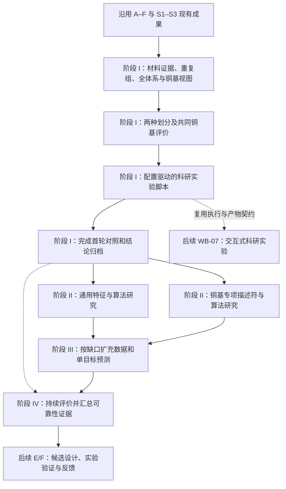

# Cat_AI 下一阶段科研与工作台实施规划（审议稿）

2026-11-20（Asia/Shanghai）。需求依据为[用户提交的下一阶段科研方案](Cat_AI_scientific_plan_next_stage_20261120.md)和本轮确认的实施口径。用户已确认启动 S4-01。本次先交付分类和重复核查，再汇报结果。实际状态按正式管理库及固定证据核对。

## 1. 项目基础与需求匹配

总体沿 A 工程和数据契约 → B 接入与治理 → C 特征工程与预测 → D 解释和可靠性 → E 约束下设计 → F 实验反馈推进。S1–S3 是已验收的预测建设和对照批次，R1/R2 是实验预设，D-01～07 是评价执行分解。下一阶段在 B/C 增加数据组织和预测研究分支，D 的方法与证据随模型版本延续，E/F 保留为后续路线。[总体设计](architecture/system_design.md#5-一条实施主线与三种编号) · [当前科研进度](progress.md)

| 领域 | 已有基础与事实边界 | 匹配及增量 |
|---|---|---|
| 架构与治理 | 模块化单体。`data/catalog.sqlite` 管理科研事实、导入、修订、人工审核事件、快照与特征目录，`data/workbench.sqlite` 管理过程和证据引用。TheMeCat 修订批次 820 条，609 条科研 `curated`，211 条阻断，609 条中 593 条具备 CO₂ 转化率资格，16 条缺目标。领域库另有 1 条合成演示 `curated`，人工审核事件为 0。TheMeCat 继续沿用来源接受及绝压假设，B3 逐条核验暂缓。 | **复用**治理、来源、关系实体、目标资格、不可变快照及哈希。**增量**增加按目标和材料筛选的快照视图、逐条证据和跨来源实验身份分组。导入指纹去重已实现，实验身份分组另需证据。 [数据与治理](progress.md#已验证成果与证据) · [导入实现](../src/catalyst_ai/ingest.py) |
| 材料分类 | 契约有 `material_family`、组分角色及配方、制备、测试层级。TheMeCat 适配器曾以样品名填写 `material_family`。S2-03 固定了 553 条逐条资格状态和 36 个 DOI，因缺可信家族标签，A/B1 分家族对照有据跳过。 | **新增**证据化铜基分类和专项视图。样品名、来源接受和物种映射仅作候选线索。后续材料家族沿同一契约扩展。 [领域契约](../src/catalyst_ai/schemas/domain.py) · [TheMeCat 适配](../src/catalyst_ai/sources/themecat.py) · [S2-03](s2_03_acceptance.md) |
| 划分与资格 | 593 条父快照含 37 个 DOI。历史外层按 DOI 组数约 70/15/15，R2 共同资格集 553 条、36 DOI，实际为 454/47/52 条及 26/6/4 DOI。历史训练 OOF 为三折 DOI `GroupKFold`。当前 `select_inputs` 会重建历史 DOI 清单，资格、特征构建和配置校验追溯该划分，训练器按 DOI 创建折。 | **增量**增加版本化划分、分组和折清单，贯通校验、资格、特征及训练。保留旧版解析和重放。仅增加配置选项或更换折叠函数无法完成端到端接入。 [划分](../src/catalyst_ai/datasets/split.py) · [特征筛选](../src/catalyst_ai/features/pipeline.py) · [特征构建](../src/catalyst_ai/features/build.py) · [配置校验](../src/catalyst_ai/modeling/config.py) |
| 特征、训练与预测 | S1-A 入库物化属性、物种映射与来源处置，S1-B 构建 553 条共同资格和 5,530 个逐值索引。`F_cond` 是四项工况，`F_base` 增加角色/物种 mol%，`F1/F2` 逐级增加组分统计及差值。S2/S3 已有 YAML/JSON 配置校验、Dummy/Ridge/Extra Trees、参数白名单、折内拟合、模型包与独立单条/批量预测。S3 在相同 R2 子集和折上选定 `F_base/Extra Trees`，全部诊断预测的 OOF 论文等权 MAE 为 5.373464 个百分点，F1/F2 分别增加 0.557559/0.514140。入口可用 OOF 274/454，开发验证 28/47，均含警示。 | **复用** S2/S3 训练及打包入口、特征公式、预测契约和历史基线。**增量**拆开划分、拟合与留出评分的策略，允许显式装载预先锁定的评估清单和训练配置。新描述符、算法及寻优进入阶段 II。 [S1-B](s1_b_acceptance.md) · [S3 比较](s3_01_comparison.md) · [S3 端到端证据](s3_02a_execution.md) · [训练实现](../src/catalyst_ai/modeling/experiments.py) |
| 评价与解释 | D-01 有失败归因，D-02 有块置换重要性，D-03 有候选域规则，D-05 有树间离散度开发诊断。D-04 v2 和 D-06 点预测评价流程已就绪，尚无合格独立评价集及正式独立结果，预测区间未校准。D-07 有证据哈希索引，模型卡正文有问号损坏；正式管理库未登记 D 系列任务。 | **复用**逐条状态、支持率、分层误差、置换和独立评价流程。**增量**在新运行中报告比较分母与支持变化，按新模型固定诊断规则。SHAP、学习曲线和校准按后续证据展开。 [D 计划](d_implementation_plan.md) · [D-06 流程](d06_evaluation_workflow.md) · [D-07 哈希索引](../artifacts/reports/d-07-20261119-01/evidence-sha256.json) |
| 工作台 | 已有项目总览、任务与验收、依赖/决策、文档和固定成果索引、数据基础/样本和导入恢复、固定模型批量预测、模型证据台账。WB-13 已有分类、主计划与核对、分类焦点和近期安排，WB-14 已有科研路线和任务双向定位。WB-15-01 已完成，WB-15 父任务及 02～05 为 `planned`，工作区已有部分后续实现。WB-16/17 继续承担页面整合和整体验收。WB-07 为历史计划引用，当前无同名正式任务和独立训练交付。 | **复用** WB-06 worker 生命周期与 WB-10 台账，以及 WB-13/14 管理能力。**新增**科研实验的配置、编排、训练执行和运行记录入口，由 WB-07 承接。WB-15 管交接与计划定位，WB-16/17 管现有管理范围。 [工作台主方案](architecture/project_workbench_plan.md#21-既有建设进度承接) · [WB-14 验收](workbench/wb14_06_acceptance.md) · [WB-15 实施方案](workbench/wb15_implementation_plan.md) |

管理基线：两库 `quick_check=ok`，管理库 schema 8、外键检查无异常。`cat-ai` 有 10 条已完成科研任务（S1 两条、S2 六条、S3 两条）、22 条建设任务（17 条已完成、5 条计划），12 条历史 WB 引用、14 个活动科研节点、8 条活动任务节点关联。22 条建设任务均已有活动主计划，科研任务当前均无活动主计划。两类均无活动近期安排，科研分类上下文尚未建立。历史引用、正式任务、工作区代码和产物分别核对。README、总体设计第 5 节和进度首页有滞后的 S1/S2 或 WB-14 下一步表述，WB-15 方案中的未登记状态为登记前基线。

## 2. 建议总体科研路线

| 阶段 | 重点与交付 | 进入或收口条件 |
|---|---|---|
| I 数据组织与基础实验 | 输出材料及重复身份台账、全体系及铜基专项版本、两种划分及折清单、配置驱动的实验脚本和 EXP-01～03 报告。优先回答数据划分、两类模型及现有描述符对误差和可用率的影响。 | 脚本可独立预检、运行和重放，分组防泄漏、覆盖与样本门槛、旧运行兼容、共享铜基留出和运行追溯通过。铜基证据不足时保留全体系研究和缺口报告。 |
| II 特征与算法研究 | 通用路线按工况、组成、角色、物化分布及组分交互做配对消融，检验与固定词表更少耦合的表达。铜基路线优先 Cu 含量、Cu/Zn（或 Zr、Al）配比及组分相互作用。先用固定特征比较随机森林和一种梯度提升算法，再评估增量特征和训练侧寻优。工艺、BET、铜表面积、分散度和粒径按数据覆盖与可得时点评估，制备后表征另建诊断用途。 | 用阶段 I 固定协议起步，逐项控制数据、划分、特征和算法参数。调参在训练/开发范围内，测试一次性评分。算法与描述符按实际收益、覆盖及稳定性决定是否进入工作台。 |
| III 数据扩充与多性能目标 | 按阶段 I/II 暴露的覆盖缺口引入 Suvarna、Yan 等来源。许可、原件哈希、测量定义、单位、来源交叉重复和目标资格先审查，随后在同一评价集合上比较新增数据前后的误差及覆盖。先逐目标建立 CO₂ 转化率、甲醇选择性、甲醇 STY 的资格和单目标模型，再研究 CO 选择性、收率和联合预测/物理一致性。 | 独立评价候选先保留在训练池之外。实测、计算派生和统计插补分别标记，缺标签不填为实测。派生目标须锁定公式、基准及可用输入，防止目标衍生字段泄漏。 |
| IV 综合评价与交接 | D 系列诊断贯穿 I～III，在 IV 汇总解释、材料/配方外推、适用域、不确定性校准和模型卡。有合格来源时按独立方案执行外部评价。 | D-06 现有协议对冻结 S3 R2 包设至少 30 条、10 个独立组的就绪条件。后续模型需重新固定包、规则和评估范围。E/F 的候选约束与实验反馈按各自阶段验收。 |

阶段 III 的候选规模用于排优先级。Suvarna 发布页列出 1,234 条整理数据文件，描述中的研究汇编总量为 1,425。Yan 公开 CSV 标示 501 行含表头，完整资料需向作者询取，项目既有评审区分了 2,476 条保留记录与 2,383 条建模记录。许可、标注基准、重复比例和实际可入模条数留待接入评估。若当前数据已具备甲醇目标的足量标签，可在阶段 II 先做只读口径及覆盖审查，正式入模按阶段 III 的门槛执行。 [Suvarna 数据发布](https://zenodo.org/records/6541445) · [Yan CSV](https://github.com/MoYan-101/CommsEng/blob/main/data/Data_MeOH.csv) · [作者仓库说明](https://github.com/MoYan-101/CommsEng#notes) · [项目既有评审](Yan2026_Repository_Architecture_Review_and_Codex_Amendment.md)

## 3. 第一阶段科研任务与执行计划

S4-01 按科研类别登记。S4-02～S4-04 为后续任务。P0 为首批关键路径，默认映射现有 `high` 优先级，实际排序由依赖和分类近期安排决定。S4-01/S4-02 关联 B 并服务 C，S4-03/S4-04 归 C，评价交付关联 D。协议设计和接口准备可并行，实际运行以冻结输入和真实前置验收为准。

| 拟用编号 | 优先级 | 执行前置 | 预期交付与通过条件 |
|---|---|---|---|
| S4-01 | P0 | 方案确认，冻结 TheMeCat 父快照及 S2-03/S1-B 证据可读 | 材料分类、重复组规则和逐条台账，附数据覆盖/样本与来源分布。父集每条记录均有分类或待决状态和重复组身份。 |
| S4-02 | P0 | S4-01 的逐条证据及规则版本 | 同源全体系/铜基视图、纳排和共同资格清单、样本就绪报告。子集来源可追，分母及排除原因可对账。 |
| S4-03 | P0 | S4-02，沿用 S2/S3 端到端契约 | 外层划分、内折、铜基共享留出清单及配置驱动的脚本入口，附模板和复现说明。分组防泄漏、测试隔离和旧版兼容通过。 |
| S4-04 | P0 | S4-03 脚本验收，同一评价协议已冻结 | 通过脚本运行 EXP-01～03，交付固定包、配置、逐条结果、对照报告及适用范围。依据实际样本报告正面、负面结果或证据不足。 |

### S4-01 材料分类与重复身份核查

1. 从 593 条已冻结目标记录建立逐条清单，保留其 553 条 R2 共同资格交集。汇总 DOI、配方、样品/批次线索、来源角色、Cu 物种及工况分布。820 条用于交代父源治理分母，训练母池以冻结资格为准。
2. 首轮专项采用宽口径，催化剂配方明确含 Cu 或含 Cu 化合物时默认纳入 `铜基`，包括 Cu 用作助剂或有意掺杂的配方。Cu 的含量、物种和已知角色单独保留，供后续分层。来源确认配方无 Cu 时归 `非铜基`。检测杂质与配方组分按来源证据区分，配方信息缺失或冲突时归 `证据不足`。逐条记录判据、原始定位、复核人和版本。全体系保留满足共同资格的各标签状态。
3. 先核查去重，再为确属同一次实验且需保留的重复测量登记共同划分组。复用原始指纹和来源定位，再结合样品或批次标识、规范组成、指标口径及工况判断实验身份。同一催化剂在不同工况下的有效实验可以参与随机划分，独立实验可以分别分配。论文、催化剂种类或配方相同不单独构成随机分组约束。对已确认的重复收录固定代表记录并保留别名。对身份未决的候选保留证据和处置建议，数据集冻结前确认。
4. 验收逐条覆盖无缺项，类别合计和重复组成员与母池一致。输出规则版本、逐条标签、判据、组映射、未决复核表、纳排及各层覆盖，重点核对铜助剂、含铜复合体系、明确无铜和配方信息缺失等情况，并复核同一样品的多工况关联。材料证据登记沿用冻结记录 ID，来源接受的既有资质独立保留。

### S4-02 全体系与铜基数据集冻结

1. 在统一领域库之上生成全体系和铜基快照视图。全体系描述当前目标合格记录及共同建模子集，铜基视图以已确认标签为筛选依据。复用父快照、资格报告、S1 目录和记录级来源处置，视图固化目标定义/单位、成员 ID/哈希、标签/重复规则版本及逐条筛选结果。首期以版本化清单表示子集，沿用快照与成果索引，无需新增独立物理数据库。
2. 第一轮三个特征集都使用 S1-B 共同资格，物化目录和映射固定。保留 593→553 原资格差异，并另列分类、重复处置和后续划分造成的计数差异。按视图报告 DOI、配方、实验组、目标及四项工况分布，列出含铜记录的已知角色分布及配方证据不足的规模。
3. S4-03 开工前根据覆盖盘点，预定铜基训练集和测试集各自的记录数和独立实验组下限，并评估实际来源覆盖和比例偏差。技术下限为五折训练至少五个独立划分单元，训练集和测试集均非空。专项证据门槛若未达到，交付缺口和拟补依据，先开展 EXP-01/02 的可执行比较。任何降低折数、缩减种子或调整比例的变更在评分前说明并确认。验收重建出的视图及成员哈希一致，铜基成员是全体系子集，排除均可回溯。

### S4-03 划分协议与训练接入

1. **随机协议**先去重。每条独立观测可随机分配，确属同一次实验且保留的重复测量整组进入同一集合及同一留出折。默认按记录数 80% 训练、20% 测试，训练内五折，无单独固定验证集。划分比例、交叉验证折数、随机种子、划分方式可配置。按实际报告全体系和铜基的记录数与组数，固定分配清单和内折。
2. **DOI 协议**衡量跨论文来源泛化。论文内全组隔离，跨 DOI 确认重复时将相关 DOI 连通后整体分配。首轮新 DOI 对照建议在相同候选母池使用相同目标比例与五折，报告实际样本数、来源数和合并组数。历史 DOI 按组数取比例、三折及原成绩单独留存。新协议间的训练规模、评估记录和材料覆盖仍可能不同，差异报告按实际分布解释，需要严格归因时另锁定共同留出和训练规模做预先设计的敏感性分析。
3. **铜基共享评价**以 EXP-02 的全体系随机清单为主，将其训练和测试成员按铜基标签投影给 EXP-03。两者使用完全一致的铜基测试样本。测试记录及其需同组保留的重复测量均与两模型训练及内折隔离。主比较按相同 `record_id` 给出配对差值，若需比较 OOF，可投影同一全体系折，仅在各铜基折均有足够数据时报告。
4. **接入点**由 `datasets` 输出策略、版本、种子、组依据、成员、比例和内折哈希。`features` 校验有效清单、保持公式和来源映射，新版选择及特征产物绑定实际 ID。`modeling` 扩展配置版本和相应评价语义，消费固定折，词表、缩放、填补和数据依赖阈值限训练折拟合。现有训练器会在同一次训练中为候选输出 test 预测，新版入口须在训练与开发选择完成后，由单独入口执行一次已锁定的测试评分。历史构建及包校验绑定实现哈希，增量开发需保留旧版实现的重放路径或固定其运行环境，验证原 R1/R2 包可按原契约加载和预测。新版使用自身的构建、包版本和哈希。 [模型包校验](../src/catalyst_ai/modeling/predictor.py)
5. 验收覆盖训练/测试及默认五折的完整性、各折留出记录仅出现一次、保留的同次实验重复测量组零交叉、DOI 协议来源及连通组零交叉、铜基两模型留出完全相同、训练清单无其关联组、特征输入一致、同配置同版本重放一致、缺失或篡改等故障得到明确报错。划分清单需区分策略、数据视图、组件哈希及测试用途，避免复用旧结果时误标为新结果。

### S4-04 第一轮模型对照

| 实验 | 训练样本与策略 | 主要评价用途 |
|---|---|---|
| EXP-01 | 全体系共同资格，新的 DOI 分组 | 跨论文来源的内部评价。历史 S3 参考另列。 |
| EXP-02 | 全体系共同资格，按实验组随机分区 | 数据内插值场景与全体系表现，另给出共享铜基留出指标。 |
| EXP-03 | 铜基共同资格，投影 EXP-02 随机清单 | 与 EXP-02 全体系模型在同一铜基留出上配对比较。 |

每单元比较 `F_base`、`F1`、`F2`。Extra Trees 使用 S3 的有效参数：100 棵树，`min_samples_leaf=2`，`max_depth=None`，`max_features=1.0`，`n_jobs=1`，模型种子固定 42。建议主划分种子 42，拟重复 43、44，三份清单在查看结果前固定。模型种子与划分种子单独保存，并明确重复清单间重叠与相关性。特征和模型选择仅在训练集内部交叉验证完成，固定比较项和判定口径后一次性发布测试评分。所有新划分来自已研究过的 TheMeCat，报告标为内部评价。历史结果只有在范围、参数、分区和指标口径一致时才作直接比较。

报告保留记录等权、论文等权及必要时实验组等权 MAE，带 RMSE、记录数、独立组/DOI 数、覆盖及种子间变异。诊断预测误差、入口可用率（`ok`/`caution`）、可用子集误差和共同可用配对误差分别列实际分母。报告温度、压力及组成等主要覆盖差异，标记未见物种与拒绝原因。共同可用样本很少或受单一来源主导时披露限制。图表首期包括实测–预测、残差及折间/种子间指标。样本足够时按独立组给出配对变异，并把重复种子结果作为稳定性描述。

交付包括实验配置、快照及分组清单、版本/环境、逐条预测及状态、汇总指标、固定模型包和结论。验收要求数据与特征对齐、配置可重放、结果分母可核对、铜基配对和证据边界成立。性能提升可作为研究发现，可靠的无增益或受数据限制的结果也可交付。S4-04 使用 S4-03 交付的脚本运行，阶段 I 以脚本及首轮科研证据收口。

## 4. 脚本先行与后续工作台建设

### 阶段 I 科研实验脚本

现有 `scripts/train_s2.py` 已能读取训练配置、运行 DOI 分组训练并保存指定模型包。建议在 S4-03 交付统一实验脚本，例如 `scripts/run_research_experiment.py`，以薄封装复用配置验证、训练、评价和模型打包函数。EXP-01～03 使用同一入口与各自的 YAML 模板。历史训练脚本继续按现有用法执行。 [现有 S2 脚本](../scripts/train_s2.py) · [调用契约](api_contracts.md)

脚本以冻结数据视图、划分及内折、特征和模型配置为输入。提供只读预检、训练及开发评价、显式留出评分三步。预检校对版本、文件哈希、分组完整性和输出路径。训练按新运行目录保存有效配置、实际折、日志、开发指标和模型包。留出评分读取已锁定配置及对应模型包，单独保存逐条预测、可用率和汇总指标。脚本使用不同退出码区分成功和失败，失败原因与运行记录一起保存。

脚本验收使用隔离样本覆盖 DOI 分组、实验组随机及共享铜基留出，核对同配置重放的清单、指标和模型绑定。另检查预检不训练、训练步骤不读取测试标签、测试评分只能对锁定配置执行、重复运行不覆盖原产物。首轮运行的固定输出可从现有成果索引挂接到相应科研任务。

### 后续 WB-07 交互式科研实验

WB-07 承接后续交互能力，在智能研发下设置独立的「科研实验」页面，复用脚本验证过的配置、执行和产物契约。科研任务仍从原科研路线、任务和证据入口进入。WB-06 的持久化执行和恢复模式可复用，训练提供独立于批量预测的执行契约。WB-10 台账可保存执行状态、科研状态和固定证据引用，用于承接成功训练与历史运行。新运行使用同一个逻辑实验 ID 和独立的尝试 ID，保存其任务关联与产物。执行状态、科研审查及任务验收各沿现有状态规则。

| 拟用编号 | 优先级与前置 | 首期交付与验收 |
|---|---|---|
| WB-07-01 配置与预检 | 后续建设。S4-03 脚本契约已验收。 | 表单配置实验名、目的、关联科研任务、数据视图、CO₂ 转化率、划分策略、比例、折数、种子/重复、特征集、允许的模型及参数和输出选择。配置可预检、保存、读取和复用，能定位资格、分组不足或版本不匹配。 |
| WB-07-02 训练执行与恢复 | 后续建设。WB-07-01 配置契约、S4-03 领域入口。 | 排队、独立 worker、阶段进度、日志、心跳、失败原因、取消和保留原尝试的重试。相同请求去重，失败/中断可审计。验证写入路径及资源上限，避免与固定预测队列相互阻塞。 |
| WB-07-03 结果、归档与复现 | 后续建设。WB-07-02。 | 提供统一指标、覆盖对比、历史查看、复制配置和启动复现。登记配置、快照/划分、特征版本、环境、结果、模型包及关联科研任务。用相同配置对照脚本和工作台的清单、指标和状态，并验证取消/重试及备份恢复。 |

首期通过已有数据发布和快照引用编排实验，可选筛选视图或生成不可变运行输入清单。领域治理和数据发布权限沿用现有流程。自动寻优、额外算法及多目标、SHAP/学习曲线和校准可视化随已验收的领域能力再开放。WB-11 候选管理和 WB-12 实验回灌仍按 E/F 的领域条件推进。

管理工作台沿 WB-15 → WB-16 → WB-17 的既有顺序推进，科研线按 S4-01 → S4-02 → S4-03 → S4-04 执行。WB-07 维持后续建设候选位置，可根据首轮脚本使用反馈细化交互范围，再按实际资源排期和单独验收。

## 5. 确认后的文档与任务更新方案

| 权威入口 | 确认后的更新动作 |
|---|---|
| [总体设计](architecture/system_design.md#5-一条实施主线与三种编号) | 更新第 5 节阶段状态及近期路线，将阶段 I 到 IV 定位为 B/C/D 的研究切片。给出阶段分支和当期实施入口，保留 A–F 阶段根与原开发指引。使用 WB-14 现有节点与任务关联服务，核对已登记源章节和哈希，再增量登记新分支。 |
| 本稿第 2～3 节 | 经确认后形成下一阶段科研实施计划的唯一正文；保留用户原方案为需求基准。每项 S4 正式任务指向一个同名主计划章节，引用 S1/S2/S3、TheMeCat 和 D 已有计划作为参考。首轮运行的参数、分区、指标及产物清单随实验配置和证据归档。 |
| [工作台主方案](architecture/project_workbench_plan.md#7-本轮交付与后续演进)、[统一建设安排](workbench/management_improvement_plan.md#0-统一执行顺序与当前下一步) | WB-07 专项章节记录后续交互能力及其对脚本契约的依赖，阶段 I 脚本交付由 S4-03 的主计划管理。WB-15～17 沿已有专项计划执行并保留版本记录。 |
| [进度](progress.md)、[决策](decisions.md)、[README](../README.md) | 进度首页标明核查日期、两类下一步、阻塞及固定证据，仍按日期保存历史。记录划分和铜基口径、阶段安排的已确认决策。README 只保留当前摘要与入口。D-07 可读版从独立证据重建并作为新修订挂接，原卡和哈希证据继续保留。 |
| 正式工作台管理库 | 核对编号及 WB 历史引用，复用分类、依赖、计划引用及核对、固定证据、验收与分类近期安排服务。正式任务填目标、可验证交付与验收项；每条只关联一个活动主计划。主计划文件变更后按既有流程核对并保留记录。科研任务关联到 B/C/D 节点，工程任务进入建设类别。依据实际前置更新各自焦点，已有成果只附历史引用，审批和状态按实际日期登记。 |

建议登记顺序为确认科研决策、定稿章节和编号、核对拟登记内容与依赖、再按现有服务登记并检查显示。可复用 WB-15 的计划入口显示缺计划或待核对，避免依据历史文档推断当前任务状态。正式验收前需使用与任务绑定的固定版本证据；实验运行成功可自动登记成果，科研结论评审和任务验收依现有服务发生。

## 6. 已确认的实施口径

| 决策 | 实施口径 | 影响 |
|---|---|---|
| 1. 划分与重复规则 | 先去重，保留的同次实验重复测量整组分配。随机为主，DOI 为泛化对照。默认 80% 训练、20% 测试，训练内五折，无固定验证集。比例、折数、随机种子和划分方式可配置。铜基覆盖盘点后、评分前确定样本门槛。 | 得到两种场景的内部对照证据，旧 DOI 结果继续可重放。 |
| 2. 铜基纳入及共同评价 | 首轮按配方明确含 Cu 默认纳入，记录 Cu 的含量及已知角色。以 EXP-02 的铜基留出和实验组投影定义 EXP-03。 | 决定专项样本规模，保证全体系和专项的铜基对照使用同一留出。 |
| 3. 首轮科研范围 | 固定 Extra Trees 与 F_base/F1/F2。RF、XGBoost 等在阶段 II 接入。当前仅登记执行 S4-01，先汇报分类、数据分布和重复核查，再进入数据集冻结和模型训练。 | 如铜基证据不足，可先形成全体系的 DOI/随机对照和专项数据缺口。 |

工程顺序已明确为脚本先行。S4-03 交付脚本，S4-04 使用脚本执行首轮对照，后续交互能力由 WB-07 承接。
