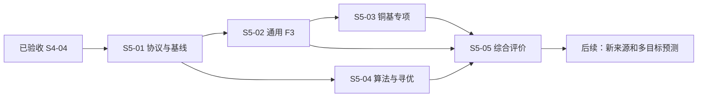

# Cat_AI S5 阶段科研方案与任务分解（建议审议稿）

> 日期：2026-11-23（北京时间）  
> 适用仓库：<https://github.com/da-xiongdi/Cat_AI>，`main`  
> 核对基线提交：`7fb122809e713653b8a4d25a0305ba0ff7fbde1b`（2026-11-23 09:53 北京时间）  
> 状态：**规划草案**。尚未向 GitHub 写入文档、创建正式 S5 任务、修改代码或启动 S5 实验；具体任务状态以项目正式工作台为准。  
> 所属总体路线：C（特征工程与模型预测）为主，B（数据治理）和 D（解释与可靠性）提供支撑；E/F（配方设计与实验反馈）不在本阶段实施。

## 1. 现状与立项依据

### 1.1 已完成的上游工作

- S1—S3 已完成数据、特征、配置训练、模型预测和基准比较等能力的既定验收。
- S4-01—S4-04 已完成材料分类、重复实验身份核查、全体系/铜基数据视图、随机及 DOI 分组策略、九组固定模型对照和证据审核，S4-04 已在正式工作台登记 `done`。
- S4-02 的 CO₂ 转化率目标合格视图：全体系 578 条、铜基 211 条；F_base/F1/F2 的共同资格：全体系 542 条、铜基 211 条；共同资格 DOI 分别为 36、16。593 条父快照中 15 条实验身份未决而暂排，其他不满足共同资格的记录按现有冻结报告解释，不回写原始事实。
- S4-04 在既有 TheMeCat 内对照，使用种子 42/43/44、Extra Trees 固定参数，在训练侧五折 OOF 选特征后独立留出评分一次。

### 1.2 关键发现

1. **F_base 仍为主要基线。** 九组 S4-04 训练选择中，八组选中 F_base，仅铜基 EXP-03/42 选择 F2；当前物化增量没有确立稳定收益。
2. **跨来源表现弱于随机场景，但不能据此做单因素归因。** EXP-01 的测试记录等权 MAE 为 5.451、9.574、5.679 个百分点；EXP-02 为 2.026、2.663、2.553。两套协议的训练/测试成员、DOI、材料和工况覆盖不同，不能直接把差值解释成“仅因采用 DOI 分组”。
3. **可用性与误差需要分开报告。** EXP-01/43 入口可用 59/104，入口可用子集 MAE 13.680，而全体诊断 MAE 为 9.574；被拒绝记录的诊断预测并非实际可用预测。
4. **铜基专项模型尚无稳定优势。** 在共同铜基测试记录上，铜基减通用模型的记录等权 MAE 差值为 +0.044、−0.106、−0.107 个百分点；不能据此声称明显优越或等效。
5. **训练支持存在明显范围差异。** S4 铜基训练温度最高为 553 K，不能对更高温度断言预测能力。未见物种/角色、DOI 集中和流量边界是重点诊断对象。已接受的 TheMeCat 来源并不等于逐行原文核验，压力绝压口径仍沿用既有假设。

**本阶段的核心科研问题：** 在不引入目标泄漏或不可靠物性假设的前提下，哪类具有材料化学意义的描述符和哪类机器学习模型，可以在保持/扩大实际预测支持范围的同时改善 CO₂ 转化率预测，尤其是跨 DOI、未见组合和铜基共享测试场景？

## 2. S5 定位、目标和不做事项

### 2.1 阶段目标

- G1：建立可信的 S5 开发评价协议，能区分随机插值、跨论文迁移、模型入口可用性和共同样本配对增益。
- G2：设计及实现**不完全依赖固定物种词表**的通用组成/物化特征，与 F_base/F1/F2 受控比较。
- G3：在相同数据与特征条件下拓展 RF 和一种梯度提升算法，判断算法及适度调参的独立增益。
- G4：对铜基建立 A（通用模型）/B1（相同通用特征的铜基模型）/B2（铜基专属特征模型）的分层比较，区分训练范围与专属特征的作用。
- G5：交付可重放的模型、指标、逐条预测、覆盖/限制、解释与模型卡，为下一阶段文献扩充和多目标预测提供决策依据。

### 2.2 不在 S5 开展

- 不重新建设物理数据库，不覆盖 S1—S4 的任何冻结快照、模型包及验收证据。
- 不在本阶段正式接入 Suvarna/Yan 作为训练新母池；只允许做非侵入性字段/许可/独立来源可行性清点，正式接入归下一阶段。
- 不扩展甲醇选择性、时空收率作为 S5 正式建模目标；S5 仍限 CO₂ 转化率。
- 不把 BET、实际粒径、金属分散度、实验后表征值等默认纳入**配方设计前模型**。有覆盖且来源可信时，可作为后续单独的“表征后诊断模型”研究，不混入主模型对照。
- 不启动正式配方寻优、候选投料、实验验证或主动学习闭环；WB-07 交互式科研实验页面为并行工程建设，不应阻塞脚本科研任务。

## 3. 总体研究与评价协议

### 3.1 数据与身份

1. 以 S4-02 **542/211 共同资格视图**为主要配对母池，不将父集 578 条直接视为所有新特征自动合格。对 F3 若存在单独资格变化，先报告差异、原因、DOI 和角色分布；受控性能比较必须在交集上完成。
2. 复用 S4-01 实验身份台账及已确认重复组。不同工况的有效观测不因配方相同而自动认作重复；已确认同次实验不得跨训练/验证折。15 条身份未决记录不在本阶段自动恢复。
3. 材料分类沿用 S4-01 已批准的“明确含 Cu 配方”的宽口径，Cu 仅为助剂或掺杂时也可能纳入；不得在无来源证据时自动推断真正活性相。保留作用角色和分层说明。
4. 来源、数据/属性目录、解析规则、特征代码、模型配置、Python 依赖、随机种子和实验清单全部版本化，产物以内容哈希绑定。

### 3.2 三种不同的评价语义

| 目的 | 方案 | 科学解释 | 允许用途 |
|---|---|---|---|
| 主研究：跨文献泛化 | DOI 组隔离；按分组外层/内层交叉验证协议事先固定 | 既有 TheMeCat 来源之间的迁移 | 开发期算法与特征稳健性研究，不是独立外部验证 |
| 辅研究：数据内插值 | 实验身份组不跨折的随机分组 CV；预定种子重复 | 训练中存在相似文献/材料知识时的表现 | 受控算法/特征对照；不宣称新文献泛化 |
| 未来：真正外部独立 | 之后新增、未参与本阶段设计和调参且去重核验合格的独立 DOI/样品 | 面向新来源的有效性 | 仅在数据与协议齐备后由 D-06 正式评价 |

**关键禁令：** S4-04 的测试标签和结果已被团队查看。S5 不得通过反复查看/优化这些测试集来选择 F3、模型和超参数，再将改进后的成绩标为“未触碰独立测试”或新的外部验证。S4-04 可作为**已知的历史诊断证据**；S5 应以新的、预先登记的训练侧交叉验证及必要时嵌套 CV 进行选择。任何重新评估已查看记录都应标识为探索性内部分析。

### 3.3 建议的冻结协议（S5-01 核定后方可启用）

- 主协议：以 DOI（以及已确认跨 DOI 重复的连通组）为分组单元，建议外层 **4 折**、内层 **3 折**，折数须经实际 DOI/分组规模及各折标签分布核查通过后冻结；外层只用于评估内层选出的完整模型选择流程，禁止用外层评估结果反向挑选超参数。
- 辅协议：实验身份组约束的 **5 折随机 CV**，种子建议 42/43/44，重复用于划分敏感性而非相互独立证据；同一外层记录在不同种子可重叠，必须注明。
- 样本质量：每折列训练/验证的记录、DOI、实验组、组成签名与主要工况覆盖；若外层 DOI 过少/分布过于不均，降低折数或替换策略须在查看新结果前书面确认，保留变更记录。
- 选模：特征/算法/超参数搜索只使用每个外层训练块的内层 CV。对照实验初期一次只改变一类因素，后期才开展小规模特征 × 算法交叉研究。
- **主指标不采用单一数字宣称胜出**：至少并列报告 DOI 等权 MAE、记录等权 MAE、入口可用率、共同可用记录上的配对误差、RMSE 和各 DOI 误差分布。跨 DOI 研究首要关注 DOI 等权结果，但不能牺牲入口覆盖换取貌似较低的可用子集 MAE。
- 对不同 F3 资格和支持范围，报告 ①全部诊断值（单独说明不可用）②各自可用子集 ③严格共同可用样本 ④全部母池入口可用率，四者不可混同。
- 给出每折性能与失败原因，说明测试 DOI/记录相关性；任何置信区间或配对抽样以 DOI/实验独立组为基础，不把行数当成独立研究重复。

### 3.4 F3 特征研究的三个受控方向

| 暂定名称 | 定义 | 核心问题 |
|---|---|---|
| F3-P（纯物化） | 四项工况 + 经过核验的组分元素计数/角色专属物化分布、含量与作用差；**不使用训练物种 one-hot 词表** | 对未知但可解析化学组成，是否能形成可计算输入？ |
| F3-H（混合增量） | F_base + F3-P 的材料特征块（同义重复字段应标记或去重） | 在保持 F_base 的条件下，物化表达是否真实带来增量？ |
| F3-I（作用关系） | 以 F3-P 为基础，增添有支持的活性角色—载体/助剂的属性差、组成比例和分布描述符 | 组分间关系是否优于简单均值？ |

其中 F3-P、F3-I 可评估减少对词表的依赖；F3-H 仍继承 F_base 的词表边界，**不应因为附加化学描述符就自动声称可支持训练未见物种**。研究首批尽量复用已审查的 Pauling 电负性、Cordero 共价半径和物种中心计数，新增电离能、氧化态、名义 O/M 等仅在定义、许可、源版本和覆盖充分时另行试验，不以扩充特征数量为目标。

现有输入的材料 mol% 不等于元素原子分数。角色内化学计量展开、中心计数和归一化规则必须写明；来源 `compound` / `support` 不等于已经证明的实际活性位、助剂功能或反应工作态。对复合/非整数计量式、含糊相态和不完整源信息保留 `unsupported`/`unknown` 状态，不猜测、不填造；角色缺失时区分 `not_applicable` 与真正零值。设计期未知的表征数据不能通过其他字段间接泄漏。

## 4. S5 正式任务建议与依赖

| 编号 | 优先级 | 主任务 | 依赖 | 建议完成标志 |
|---|---|---|---|---|
| **S5-01** | P0 | 科研问题、S4 失败诊断与实验协议冻结 | S4-04 验收成果 | 预先冻结的变量、数据/分组、评估及不触碰测试规范；诊断证据可复查 |
| **S5-02** | P0 | 通用组成/物化 F3 表达及消融 | S5-01；复用 S1/S4 数据契约 | 新特征版本、覆盖率与缺失机制、折内重放、受控增量报告 |
| **S5-03** | P1 | 铜基专属特征与 A/B1/B2 对照 | S5-01、S5-02 | 铜基证据/角色报告、专属特征与共同样本配对结果 |
| **S5-04** | P0 | 模型算法扩展与受控寻优 | S5-01；可与 S5-02 并行 | RF + 一种梯度提升实现、固定特征对照、搜索审计与包重载 |
| **S5-05** | P1 | 综合比较、解释与 S5 阶段收口 | S5-02、S5-03、S5-04 | 综合结论、下一代候选模型/保留原基线的理由、模型卡、证据索引 |

以下 `-01`、`-02` 等为**主任务下的建议执行子任务**，Codex 应先核对当前工作台的编号/主计划接口，再决定登记为子任务还是执行清单；不要直接创建与历史任务冲突的正式 ID。

### S5-01 科研问题与协议冻结（首项必须先交付）

**S5-01-01 读取与复核基线**
- 锁定 S4-02 视图和 S4-03/04 的九组配置、折、逐条预测、误差、预测状态与哈希。
- 在已有 S4-04 分类/覆盖报告基础上增量回答：主要高误差 DOI 的影响、未见物种/角色分布、有效支持率、组成及工况联合偏移、铜基测试来源集中程度；做按 DOI 的删一组敏感性诊断，但不改变历史分数。
- 输出 `s5_baseline_inventory.md`、`s5_failure_hypotheses.md`；将假设写成可证伪陈述，明确哪些属于相关性而非因果。

**S5-01-02 确定数据/验证协议**
- 形成 S5 样本资格、母池、DOI 连通组与重复身份分组、嵌套 CV 和随机分组 CV、指标、模型选择及停止/降级规则。
- 用只读的分布检查检验 4×3 DOI 嵌套和随机 5 折是否可行；固定分组/折分配、种子、版本与哈希；输出每个评估分区的记录/DOI/组成/工况分布。
- 保留“S4 已查看留出不得再作为新的无偏测试”的访问和命名规则。

**S5-01-03 研究执行与报告契约**
- 固定特征、算法和超参数的主效应实验矩阵、配对规则、可用率及误差的报表 schema、研究产物目录和审计清单。
- 技术实现尽量复用 S4-03 的 `preflight/train/score`、研究清单和模型包；需要嵌套 CV 时先设计版本化扩展，禁止隐式改变 S4 的 v1 运行含义。

**通过条件：** 数据/分组不交叉、样本数对账、训练与评价权限隔离、同配置哈希一致、所有实验变量可识别。完成后才允许大批量正式 S5 训练。

### S5-02 通用 F3 特征工程与消融

**S5-02-01 特征设计和覆盖审查**
- 建立每个候选描述符的字段名、数学定义、单位、角色意义、输入时点、来源、版本、物种可解析性、缺失状态及可能共线/泄漏风险。
- 优先审查角色内元素/中心加权均值、方差/极差、组分含量、不同来源角色的属性差；只用已固定物性源，后续扩充须先治理。
- 输出 542 条母池与 211 条铜基子集的逐行可计算状态，并按 DOI/组分/角色分层；F3 因新资格减少样本时不得隐瞒。

**S5-02-02 实现 F3-P、F3-H、F3-I**
- 新建独立、版本化特征实现，不覆盖 `physchem-v1`、`R1Features` 或已验收模型的变换语义。
- 针对纯物化特征提供受限输入与新物种支持状态：可解析且属性齐全、属性/物种映射不足、角色未知、工况越界分别有可追踪原因；不悄然改变 F_base 的拒绝规则。
- 缺失角色采用单独标志及训练折内适当处理；不得在全数据上预拟合填补器、缩放器或选择器。
- 用物种顺序交换、同物种合并、百分比闭合、计量单位、非整数式、缺失角色、故障映射和模型重载等测试验证数学不变量。

**S5-02-03 特征消融与增量研究**
- **固定 Extra Trees 和冻结折**，先比较 F_cond、F_base、F1、F2 与 F3-P/F3-H/F3-I。
- 在匹配共同资格、共同记录与共同预测支持的条件下分别报告 F3 的精度与入口覆盖变化；按特征块做消融，而不是枚举所有可能组合。
- 展示不同 DOI、未见角色/物种、催化剂类别和工况的误差分层；置换/SHAP 只作解释线索，不当作机理因果证明。

**通过条件：** 特征计算和单位可审计、正反例及边界回归通过、历史 F1/F2 重放一致、模型包预测使用同一计算实现、消融对照不混入新算法变化。即使 F3 无增益，也以完整、可靠的负结果验收。

### S5-03 铜基专属特征与三层模型比较

**S5-03-01 铜基数据与物性覆盖**
- 复核 Cu 作主组分、助剂和掺杂的来源标签及含量、角色、可确定的 Cu/Zn、Cu/Zr、Cu/Al 化学计量比；分母为零或基准不确定不得机械计算。
- 汇总铜基 211 条中各候选专项特征可计算的记录/DOI、温度/压力与组成分布；不将 `compound` 强行解释为纯 Cu 活性相。

**S5-03-02 专项特征实现**
- 仅对经核实可计算的 Cu 负载、Cu/其他金属计量比、活性组分与载体/助剂属性差建立版本化 Cu 专属特征组（暂称 `F_Cu`）；组分角色来源不明则保留缺失/拒绝，而不是任意赋予促进剂身份。
- 铜基特征必须能在拟推荐新配方时从组成和明确的计划工艺中计算，不能混入实验后测得的选择性、粒径、BET 等。

**S5-03-03 A/B1/B2 受控配对**
- A：全体系训练 + 与 B1 相同的通用特征；B1：铜基训练 + 相同通用特征；B2：铜基训练 + 专项特征。
- A/B1 在同一铜基测试成员及严格可用交集上评价，区分训练数据范围差异；B1/B2 在同一铜基训练记录、同一算法、相同折和共同资格上对照，尽量只改变特征。
- 随机协议和 DOI 协议分别报告；若 DOI 分区让铜基可用论文/训练量过小，记录无法识别的效应，不强推结论。

**通过条件：** 铜基评价成员完全一致、训练折与测试没有样品身份泄漏，形成记录配对表和 DOI 等权误差、覆盖及负结果说明；不能直接把 A 与 B2 的差异归因于“铜基专属特征”。

### S5-04 算法扩展、固定特征比较与有限寻优

**S5-04-01 算法实现**
- 在现有 `dummy/ridge/extra_trees` 基础上优先加 `random_forest`，然后加入**一种**梯度提升（建议 XGBoost；安装/许可/平台支持需先核查），不必首批引入 LightGBM、CatBoost、SVR、GPR 和 MLP。
- 使用显式模型/参数白名单、固定版本和随机性控制；不接受任意 Python 类或 pickle 来源。模型保存、加载、批量预测、参数失败路径须有真实数据端到端验收。
- 与现有 S4 配置 `schema_version=1` 和历史 R1/R2/S4 模型包兼容；新算法通过新配置/模型版本开启，不静默重解释旧清单。

**S5-04-02 固定特征算法对比**
- 固定 F_base、母池、分组/折、评价口径，比较 Extra Trees、Random Forest、XGBoost（及 Dummy/Ridge 参照）；默认参数可做首轮，不在已查看测试上挑模型。
- 记录各算法全部诊断 MAE、可用率、共同可用误差、论文分组、训练和预测成本及重复稳定性。

**S5-04-03 有限超参数寻优**
- 预先锁定每种算法的搜索空间、试验次数、时间/计算预算和种子；只在内层训练/验证上调参，选定后在外层训练块重训；不能用外层预测反向修改同轮搜索策略。
- 建议首批有限网格/随机搜索，不以构建通用 AutoML 框架为阶段必要条件；额外搜索轮次需有记录和研究理由。
- 新的算法 × 特征组合仅选取 S5-02 和本任务中先验约定的少量候选，不全面穷举，避免多重比较导致偶然“最优”。

**通过条件：** F_base 下的纯算法主效应可比较、超参数完整审计、折内变换、历史模型回归、同环境重放和支持状态一致。新算法无增益时明确保留 Extra Trees。

### S5-05 综合评价与科研收口

**S5-05-01 冻结候选与形成对比结论**
- 按 S5-01 固定评价口径汇总 F_base/F3、各算法及铜基 A/B1/B2 的主效应与有限交互结果。至少分别说明随机内插、跨 DOI、入口覆盖、未见可解析物种与铜基共享成员。
- 分开保存“现有可信基线”和“下一代模型候选”；是否替代 F_base/Extra Trees 须基于跨分组稳定性、可用范围和复杂度，而非单一偶然最小 MAE。
- 在没有真正新来源时只形成 **内部开发结论**，不得宣布通过 D-06 外部验证。

**S5-05-02 解释、适用域与可靠性**
- 复用 D-01—D-05 的逐行诊断和解释思路，比较组成/工况/角色及新特征的解释稳定性和可用风险。
- 若新模型拓展 F3 纯物化支持范围，要按映射是否支持、训练组成邻近性、工况联合覆盖和实际误差分层谨慎描述，不能把“可编码”当作“已被验证精确预测”。
- 不确定性区间必须有独立校准证据才能报告统计覆盖承诺；树间分散度只可称经验指示量。

**S5-05-03 正式成果与工作台登记**
- 交付研究总报告、冻结模型/特征/环境/划分与指标清单、逐条预测、模型卡、局限和下一阶段数据缺口清单。
- 正式工作台的任务状态、成果索引、主计划、科研路线图关联及验收记录应由既有管理服务按正常审批流程写入，不能仅凭文件存在标 `done`；WB-07 可后续复用经过验证的科研脚本契约。

**通过条件：** 所有子实验可追溯、没有过时版本冒充最新、S1—S4 关键回放不变；结论与分母匹配，正面/负面结果均完整。只在具备证据时确定新基线，否则继续保留现有 F_base/Extra Trees。

## 5. 先后次序与检查点



- **检查点 M0：** S5-01 的变量与折清单已冻结、审计通过，再正式运行新批次。
- **检查点 M1：** S5-02 特征覆盖、数学不变量及受控消融验收；S5-04 可同步完成固定 F_base 算法比较。
- **检查点 M2：** S5-03 铜基专项证据与 A/B1/B2 配对完成，S5-04 内层超参数搜索交付。
- **检查点 M3：** S5-05 报告、模型卡、限制和证据索引完成，科研任务按管理流程验收。

**建议登记策略：** 初次仅正式登记或启动 S5-01；S5-02 与 S5-04 可先创建 `planned` 且依赖 S5-01；S5-03、S5-05 暂保持计划态，不能提前认定数据/实验准备就绪。父任务全部工作明确后再登记总体验收。

## 6. 首批实验矩阵（用于 Codex 拆解，不表示已执行）

| 批次 | 范围和协议 | 固定项 | 唯一主要研究变量 | 主要产物 |
|---|---|---|---|---|
| S5-E01 | 全体系 DOI + 随机开发 CV | 542 共同母池、Extra Trees 默认 | F_base/F1/F2/F3-P/F3-H/F3-I | 特征增量与入口可用率 |
| S5-E02 | 全体系相同开发 CV | F_base、同折同样本 | Extra Trees/RF/XGBoost | 算法主效应 |
| S5-E03 | 铜基相同开发 CV | 铜基共同资格、Extra Trees | F_base vs F3 vs F_Cu | 铜基特征效应 |
| S5-E04 | A/B1/B2 铜基共同评价 | 同一铜基评估记录及预设模型 | 全体系 vs 铜基训练、专属特征 | 配对差值及 DOI 分层 |
| S5-E05 | 已完成前述主效应筛选后 | 冻结协议、有限候选 | 少量算法 × 特征组合、内层调参 | 候选模型及风险总结 |

**不允许的比较：** 对 F3-P 的“新支持记录”仅用它自己的可用 MAE 与 F_base 的更小可用集合 MAE 比较并宣布胜出；对不同 DOI 测试集简单相减并宣称纯因果效果；以已查看 S4 测试分数选出新算法再称它是未见测试成绩。

## 7. 代码集成位置与版本策略（建议，非已实现）

| 现有模块/入口 | 当前事实 | S5 建议增量 |
|---|---|---|
| `src/catalyst_ai/features/pipeline.py` | R1Features/F_base 采用训练物种角色词表；未见正含量物种可拒绝 | **保持原语义**；新特征另建版本化 transformer |
| `src/catalyst_ai/features/physchem.py`、`enhanced.py` | S1 的 2 属性角色平均及 F1/F2 增量 | 新建 F3 计算、角色统计/化学计量、缺失与支持逻辑；不原位改写旧实现 |
| `features/stoichiometry.py` 和 S1 物种目录 | 存在受限化学式解析、显式物种中心映射 | 有证据且版本化地扩展；不能把解析成功等同来源语义核实 |
| `src/catalyst_ai/modeling/research_preflight.py` | 研究配置 v1 仅接受 F_cond/F_base/F1/F2 和 Dummy/Ridge/Extra Trees | 设计 v2 候选与验证策略，在保留 v1 重放基础上实现 F3/RF/XGB 配置校验 |
| `src/catalyst_ai/modeling/research_training.py` | 训练核心读取训练成员及预先提供的折，在训练侧 OOF 选候选 | 扩展 transformer/estimator 注册与嵌套评估；保持训练/测试目标隔离 |
| `src/catalyst_ai/modeling/research_run.py` 和 `scripts/run_research_experiment.py` | S4-03 预检、train、train-batch、锁定模型后单独 score 已验收 | 复用预检/锁/包/记录；新增 S5 报告与安全的内层/外层研究执行，不覆盖 S4 路径 |
| `configs/research_plan_example.json` | S4 示例 3 种划分、固定 ET/F_base/F1/F2 | 新建 `configs/s5_*.json`，不修改已验收示例以冒充 S5 功能 |
| 现有 D 诊断、工作台成果索引 | 已有失败归因、解释、评价入口和成果关联基础 | 对 S5 模型复用且版本绑定；D-06 外部评价必须等独立数据可用 |

### 最低软件验收项

- 只读预检不会触发训练、读取禁止的测试标签或更改数据。
- 训练/外折/内折及确认重复组没有泄漏；不允许跨 DOI 连通的同次实验拆分。
- 同一冻结配置、输入哈希、实现与环境能复现划分、逐条预测、核心指标和输出身份。
- 物种换序和同角色同物种合并得到相同组分特征；元数据与目标不可误入特征。
- F3-P 可编码未见但有合法映射的组成时给出清晰支持状态；无证据映射或缺属性必须拒绝或标记不可用，不能以零值捏造。
- 包加载、旧版 R1/R2/S4 回归、旧 `schema_version=1` 配置读取、错误/篡改拒绝和模型失败保留记录通过。
- 每一份报告包括母池/共同池/入口可用分母、DOI/实验组数、单位、模型与特征版本、是否历史已查看数据。

## 8. 风险与应对

| 风险 | 应对 |
|---|---|
| DOI 数少、个别论文样本量大 | DOI 等权指标，外折覆盖审查，删一 DOI 敏感性；必要时在评分前降低折数 |
| 新描述符导致额外缺失，虚假“精度提升” | 同时比较覆盖和共同支持误差，保留资格变动清单，宁可报告无结论 |
| 物化属性是元素代理、不是表面活性位事实 | 保留角色语义与物理假设级别，解释不越界至催化机理因果 |
| F3 混合特征仍依赖旧词表 | F3-P 独立研究；新可编码物种不等于外推准确有保证 |
| 反复使用 S4 测试信息 | 划清历史诊断与 S5 开发，冻结新协议；真正外部证据在新来源加入后再评价 |
| 铜基样本集中且高温缺口明显 | 按 DOI/温度/组成报告覆盖；不声称 >553 K 的铜基模型已被评价 |
| XGBoost 环境不兼容或优化过度 | 先 RF 后一种梯度提升，依赖版本锁定、有限搜索、允许负结果 |
| 工程任务与科研任务混同 | S5 负责研究能力和证据；WB-07 负责交互工作台；分别计划与验收 |

## 9. 成果目录与工作台登记建议

建议以新增、不可覆盖的路径保存：

```text
docs/plans/Cat_AI_S5_research_plan.md           # 本计划经批准后的仓库规范位置（建议）
docs/s5_01_protocol.md                          # 研究问题、数据与评价协议
docs/s5_02_features.md                          # 特征字典、覆盖和消融
docs/s5_03_cu_specialization.md                 # 铜基 A/B1/B2
docs/s5_04_models.md                            # 算法与调参
docs/s5_05_final_report.md                      # 汇总研究结论
configs/s5/                                    # 新的冻结实验配置
artifacts/reports/s5-01-<tag>/                  # 分组审计与冻结协议
artifacts/reports/s5-02-<tag>/                  # 特征覆盖与消融
artifacts/reports/s5-03-<tag>/                  # 铜基配对
artifacts/reports/s5-04-<tag>/                  # 算法与搜索
artifacts/reports/s5-05-<tag>/                  # 汇总及证据索引
artifacts/models/s5-<tag>/                     # 经审核后才冻结的候选包
```

以上是**建议路径**，Codex 在写入前须核对仓库现有 `docs/plans` 组织规范与管理服务；不存在的目录可以按项目规范创建，不得将建议路径当作已存在的文件链接。

建议工作台任务记录至少包含：科研问题、依赖、前置证据、主计划章节、所属 C/D 研究节点、版本化配置与产物、验收标准、科研结论、限制与负责人/审查记录。`S5-01` 获批并登记后开始实施；通过对应验收后再将下游任务转为 `ready`。不自动批准或标记 done。

## 10. 给 Codex 的第一轮执行指令

1. 在 `main` 上**先做只读核查**：确认 HEAD、工作区是否干净，定位 S4-02、S4-03、S4-04 的最新权威成果、正式任务登记、现有科研实验脚本及配置/schema v1；列出本计划需要微调的事实。
2. 形成 S5 正式阶段计划草案和 5 个主任务分解，给出对应科研节点、父子关系、依赖、主计划链接、验收标准，禁止直接覆盖 S4 文件或重训。
3. 首先提交 **S5-01 可执行计划**：诊断增量（不重复 S4 已完成的分析）、新验证方案、数据/折/输出/测试访问规则及冻结前核验清单；说明嵌套 CV 可行性和与 S4 已查看测试的边界。
4. 在用户批准之前，**仅准备计划与只读审计，不批量运行 S5 实验、不写正式管理库验收状态、不自动升级模型**。
5. 交付差异清单：已经实现、可复用但需扩展、尚未实现；列清风险、依赖、计划文件位置和 S5-01 开工条件。

## 11. 参考仓库事实（核对日期 2026-11-23）

- [当前进度](https://github.com/da-xiongdi/Cat_AI/blob/main/docs/progress.md)
- [S4-03 验收](https://github.com/da-xiongdi/Cat_AI/blob/main/docs/s4_03_acceptance.md)
- [S4-04 最终报告](https://github.com/da-xiongdi/Cat_AI/blob/main/docs/s4_04_final_report.md)
- [S4-04 对照分析](https://github.com/da-xiongdi/Cat_AI/blob/main/docs/s4_04_comparison_analysis.md)
- [S4-04 适用范围与覆盖](https://github.com/da-xiongdi/Cat_AI/blob/main/docs/s4_04_applicability_coverage.md)
- [下一阶段科研构想](https://github.com/da-xiongdi/Cat_AI/blob/main/docs/Cat_AI_scientific_plan_next_stage_20261120.md)
- [物化描述符候选方案](https://github.com/da-xiongdi/Cat_AI/blob/main/docs/phy_chem_features.md)

---

**总结：** S5 先把评估协议做对，再分别检验化学描述符与算法的主效应；随后针对铜基完成控制变量的 A/B1/B2 研究，最后综合模型可靠性与科学结论。S5 的完成条件是**可信研究证据**，不是必须超过旧模型或提前进入实验闭环。
