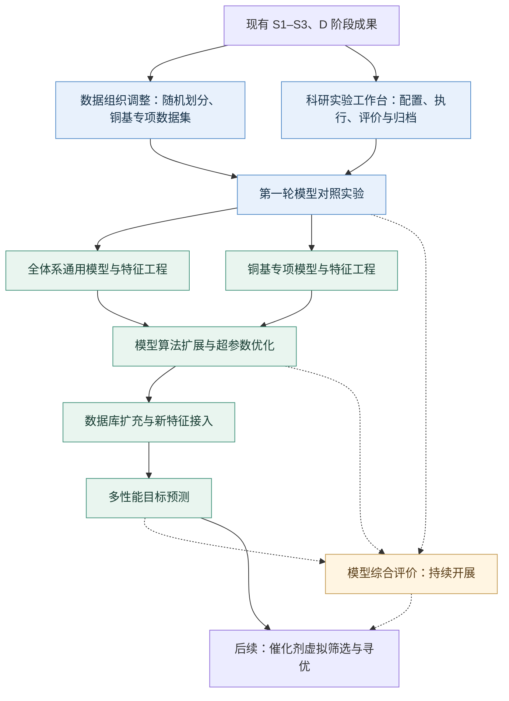

# Cat_AI 下一阶段科研方案与实施计划

> 方案日期：2026年11月20日  
> 定位：催化剂性能预测模型深化研究与自主科研实验能力建设  
> 适用范围：Cat_AI 项目下一阶段科研规划及开发任务编制

## 一、现有研究基础

截至2026年11月19日，项目已初步完成 AI 辅助 CO₂ 加氢制甲醇催化剂研发的上游基础能力建设，包括：

- TheMeCat 数据库接入、数据治理及版本管理；
- 催化剂组成特征及基础物化描述符构建；
- 可配置的机器学习模型训练与预测框架；
- R1、R2 模型训练及特征对照研究；
- 模型解释、适用域及独立评价流程建设；
- 项目管理工作台及科研任务管理能力建设。

当前工作模型为 F_base/Extra Trees，预测目标为 CO₂ 转化率。

现阶段已基本解决从文献数据到模型训练及预测的流程贯通问题，但在数据组织方式、催化剂特征表达、模型算法、预测目标和模型泛化能力等方面仍有较大的研究空间。

下一阶段应逐步将科研重心从基础设施建设转向催化剂性能预测模型本身的研究。

## 二、总体研究思路

以现有项目架构和研究成果为基础，围绕催化剂性能预测开展系统性的机器学习研究，并建设支持用户自主开展科研实验的操作平台。

本阶段主要包括七个研究及建设方向：

1. 数据组织方式调整；
2. 自主科研实验能力建设；
3. 特征工程深化；
4. 机器学习算法及模型优化；
5. 催化剂数据库扩充；
6. 多性能目标预测；
7. 模型解释、泛化与可靠性研究。

研究对象采用全体系催化剂通用模型与铜基催化剂专项模型并行发展的方式。铜基催化剂作为首个重点研究对象，但不改变项目整体不限定催化剂材料方向的定位。

本阶段继续聚焦上游科研能力建设，暂不进入正式催化剂配方寻优、实验验证及主动学习闭环阶段。

## 三、主要研究与建设内容

### 3.1 数据组织方式调整

#### （1）研究数据集组织

基于现有 TheMeCat 数据库，建立两类主要研究数据集。

| 数据集 | 数据范围 | 研究目的 |
|---|---|---|
| 全体系催化剂数据集 | 符合训练资格的全部催化剂 | 研究通用性能预测能力 |
| 铜基催化剂数据集 | 具有明确铜基催化属性的催化剂 | 深化特定材料体系的性能预测研究 |

铜基催化剂识别应以主要活性组分、催化剂组成及材料属性为依据，不简单以是否含 Cu 元素作为判断标准。

专项数据集通过统一数据库中的标签、筛选条件及数据快照生成，不额外建设独立的物理数据库。

未来可采用相同方式扩展至铟基及其他催化剂体系。

#### （2）数据划分方式调整

现有训练框架主要采用 DOI 分组划分。考虑到不同论文包含不同的催化剂知识，按照论文整体划分可能导致训练数据中的材料信息缺失。

下一阶段优先采用随机划分，同时保留原有 DOI 分组划分能力。

初步设置如下：

- 训练集、验证集、测试集比例为 70%/15%/15%；
- 训练集内部采用五折交叉验证；
- 数据划分比例、交叉验证折数及随机种子均可配置；
- 支持多随机种子重复实验。

随机划分前应识别重复实验记录，避免相同实验数据跨集合分布。重复记录或同一实验的重复收录应作为同一划分单元，在外部分区和内部交叉验证中均不得拆分。

随机划分主要用于评价模型的插值及已有材料知识范围内的预测能力。DOI 分组主要用于评价跨文献来源的泛化能力。

后续根据研究需要，再增加按催化剂配方、化学物种及材料家族分组的评价方式。

#### （3）第一轮对照实验

保持现有模型及特征工程不变，优先研究数据组织方式变化带来的影响。

| 实验 | 数据范围 | 划分方式 |
|---|---|---|
| EXP-01 | 全体系 | DOI 分组 |
| EXP-02 | 全体系 | 随机划分 |
| EXP-03 | 铜基催化剂 | 随机划分 |

统一采用现有 Extra Trees 固定参数，并对 F_base、F1、F2 开展比较。

重点分析：

- 数据划分方式对模型预测效果的影响；
- 全体系模型与铜基专项模型的性能差异；
- 物化描述符在不同研究场景下的实际贡献。

通用模型与铜基专项模型应在相同的铜基评价数据上进行比较，并确保评价记录及其重复记录未进入任一模型的训练过程。特征比较采用相同的合格样本范围及划分清单。

原有 DOI 划分及训练结果继续保留。历史结果的直接比较应采用一致的样本范围和评价口径；如划分比例或交叉验证折数不同，应明确差异，必要时重放对照。新随机测试集属于内部评价，不视为独立外部验证。

### 3.2 自主科研实验能力建设

基于现有 S2、S3 训练框架，在项目工作台中增加独立的“科研实验”功能模块。

该模块的目标是使用户能够自主完成一次完整的机器学习实验，而不需要针对每次科研实验重新编写代码。

#### （1）实验配置

用户可根据研究需求自主选择及配置以下内容：

| 配置类别 | 配置内容 |
|---|---|
| 实验信息 | 实验名称、研究目的、关联科研任务 |
| 数据选择 | 数据源、数据版本、材料体系、筛选范围 |
| 预测目标 | CO₂ 转化率及后续扩展的性能指标 |
| 数据划分 | 划分方式、训练验证测试比例 |
| 特征工程 | 特征集、描述符组合及版本 |
| 模型算法 | 单模型或多模型组合 |
| 模型参数 | 默认参数、手动设置、自动寻优 |
| 训练设置 | 随机种子、交叉验证折数、重复次数 |
| 模型评价 | 评价指标、可视化及诊断项目 |
| 成果输出 | 实验报告、训练模型及相关数据 |

首期仅开放底层已经实现并经过验证的功能，后续随科研能力扩展逐步增加可选项。

#### （2）实验执行

完成实验配置后，由系统自动执行以下流程：

1. 实验配置及输入检查；
2. 数据提取与数据快照生成；
3. 数据划分；
4. 特征构建；
5. 模型训练及交叉验证；
6. 模型评价与比较；
7. 实验结果输出及成果归档。

提供实验运行状态、进度、日志、失败原因及必要的取消和重试功能。

#### （3）实验结果分析

建立统一的实验结果输出方式，逐步支持：

- 模型性能指标对比；
- 预测值与实测值散点图；
- 残差及误差分布；
- 交叉验证结果及稳定性；
- 特征重要性及 SHAP 分析；
- 学习曲线；
- 过拟合分析；
- 模型预测可用率与适用域分析。

不同模型及实验采用统一的指标定义，并明确评价数据范围和实际样本数量。

#### （4）历史实验管理

每次实验形成独立的实验记录，保存：

- 实验目的及完整配置；
- 数据快照及划分清单；
- 特征版本及模型参数；
- 代码及运行环境版本；
- 运行日志及评价结果；
- 训练模型及科研结论。

支持历史实验查看、配置复用、实验复现及不同实验之间的对比。

科研任务管理与科研实验管理应保持独立，通过关联机制实现研究任务与具体实验成果之间的追溯。

工作台建设原则上复用现有 WB-07 训练接入计划，并根据实际需求扩展其建设范围。

### 3.3 特征工程深化

在现有 F_base、F1、F2 基础上，系统研究更合理的催化剂特征表达方式。

#### （1）通用催化剂特征工程

| 特征层级 | 主要研究内容 |
|---|---|
| 催化剂类别 | 材料家族、活性组分及类型 |
| 催化剂组成 | 元素、物种、含量及组成比例 |
| 物化属性 | 电负性、原子半径、离子半径、电子结构等 |
| 组分相互作用 | 属性差异、组分比例、相互作用描述符 |
| 结构性质 | 比表面积、孔容、粒径、分散度等 |
| 合成工艺 | 合成方法、焙烧及还原条件等 |
| 反应工况 | 温度、压力、氢碳比及空速等 |

物化描述符不再局限于简单的加权平均值，进一步研究属性分布、方差、极值及组分之间的差异。

同时探索不依赖固定物种词表的特征表达，以增强模型对未知组分及新催化剂配方的支持能力。

#### （2）铜基催化剂专项特征工程

针对铜基催化剂的材料特性及反应机理，重点研究：

- Cu 含量及主要组分含量；
- Cu/Zn、Cu/Zr、Cu/Al 等组成比例；
- 载体和助剂的物化性质；
- Cu 与其他组分之间的相互作用描述符；
- 铜比表面积、铜分散度及粒径；
- 合成工艺与结构性质之间的关系。

具体描述符应结合实际数据覆盖率、物理意义及预测阶段的可获得性确定。

#### （3）特征有效性研究

通过特征增量比较、消融实验、相关性分析及模型解释，研究不同特征对预测性能的实际贡献。

应在相同数据、相同划分及相同算法参数的条件下评价特征增益，不以增加特征数量为研究目标。

### 3.4 机器学习算法及模型优化

在现有 Dummy、Ridge 及 Extra Trees 模型基础上，逐步扩展适用于催化剂表格数据的机器学习算法。

| 模型类别 | 候选算法 |
|---|---|
| 基准模型 | Dummy、Ridge |
| 随机树集成 | Random Forest、Extra Trees |
| 梯度提升模型 | XGBoost、LightGBM、CatBoost |
| 核方法 | SVR、高斯过程回归 |
| 神经网络 | MLP 等 |

优先研究树集成及梯度提升算法，再根据数据规模和研究需求扩展其他算法。

主要研究内容包括：

- 不同算法的基准性能；
- 全体系模型与铜基专项模型的差异；
- 算法与特征工程的匹配关系；
- 超参数优化；
- 模型复杂度与过拟合；
- 数据规模对模型性能的影响。

逐步建设自动超参数优化能力，并纳入自主科研实验工作台。

模型及超参数选择应在训练和开发验证范围内完成，测试集不得用于反复选模。

### 3.5 催化剂数据库扩充

数据库扩充不作为本阶段初期科研工作的前置条件，优先使用现有 TheMeCat 数据库开展方法研究。

待研究框架进一步完善后，择机接入其他文献数据库。

| 数据库 | 数据规模 | 研究价值 |
|---|---:|---|
| TheMeCat | 820 条原始记录 | 现有研究基础 |
| Suvarna 等（2022） | 1,234 条公开整理数据 | 多体系催化剂及甲醇 STY |
| Yan 等（2026） | 500 条公开数据 | Cu/ZnO 基催化剂专项研究 |
| Yan 完整数据库 | 2,476 条，需向作者申请 | 铜基催化剂数据规模扩充 |

数据来源：

- Suvarna：[Zenodo 数据集](https://zenodo.org/records/6541445)；
- Yan：[GitHub 仓库](https://github.com/MoYan-101/CommsEng)，[公开 CSV 文件](https://github.com/MoYan-101/CommsEng/blob/main/data/Data_MeOH.csv)。

后续接入时重点解决多数据源字段映射、单位统一、物种表达、重复实验记录识别、数据质量、数据许可及来源追溯等问题。

区分原始实测数据、计算派生数据及统计插补数据。

数据库扩充后，应在固定评价数据上研究新增数据对于模型性能及预测覆盖范围的实际贡献。上述数据规模为来源公布或此前核查的名义规模，尚未去重或完成训练资格审查。

### 3.6 多性能目标预测

在现有 CO₂ 转化率预测基础上，逐步增加其他与甲醇催化剂研发相关的性能指标。

| 预测目标 | 研究意义 |
|---|---|
| CO₂ 转化率 | 反应活性 |
| 甲醇选择性 | 目标产物生成能力 |
| CO 选择性 | 副反应控制能力 |
| 甲醇收率 | 综合催化性能 |
| 甲醇时空收率 | 甲醇生产效率 |

优先研究 CO₂ 转化率、甲醇选择性和甲醇时空收率。

不同预测目标允许使用不同的合格数据子集。涉及派生指标时，应明确计算公式及物理基准，避免目标信息泄漏。

在单目标预测能力建立后，再研究多目标联合预测及性能指标间的物理一致性。

### 3.7 模型解释、泛化与可靠性研究

复用现有 D 阶段评价能力，并随模型版本更新持续开展相关研究。

主要包括：

- 特征重要性与 SHAP 分析；
- 材料组成及反应工况的影响分析；
- 模型预测失败归因；
- 适用域识别；
- 未见配方及未见物种的预测能力；
- 预测不确定性与校准；
- 跨文献及外部独立数据评价。

模型评价应同时关注预测精度、预测可用率及适用范围。

随机划分、DOI 分组及外部独立评价分别对应不同的预测场景，不应相互替代。

## 四、阶段实施计划

### 第一阶段：数据组织与基础科研实验能力

**近期优先实施。**

主要任务：

1. 统计现有数据库的材料体系及铜基催化剂数据分布；
2. 建立铜基催化剂识别及筛选规则；
3. 建立全体系与铜基专项数据集；
4. 扩展随机划分及交叉验证能力；
5. 建设科研实验工作台基础版本；
6. 完成第一轮数据组织及模型训练对照实验。

主要交付成果：

- 催化剂数据分布与分类报告；
- 全体系及铜基专项数据快照；
- 可配置的数据划分模块；
- 科研实验工作台基础版本；
- 第一轮模型对照研究报告。

### 第二阶段：特征工程与模型研究

基于第一阶段形成的科研实验能力，重点开展模型本身的研究。

主要任务：

1. 通用催化剂描述符研究；
2. 铜基催化剂专项描述符研究；
3. 特征工程消融及增量比较；
4. 机器学习算法扩展；
5. 超参数优化；
6. 全体系与铜基专项模型对比；
7. 完善科研实验结果分析及历史实验管理功能。

主要交付成果：

- 特征工程专项方案；
- 新版本特征集；
- 扩展后的机器学习模型库；
- 超参数寻优模块；
- 模型与特征对比研究报告。

### 第三阶段：数据扩充与多性能目标预测

根据前期研究确定的数据需求开展数据库扩充。

主要任务：

1. 接入 Suvarna、Yan 等文献数据库；
2. 完成多数据源治理及融合；
3. 分析数据扩充对模型性能的影响；
4. 扩展合成工艺及结构性质特征；
5. 建设甲醇选择性、甲醇时空收率等预测模型；
6. 开展综合模型评价。

主要交付成果：

- 扩充后的催化剂数据库；
- 多数据源治理及质量报告；
- 多性能目标预测模型；
- 综合模型研究报告。

### 第四阶段：模型综合评价与后续研究准备

主要任务：

1. 模型解释与催化剂规律分析；
2. 模型适用域及泛化能力研究；
3. 不确定性分析与校准；
4. 具备条件时开展外部独立数据验证；
5. 形成面向后续催化剂虚拟筛选与配方寻优的预测能力。

相关诊断工作应贯穿前述各阶段，不必全部延后至第四阶段。

## 五、项目实施原则

1. 复用现有项目架构及 S1—S3、D 阶段成果，不重复建设已完成的基础能力。
2. 将数据、特征、模型、训练设置及评价方法作为独立、可配置的研究变量。
3. 科研实验应具有明确的研究目的，并支持完整记录、复现和比较。
4. 科研任务完成不以模型性能必须提升为条件，有可靠证据支持的负面结果同样属于有效科研成果。
5. 科研实验工作台属于支撑科研的工程建设任务，应与科研研究任务分别管理并建立关联。
6. 保留所有历史数据快照、模型及训练成果，不覆盖已有科研证据。
7. 现阶段继续聚焦上游能力，不将正式催化剂筛选、实验验证及主动学习闭环作为近期任务。

请基于本方案及当前仓库实际实施情况，更新项目总体科研路线图、阶段实施方案及任务计划，明确各项任务的依赖关系、执行顺序与验收要求。

近期首先推进第一阶段，不提前铺开所有后续研究任务。

## 六、总体科研路线图

## 七、方案状态与待确认事项

- 数据划分比例、交叉验证折数、候选算法及阶段实施顺序为建议设置，待结合实际数据规模与仓库情况细化。
- 外部数据库接入延后，许可、字段覆盖率及跨库重复比例仍需审查。
- 本方案保留历史科研成果及现有工作台建设计划；具体任务编号、WB-07 排期和验收拆分由项目核对后确定。
- 本文为科研与开发指引，尚未实施代码修改或重新训练模型。
