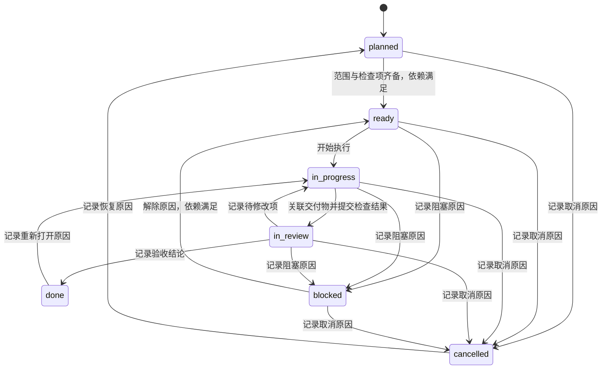
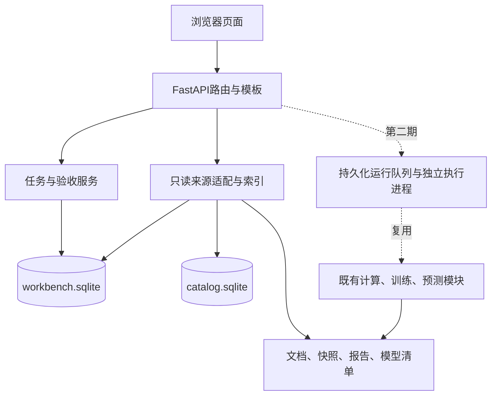

# 项目管理 Web 工作台方案

2026-11-18 实施状态更新。基础管理、数据基础、固定模型批量预测和模型证据台账已交付。管理库已升至 schema 8，WB-13-08 的隔离验收与恢复演练已完成，下一步是正式部署和父任务验收。下文的 schema 3、模块分期及原交付顺序保留为 v0.2 规划基线。现行安排见[v0.3 方案](project_workbench_plan.md)和[WB-13 记录](../workbench/wb13.md)。

修订日期为2026-11-16，时区为Asia/Shanghai。版本为v0.2，状态为扩展方案草案。方案以现有WB-01至WB-04管理能力为基础，吸收离线工作台v1.1的四组十一模块、研发证据分类和实验闭环设计。新增模块、实体及接口按下文分期交付，现有实现范围以工作区代码及对应交付记录核对。

本次修订依据为临时目录中的[使用说明](../workbench/temp/README.md)、[项目管理梳理](../workbench/temp/项目管理梳理.md)、[更新记录](../workbench/temp/更新记录.md)，并对照[index.html](../workbench/temp/index.html)、[页面截图](../workbench/temp/preview.png)、[CSV模板](../workbench/temp/catalyst_data_import_template.csv)和[启动脚本](../workbench/temp/启动工作台.bat)。本方案采用其模块组织和操作流程，涉及当前研发进度时结合仓库内日期、版本和原始证据处理差异。

## 1. 目标与使用假设

工作台帮助项目负责人查看当前阶段、安排任务、检查交付证据、记录验收及追踪决策，并贯通“资料与来源 → 样本与字段 → 质量治理与冻结 → 模型与解释 → 筛选与候选 → 实验复核 → 模型反馈”的研发管理链。每一步独立登记证据、适用范围和实际结论。

首版按本地单项目、单操作者设计，支持同一浏览器多个标签页。界面使用中文，时间存储为UTC，显示为Asia/Shanghai。负责人、计划日期和工时由使用者填写，初始值可以为空。此处的使用规模、技术栈、独立管理库和交付顺序均为本方案建议，实施时可按实际需要调整。

总体研发路线继续由[总体设计](system_design.md)说明，特征和预测任务的细节见[特征方案](../feature_engineering_plan_v0.1.md)。近期优先完善上游特征工程、性能预测和可配置训练，筛选及实验闭环按后续阶段交付。材料体系开放，测试工况优先作为输入或分层条件。SHAP结果记录特征贡献、稳定性和解释局限。

## 2. 当前基础与首批管理对象

v0.2 规划时已有 Python 模块化单体、Pydantic、SQLAlchemy、SQLite、CLI 和 JSON 证据产物。工作区已有 `src/catalyst_ai/workbench/`、schema 3 独立管理库、`src/catalyst_ai/web/` 及 `web` 可选依赖，具备任务验收、文件索引、决策和文档页面。扩展沿用 `sqlite3` 的事务和迁移机制。

| 交付层 | 当前可核对范围 | 后续验收 |
|---|---|---|
| WB-01至WB-04 | 导入草案、任务服务、索引与Web页面已有代码及交付说明 | 页面真实浏览器桌面/窄屏验收待补，详见[WB-04](../workbench/wb04.md) |
| WB-05相关辅助代码 | `import_draft.py`提供预览/事务导入，`backup.py`提供管理库备份 | 实际项目导入、成果完整备份与恢复、端到端验收仍需形成交付记录 |
| temp离线v1.1 | 单HTML、localStorage、JSON备份和十一模块台账，变更记录包含浏览器检查结果 | 原型与Python工作台之间的数据迁移及科研来源核对待实施 |
| 本次扩展 | 四组导航、来源与科研对象管理、证据分类和闭环规则 | 按本方案WB-08及以后任务交付 |

| 对象 | 首批内容 | 导入处理 |
|---|---|---|
| 总体路线 | A工程、B治理、C预测、D诊断、E推荐、F反馈 | 用作阶段分类，按阶段展示任务与局限 |
| 当前里程碑 | S1-A、S1-B、S2、S3 | 记录范围和依赖，细分为可验收任务 |
| 历史实验预设 | R1、R2、F_cond、F_base、F1、F2 | 作为任务和成果标签关联，沿用原有定义 |
| 数据成果 | 593条目标快照、原DOI划分、S1-A资格 | 从内容标识和报告读取版本、数量及限制 |
| 特征成果 | S1-B的selection和features | 导入明确选定的构建目录，保存文件与内容哈希 |
| 模型成果 | R1比较报告、预测包、重放结果 | 关联运行、特征、模型、评价范围与输入支持率 |
| 决策与说明 | ADR、progress、专项文档 | 保存章节定位、文件版本和管理摘要 |

规划时确认的工作区事实如下。

- S1-A有验收说明，联合支持553/593条，详见[S1-A验收](../s1_a_acceptance.md)。
- S1-B已有代码及[构建说明](../s1_b_build.md)，v4产物记录训练454条、验证47条、历史测试52条，共553条。导入时记录实际文件哈希，并复核构建、逐值索引和测试证据。
- 规划时存在 S1-B 文档状态与已构建产物差异。2026-11-17 已完成固定 v4 工程验收，S1B-01 为 done，DIFF-S1B 为 resolved，历史导入建议和差异修订继续保留，详见 [S1-B验收](../s1_b_acceptance.md)。
- S2自定义配置、F1/F2训练及增强预测包仍待交付。现有R1基础成果可关联到对应已完成子任务。
- 当前工作区含未提交及未跟踪文件，成果应显示代码哈希和Git状态。数据库和大部分报告已被Git忽略，需要单独纳入备份。

### 2.1 临时资料与仓库现状的差异处理

| 差异 | 来源及时间 | 方案处理 |
|---|---|---|
| S1-A 548/593支持、45未支持、尚未完成 | temp引用2026-11-10开发反馈，`SRC-FEAT-S1A-2026`标为待核验 | 保留历史反馈，关联2026-11-13验收和553/593、40排除的新版本；39条InNi3O0.5及1条CoGaAlO4保留证据不足处置 |
| `T-S1A-2026`仍要求完成初始映射 | 原型v1.1新增P0任务 | 导入为待核对建议，与S1-A验收关联后记录处理结论；剩余来源复核单独建任务 |
| TheMeCat仅为选型，模型及样本初始空表 | 原型登记范围 | 分别显示“原型登记范围”和“仓库已索引范围”，登记真实快照、R1报告与模型包后更新对应统计 |
| 200+自有催化剂 | `SRC-002`汇报转述 | 展示来源和汇报日期，逐条接入并核验后计入样本统计 |
| 历史进度称S1-B待实现 | 总体设计、progress旧版本与构建说明存在差异 | `DIFF-S1B` 已于2026-11-17按固定成果和实际验收解决，历史记录保留 |

历史反馈、验收记录、实际文件检测分别保留来源时间、观察时间和适用范围。当前汇总使用已核对的对应版本，历史版本仍可追溯。原型的“已核验来源”迁移时保留原声明，并重新核对具体文件与结果范围。

## 3. 功能分期

| 能力 | 第一期管理基础与数据台账 | 第二期研发操作接入 | 第三期实验闭环 |
|---|---|---|---|
| 项目总览 | 四组十一模块导航、当前里程碑、优先任务、来源差异及统计范围 | 增加运行队列和最近执行情况 | 展示批次、实验复核和模型反馈 |
| 任务管理 | 创建、编辑、优先级、负责人、日期、依赖、检查项、状态和历史 | 任务关联运行提交与结果 | 任务关联实验复核及反馈 |
| 成果与证据 | 既有文件登记、刷新索引、预览、版本关联、完整性检查 | 自动登记新运行产物 | 覆盖增加后扩展新产物适配器 |
| 决策管理 | 记录背景、决定、影响任务、来源和替代关系 | 将配置及运行变更关联决策 | 按实际需求接入外部协作工具 |
| 文档浏览 | 浏览项目文档，显示来源版本和差异提示 | 生成待检查的进度文档导出 | 根据使用反馈增加文档编辑能力 |
| 数据基础 | 来源库、样本只读查询及导入暂存、五类字段、治理工作包与冻结快照引用 | 治理操作复用领域服务，接入构建和训练选择 | 实验数据经治理进入新快照 |
| 训练与预测 | 登记已有模型、指标、SHAP与适用域报告 | 复用已有Python入口提交运行，配置训练依赖S2 | 新旧模型配对复评 |
| 筛选与候选 | 接口与字段定义 | 登记真实筛选输出、候选和条件对比，按能力接入执行 | 候选进入制备与实验批次 |
| 实验与反馈 | 导航占位及能力说明 | 完善实验契约与容量参数 | 批次排程、实测复核、数据回灌及再训练证据 |

第一期在原WB-01至WB-05管理闭环上增加WB-08、WB-09，形成可用的项目管理与数据基础入口。第二期接入WB-06、WB-07及WB-10、WB-11。第三期交付WB-12。十一模块逐步具备“可浏览、可登记、可执行”的能力，页面按实际能力显示操作和待接入说明。

## 4. 页面与交互

### 4.1 导航与布局

左侧采用四组十一模块，顶部显示项目名称、搜索、最近索引时间和备份入口。活动记录放在总览及对象详情中。全局搜索扩展覆盖任务、来源、样本定位、成果、模型运行、候选和决策。对象标题与ID均可检索。

| 导航组 | 模块 | 主要入口 |
|---|---|---|
| 项目管理 | 项目总览 | 证据边界、当前焦点、里程碑、优先任务、来源差异 |
| 项目管理 | 阶段任务与问题 | 任务、依赖、检查项、技术问题、决策与历史 |
| 项目管理 | 证据台账与备份 | 成果、固定版本、验收关联、文档、备份恢复 |
| 数据基础 | 资料与来源库 | 文献、数据集、内部资料、开发报告和转述索引 |
| 数据基础 | 催化剂样本 | 材料/制备/测试记录、工况、指标和治理状态 |
| 数据基础 | 字段与描述符 | 结构、性能、合成方式、测试工况、专家知识五类字段 |
| 数据基础 | 质量治理 | 单位、缺失、重复、来源、可比性、冻结工作包 |
| 智能研发 | 训练与可解释分析 | 运行、特征、划分、评价、SHAP和适用域 |
| 智能研发 | 虚拟筛选 | 模型版本、变量空间、约束和真实输出 |
| 智能研发 | 候选配方对比 | 配方、预测、条件、证据及进入实验的候选池 |
| 实验闭环 | 实验验证与回灌 | 批次、槽位、测试、复核、反馈及模型复评 |

既有`/tasks`、`/artifacts`、`/decisions`、`/documents`路由继续提供对象入口，导航分别归入任务页和证据页的子页。技术问题可以关联决策，记录研究中、已有方案待验证、已解决及相应证据。

界面参考原型的深色分组侧栏、浅色内容区、摘要卡片和紧凑表格，正文使用本地系统中文字体，英文和数字可使用本地打包的Inter。状态同时使用文字与颜色。主要按钮承担登记、提交验收、确认完成、刷新索引等明确操作。列表提供状态、阶段和关键词筛选，条件保存在URL。空表显示登记范围和下一操作，数据读取失败显示异常及最后成功观察时间。

桌面优先验收1366×768和1920×1080。窄屏折叠导航和次要列，任务编辑、成果查看及验收操作仍可用。首版优先交付任务列表和详情，看板视图随实际排期增加。

### 4.2 总览

首屏按“状态口径 → 研究指标 → 研发链条 → 已知项目记录 → 阶段任务与约束”排列。当前焦点、可开始、进行中、待验收和阻塞摘要可进入任务详情。已知项目记录展示来源版本和待处理差异，最近成果及决策保留追溯入口。

| 总览统计 | 统计口径 |
|---|---|
| 已登记资料 | 当前项目来源条目数，显示核验分类 |
| 样本记录 | 指定快照的测试记录数，分别显示已治理、来源接受、逐条核验及排除范围；材料数另列 |
| 任务完成 | 已完成任务数/已纳入任务数，研发证据分类另列 |
| 模型与研究证据 | 按运行或研究对象统计，附目标、评价范围和证据复核状态 |
| 实验结果 | 已测试、已复核、已回灌分别计数，显示批次和当前占用槽位 |

所有数字附范围、来源版本和观察时间。尚未接入数据时显示“待接入”。已成功查询且确为零条时显示0。200+等汇报数字放在来源卡片中。

里程碑显示“已完成任务数/已纳入任务数”，统计包含明确的范围与更新时间。空阶段显示“尚未拆分任务”。计划日期缺失时显示“未设置”。当前下一步可手动指定，并展示其依赖状态，依赖满足的其他任务按优先级和计划日期排序。

示意布局如下，内容取自真实登记数据。

```text
Cat_AI                         搜索                  最近索引时间
项目管理 / 数据基础 / 智能研发 / 实验闭环

当前焦点                 可开始             待验收       阻塞
S2 配置与增强训练        任务列表           S1-B         原因摘要

里程碑                   当前任务                         最近活动
S1-A / S1-B / S2 / S3     状态、负责人、依赖、下一操作       变更与验收

最近成果                 版本、关联任务、检查结果、查看入口
```

### 4.3 任务列表与详情

列表字段包含编号、标题、所属阶段/里程碑、状态、优先级、负责人、计划日期和依赖提示。详情显示任务目标、范围、交付清单、验收检查项、依赖、成果关联、决策关联及变更历史。任务可以关联多个A–F阶段，其中一个标为主阶段。

创建任务时要求标题和目标，优先级默认普通。开始前应填写交付清单及检查项。提交验收时选择具体成果版本和检查结果。验收人可与负责人相同，操作记录保留实际填写的操作者及结论；本地姓名字段表示操作归属。

### 4.4 成果列表与详情

成果类型包含数据快照、资格、划分、属性目录、特征构建、模型比较、模型包、预测结果、测试记录和普通附件。详情展示路径、内容ID、哈希、来源运行、输入引用、关联任务、检测时间及检测结果。

模型报告展示指标时同时显示目标、单位、分区、记录/DOI分母、特征版本和输入可用率。涉及共同子集的比较显示对应选择清单及CV配置。初始跨运行列表提供来源指标查看，正式配对比较以原有报告记录的比较条件为依据。

预览优先支持Markdown、JSON摘要和文本日志。大型JSON按记录分页，保留原文件下载入口。模型序列化文件展示清单及哈希，文件查看流程使用元数据读取。

### 4.5 决策与文档

决策详情保存问题背景、结论、理由、影响范围、关联任务、来源章节和替代关系。既有ADR以源文档导入，新管理决策写入管理库并可导出为Markdown草稿。决策变更保留修订历史。

文档页按现有职责展示总体设计、进度、专项方案、接口契约和验收说明。文档来源变更后提示重新核对摘要及关联。原有章节定位失败时保留文件入口，并显示“章节定位待更新”。

### 4.6 数据基础四模块

资料与来源库登记稳定ID、类别、标题、DOI/URL/路径、版本、许可、整理人、来源日期、摘要、核验范围和限制。核验流程为已登记、待核验、已核验可引用、资料不可用，保留核验人及具体证据版本。内部汇报和进展转述可作为计划及来源线索，研究结果验收进一步关联原始数据或报告。

催化剂样本沿用领域模型中的材料、制备批次、测试及观测关系，列表一行明确为一个测试记录。详情显示原文定位、原始字符串/单位、标准值、来源接受标志、缺失状态、工况和治理历史。同材料的多工况、多制备批次和重复测量保留各自身份。CSV兼容原型模板，支持预览、逐行错误、疑似重复、字段映射及导入结果下载，新记录进入待治理区，再通过既有领域接入流程发布修订。

字段与描述符以原型36项为起始展示字典，对照既有领域字段逐项建立映射。字段包含机器键、分类、类型、单位、原始口径、缺失状态、适用条件、来源、版本和计算规则。原型“建议必填”按目标与使用阶段解释，例如仅CO₂转化率目标的导入可保留甲醇指标未报告。新增描述符进入有类型和版本的扩展字段，训练可用性按相应特征实现校验。

质量治理以工作包管理来源许可、单位/指标、缺失重复、工况可比性和冻结版本，每项关联输入、规则版本、报告、责任人及验收记录。绝压/表压、GHSV基准和进料口径保留原值、转换依据及假设；缺失、不适用、未报告等沿用既有`ValueState`。去重核对来源、材料、制备、测试工况和重复样身份。冻结引用既有快照与原DOI分组，适用域和泄漏检查纳入模型验收。

### 4.7 智能研发三模块

训练与可解释分析保存运行ID、数据集及特征版本、目标/单位、算法/参数、划分与CV、代码/环境、指标及分母、模型包、SHAP及适用域报告。已有R1运行先登记为历史证据。软件执行状态和科研证据分类分别显示。不同运行的指标比较须满足对应配对条件，树间分散度注明校准情况。

虚拟筛选登记固定模型、变量空间、组成/合成/工况约束、优化目标、评分规则、输出位置及证据。手工登记的筛选结果显示来源，执行入口在对应研发服务验收后启用。

候选配方保存组成及比例基准、制备方案、来源筛选运行、预测指标、目标工况、不确定度、适用域和推荐理由。对比视图同时展示配方、预测版本及工况。可比性按字段完整性、数值、单位、压力及GHSV基准、反应器和指标定义判断，界面展示已核对项和差异。候选进展使用规划、模型推荐、待实验、实验中、已实验待复核、已验证，并关联相应记录。

### 4.8 实验验证与回灌

实验批次关联候选、制备批次、实际测试槽位、计划/实际日期、工况及状态。排程默认4槽，设备核定后可选5或6，批内实际使用数允许低于4。底层容量契约沿用现有1–6范围，原型迁移接受其4/5/6配置。容量来源和生效时间写入管理记录。

重复样、对照样分别占用槽位。单批及所有同时执行批次的占用总数均须在有效容量内，开始执行、修改占用、恢复批次和降低容量时在同一事务检查。暂停批次显式记录槽位释放或保留。完成、取消及确认释放后更新占用，页面显示计划和实际占用。

实测记录包含候选、批次、制备与样品ID、工况、性能/单位/误差、独立重复与重复测量、原始文件、来源和复核人。状态为待验证、测试中、已完成待复核、已复核，复核检查具体指标、条件完整性和证据范围。反馈过程记录“已复核实验 → 治理修订/冻结快照 → 新模型运行 → 配对复评”，保存旧/新模型和结论。完成这些关联并保存复评记录后，方可标为已回灌。

## 5. 任务状态与验收规则

### 5.1 执行状态

任务状态采用待规划`planned`、可开始`ready`、进行中`in_progress`、待验收`in_review`、已完成`done`、阻塞`blocked`和已取消`cancelled`。



| 操作 | 校验及记录 |
|---|---|
| 创建依赖 | 依赖对象存在，属于同一项目，拒绝自依赖和循环依赖 |
| 标为可开始或开始执行 | 当前验收标准已填写，必需依赖已完成且其验收证据可用 |
| 提交验收 | 每项必需标准有检查结果及对应成果或解释性记录，未解决项清晰列出 |
| 确认完成 | 必需检查项全部通过，验收绑定任务标准版本、成果版本和结论，记录操作者与时间 |
| 进入或解除阻塞 | 保存原因、恢复条件和实际处理记录，计划恢复日期可为空 |
| 已完成任务调整范围 | 保留旧验收，建立标准新版本并显式重新打开任务 |
| 验收证据发生变化 | 保留原验收历史，标记需复核并提示受影响依赖，由操作者记录后续处置 |

证据的检测状态单独记录为可用、待检查、已变化、缺失、无效或读取失败。文件存在可登记为成果，任务完成需要上述验收操作。验收后证据失效时，该任务显示“已完成，证据需复核”，依赖就绪判断使用其当前证据状态。

管理验收保存软件交付范围和实际结论。涉及科研结论时，检查项需明确其对应模型、数据和评价范围，沿用原有来源接受、压力假设及历史测试集限制。

### 5.2 研发证据分类

任务执行状态继续沿用WB-02，增加独立的研发证据分类。已完成的软件任务可关联“已实现功能”，实验和模型结果按自身验收范围记录“已验证成果”。同一研究对象可关联多次实现和验证记录，分类提升需保存审查结论。

| 分类 | 保存内容 | 提交条件 |
|---|---|---|
| 规划内容 | 目标、范围、技术路线和待完成项 | 明确任务与验收标准 |
| 已实现功能 | 实现说明、代码/配置版本、测试或运行证据 | 固定来源版本可用，实际交付与检查项对应 |
| 已验证成果 | 对象、结果、数据和评价范围、复核说明与证据 | 对应领域验收检查通过，固定证据可追溯 |

来源核验保存“软件产物核对、数据集来源接受、逐行原文核验、实验复核”等具体范围。S1-A的工程验收可沿用已记录的数据集来源接受约定。原型中的“已核验可引用”由导入者进一步定位到对应范围及版本。

| 研究对象 | 已验证所需的主要证据 |
|---|---|
| 数据治理 | 原件/来源版本、规则、质量报告、冲突与排除处置、冻结快照及适用边界 |
| 模型 | 冻结数据、特征、目标、划分/CV、指标及分母、运行记录、复现条件与适用域 |
| 虚拟筛选 | 模型版本、搜索空间、约束、真实输出及筛选复核记录 |
| 候选有效性 | 对应候选及实际制备版本、真实实验、原始证据、完整工况、性能和实验复核 |
| 模型反馈 | 已复核实验、新数据版本、旧/新模型、再训练及配对复评记录 |

证据版本变化后保留分类和审查历史，同时标记需复核并更新统计。没有可用证据的历史验证项单列为“历史验证，证据待复核”。候选预测值、实验观测值和反馈模型指标各自保存。

## 6. 数据模型与存储

管理数据沿用`data/workbench.sqlite`，复用现有`sqlite3`事务服务、迁移和Pydantic输入校验。领域库`data/catalog.sqlite`以只读连接提供查询，报告、快照及模型保留现有文件位置。管理库保存关联及索引，原始大文件通过相对路径访问。样本导入、治理和实验回灌的领域写入通过对应领域服务执行，保存幂等操作ID、输出版本和失败记录。

独立管理库便于单独迁移、恢复和备份。管理对象与领域对象通过内容ID、文件路径和哈希连接，领域引用由适配器验证。跨文件读取记录观察时间与检测结果，页面展示最近成功索引版本。

| 实体 | 主要字段和关系 |
|---|---|
| project | ID、名称、工作区根目录、显示时区、当前焦点任务、修订号 |
| milestone | ID、项目、名称、目标、计划日期、排序 |
| task | ID、项目、里程碑、标题、目标、阶段标签、状态、优先级、负责人、日期、标准版本、修订号 |
| task_dependency | 前置任务、后继任务、创建记录，唯一约束避免重复关系 |
| acceptance_criterion | 任务、标准版本、检查说明、是否必需、排序 |
| acceptance_review | 任务、标准版本、结论、操作者、时间、检查结果及证据版本快照 |
| artifact / artifact_revision | 成果逻辑ID、类型、内容ID、位置列表、版本、文件/内容哈希、绑定引用、检测状态和时间 |
| task_artifact | 任务、成果版本、用途、关联检查项 |
| decision / decision_revision | 决策ID、内容、状态、版本、来源、替代关系及时间 |
| task_decision | 任务、决策及影响说明 |
| activity_event | 对象、操作、操作者、时间、变更摘要及对象修订号，只追加保存 |
| index_scan | 扫描ID、范围、开始/结束时间、状态、错误和已发布索引代次 |
| run_reference | 既有运行标识、报告、输入绑定、结果、来源和观察时间 |

上表为逻辑契约，规划时以 schema 3 的实际表和服务为迁移基线。新增逻辑对象如下。

| 对象 | 持久化职责与复用关系 |
|---|---|
| source_reference / source_review | 来源元数据、版本、许可、来源日期、核验范围/操作者/结论，关联已有领域来源ID和成果版本 |
| research_claim / claim_review | 研究对象、三类证据分类、适用范围、固定证据、审查及需复核标记 |
| technical_issue | 问题、P0/P1/P2、处理思路、状态、关联任务/决策及解决证据 |
| field_definition / field_revision | 五类字段定义、类型、单位、缺失/适用规则、领域字段映射、计算版本 |
| import_batch / import_row | 原始CSV/JSON哈希、结构版本、字段映射、行级暂存、错误、去重建议、发布操作ID |
| governance_package | 输入版本、规则、质量报告、排除处置、冻结/划分引用及关联任务 |
| model_run_reference | 固定运行与模型包、目标/特征/参数/划分、指标/分母、解释及适用域引用，复用run_reference |
| screening_reference / candidate_revision | 筛选配置和输出、候选组成/制备/工况、预测、推荐理由、来源及修订 |
| experiment_batch / slot_assignment | 批次、核定容量、槽位/候选/重复样、占用与释放事件，关联领域批次 |
| experiment_review / feedback_reference | 领域实验记录、复核证据、新快照与旧/新模型、配对复评和反馈结论 |

材料、制备、测试、观测、快照和训练特征的事实定义沿用领域契约，管理库通过稳定ID和版本引用。跨库操作采用“暂存 → 领域幂等写入 → 回执核对 → 管理关联发布”的流程，中断后按操作ID重试并核对回执。领域写入成功且管理发布失败时，保留待关联记录，恢复后完成关联。

首版管理一个项目，管理对象仍绑定project，避免导入时混淆工作区。任务和决策更新、修订号递增及活动事件在同一管理库事务提交。编辑请求携带预期修订号，过期编辑返回冲突并保留表单内容。重复提交通过请求ID去重。所有管理表通过显式schema版本迁移，升级前使用SQLite备份接口保存管理库副本。

备份至少包含管理库、被引用的报告/快照/模型及原件，或这些文件的可用备份位置。恢复后重新验证引用，缺失项保留索引并给出路径。Git记录和文件备份状态分别展示。

## 7. 来源适配、索引与文档职责

### 7.1 索引过程

现有Web首次启动初始化管理库、项目和索引工作区。WB-05补齐首次项目数据选择与导入预览，使用者选择首批任务、明确的成果目录和文档来源后建立关联。后续通过“刷新索引”检查新增、变化、缺失和关联异常。

扫描范围来自显式登记目录。优先适配`data/snapshots/`、`artifacts/reports/`、模型清单和相关文档。原件哈希核验按成果引用读取。扫描设置文件大小上限和分页，独立报告单个文件错误。中断扫描保留上一代完整索引，新代结果在扫描成功后发布。完整扫描发现的删除记为缺失；部分扫描失败时保留未确认项。

成果身份优先使用原有内容ID及绑定信息，同一内容可关联多个位置。缺少稳定ID的附件以类型和文件哈希登记。路径相同而内容变化时产生新版本，验收继续引用当时版本。保留文件SHA-256和原报告的规范化内容摘要，两种哈希按各自定义检查。

### 7.2 与现有代码的衔接

| 来源 | 拟复用方式 | 接入注意点 |
|---|---|---|
| `storage/feature_catalog.py` | 读取已登记属性、映射和来源证据 | Web查询连接显式只读，校验目录身份及哈希 |
| `storage/feature_build.py` | 读取构建及逐值索引 | 当前`get_build()`调用`persist()`做验证，Web只读适配需先抽取共用纯校验逻辑或增加只读查询入口 |
| `features/build.py`、`features/physchem.py` | 第二期复用构建和物化计算入口 | 固定输入版本，输出新目录，保留资格筛选 |
| `modeling/experiments.py` | 首期读取比较报告，第二期复用R1比较 | F1/F2、自定义参数能力依赖S2交付 |
| `modeling/predictor.py` | 首期读取模型清单和预测报告，第二期调用可信模型预测 | 模型执行入口独立校验包，普通预览读取清单 |
| `reporting/evidence.py` | 复用规范化摘要和实现身份规则 | 界面保留实际代码哈希及工作区版本 |
| `workbench/service.py`、`index.py`、`decisions.py` | 复用任务验收、固定证据和管理决策 | 扩展对象沿用事务、修订号及请求ID |
| `schemas/domain.py`、现有接入与治理服务 | 映射来源、材料、批次、测试、Measurement与ValueState | CSV先暂存，保留原始值/状态，通过领域入口生成修订 |
| `workbench/import_draft.py`、`backup.py` | 扩展预览、管理库备份和恢复核对 | 当前草案导入仅接受新任务ID；重复请求去重与跨备份合并需分别处理 |

### 7.3 文档与状态的权威来源

规划期继续以现有文档和运行证据记录现状。第一期初始化时显式处理S1-B等差异，形成一次导入记录。工作台验收并采用后，任务状态、验收和管理决策修订以管理库为准，领域事实和科学评价以原数据及报告为准。

`progress.md`继续作为可阅读的进度入口。工作台提供带版本和导出时间的进度摘要，由使用者检查后更新文档当前汇总区域，历史记录保留。文档编辑产生的新任务以待导入建议呈现。检测到文档摘要与管理状态差异时显示双方来源和版本，记录显式处理结果。

总体设计维护系统结构，专项方案维护验收细节，ADR维护架构决策。工作台的新决策可导出为待检查草稿，架构决策正式纳入ADR时记录相互关联。管理库采用的切换时间与首次导入版本在活动记录中保存。

### 7.4 离线v1.0/v1.1数据迁移

原型使用localStorage键`ai_co2_meoh_catalyst_project_v1`，JSON业务结构版本为`version: 1`，界面版本另由`settings.workspaceRevision`记录。先从原浏览器导出JSON，服务端读取显式上传的备份文件并保存哈希及导入批次。原型的“覆盖当前记录”操作在服务端转换为导入预览、冲突处置及事务发布流程。

| 原型字段 | 服务端目标与处理 |
|---|---|
| `sources` | 来源索引与核验历史，保留旧ID、原声明和日期，附件按实际可用性登记 |
| `records` | 暂存测试行，映射来源/材料/制备/工况/性能，保留未映射字段及原始内容 |
| `fields` | 字典修订及领域映射，自定义键冲突给出逐项处理结果 |
| `governance` | 治理工作包及任务，冻结版本按真实引用核对 |
| `roadmap`、`issues` | 任务、研究分类与技术问题；原型三类status进入research_claim，任务执行状态默认planned并保留状态建议 |
| `models`、`screenings` | 历史运行/筛选索引，原自由文本保留，版本及指标结构化后再提交验证 |
| `candidates` | 候选修订及筛选关联，实验验证状态作为待核对声明 |
| `batches`、`experiments` | 批次、候选关联、实测暂存、复核与反馈声明；按实际重复样重建槽位 |
| `settings`、版本标记 | 容量及来源版本，旧迁移标记作为来源元数据保存 |

导入器检查结构、重复ID、类型、有限数值、关联存在性、容量及状态声明的证据，预览逐项错误和差异。使用项目ID、备份哈希及旧对象ID保存映射，同一备份重复提交返回同一结果；后续备份包含旧ID时展示内容差异，由操作者选择建立修订或保留现值。验证失败的批次保留暂存报告，发布事务保持完整。

原型P0/P1/P2默认映射现有`urgent/high/normal`，原始优先级一并保留，发布前允许调整。原型阶段名称作为标签保存，预览建议关联B/C数据基础、C/D模型构建、E设计筛选、F实验与反馈，主阶段及里程碑由任务范围确认。

`SRC-THEMECAT-2026`和`SRC-FEAT-S1A-2026`可关联现有来源，原始内容及版本保留。v1.0缺少的增量索引在预览中作为建议列出，当前S1-A验收与历史548/593反馈一并呈现。迁移后由操作者按固定证据建立管理验收记录。

CSV兼容模板中的`id,name,origin,sourceId,family,composition,support,method,calcination,temp,pressure,ghsv,feed,conv,sel,sty,replicates,status,notes`，支持中文、引号、逗号和多行文本。导入状态统一待治理，数值和单位错误给出行列位置。补充原型未记录的制备/测试身份、压力及空速基准后再发布。

### 7.5 备份与恢复

证据页提供管理库备份、来源/成果文件清单和包含文件的完整备份包。清单包含结构版本、相对路径、内容ID、文件哈希及生成时间。只导出管理库时显示成果文件的备份位置及可用状态。未来服务端JSON导出独立标记格式与schema版本，并保留原型JSON导入适配器。

恢复先在新位置检查数据库完整性、结构版本、路径和文件哈希，展示缺失项及恢复预览。停止当前写入后切换已核对的副本，保留恢复前管理库备份并重新索引。恢复完成后核对任务、历史验收、来源、候选/实验和固定证据关联。

## 8. 技术架构与拟议接口

沿用现有FastAPI、Jinja2服务端模板、CSS和少量原生JavaScript，复用Python校验、管理服务和数据访问能力。原型提供界面与导入格式参考，服务端页面读取管理库和来源适配结果。当前路由提供HTML及表单操作，以下JSON接口作为扩展契约逐项交付。模板开启HTML自动转义，文档预览当前为转义纯文本。

SQLite用于本地管理数据与事务。多标签页更新通过短事务和修订号处理，并设置有限的锁等待及可重试反馈。SQLite官方将本地应用数据文件列为适用场景。[SQLite适用场景](https://www.sqlite.org/whentouse.html)



拟议代码落点如下，实施按功能逐步增加。

| 位置 | 职责 |
|---|---|
| `src/catalyst_ai/workbench/` | 管理schema、任务/验收服务、来源适配和索引 |
| `src/catalyst_ai/storage/workbench.py` | 管理库表、显式schema迁移和sqlite3事务 |
| `src/catalyst_ai/web/` | 应用创建、页面/JSON路由、模板和静态资源 |
| `configs/workbench.yaml` | 管理库、工作区、来源目录和索引限制 |
| `pyproject.toml`中的`web`可选依赖 | 已有FastAPI、Uvicorn和Jinja2，新增依赖时核对兼容性并更新锁文件 |

现有启动入口为`uv run catalyst-ai workbench serve --config configs/workbench.yaml`，安装依赖使用`uv sync --extra web`，默认地址为`http://127.0.0.1:8765`。`workspace`相对配置文件目录解析，`database`相对工作区根目录解析，配置通过独立schema校验。原型启动脚本的静态服务也使用8765端口，迁移期间另选可用端口并记录原浏览器地址。

| 拟议接口 | 用途 |
|---|---|
| `GET /api/workbench/v1/overview` | 总览、当前焦点、统计分母及最近索引时间 |
| `GET /api/workbench/v1/tasks` | 筛选、排序和分页查询 |
| `POST /api/workbench/v1/tasks` | 创建任务及初始检查项 |
| `GET /api/workbench/v1/tasks/{id}` | 详情、关联和历史 |
| `PATCH /api/workbench/v1/tasks/{id}` | 携带修订号编辑任务字段 |
| `POST /api/workbench/v1/tasks/{id}/transitions` | 校验状态转换、依赖及原因 |
| `POST /api/workbench/v1/tasks/{id}/reviews` | 提交检查结果或记录验收结论 |
| `POST /api/workbench/v1/tasks/{id}/artifacts` | 关联具体成果版本及检查项 |
| `GET /api/workbench/v1/artifacts` | 查询成果及检测状态 |
| `GET /api/workbench/v1/artifacts/{id}/revisions/{revision}` | 查看固定版本及原文件入口 |
| `GET/POST /api/workbench/v1/decisions` | 决策查询及新增 |
| `PATCH /api/workbench/v1/decisions/{id}` | 产生决策修订，保留历史版本 |
| `GET /api/workbench/v1/documents/{id}` | 登记文档的内容及来源版本 |
| `POST /api/workbench/v1/index-scans` | 提交索引刷新，返回扫描ID |
| `GET /api/workbench/v1/index-scans/{id}` | 查询扫描进展及文件错误 |
| `GET /api/workbench/v1/exports/progress` | 生成进度摘要下载 |
| `GET/POST /api/workbench/v1/sources` | 来源查询、登记及版本关联 |
| `POST /api/workbench/v1/sources/{id}/reviews` | 保存明确范围的来源核验 |
| `GET /api/workbench/v1/samples` | 领域测试记录只读查询及分页 |
| `GET/POST /api/workbench/v1/fields` | 字典与自定义描述符管理 |
| `GET/POST /api/workbench/v1/governance-packages` | 治理工作包及冻结证据 |
| `POST /api/workbench/v1/imports` | 暂存原型JSON或样本CSV，返回预览和批次ID |
| `POST /api/workbench/v1/imports/{id}/apply` | 按预览哈希和处置结果发布 |
| `POST /api/workbench/v1/claims/{id}/reviews` | 研发分类及证据复核 |
| `GET/POST /api/workbench/v1/issues` | 技术问题及任务/决策关联 |
| `GET/POST /api/workbench/v1/model-runs` | 真实模型运行、指标及解释引用 |
| `GET/POST /api/workbench/v1/screenings` | 筛选配置、输出和审查 |
| `GET/POST /api/workbench/v1/candidates` | 候选与版本、工况及预测对比 |
| `GET/POST /api/workbench/v1/experiment-batches` | 批次、槽位及容量约束 |
| `POST /api/workbench/v1/experiment-batches/{id}/transitions` | 校验执行、暂停及占用释放 |
| `POST /api/workbench/v1/experiments/{id}/reviews` | 实测证据及复核 |
| `POST /api/workbench/v1/feedbacks` | 实验、新快照、旧/新模型及复评关联 |
| `POST /api/workbench/v1/backups` | 生成备份及文件清单 |
| `POST /api/workbench/v1/restores/preview` | 检查备份并返回恢复预览 |
| `POST /api/workbench/v1/restores/{id}/apply` | 按预览版本执行恢复 |

写请求使用独立请求模型，拒绝未知字段，携带预期修订号和请求ID。状态错误、版本冲突和未满足依赖返回409并说明原因，输入字段错误返回422，缺失对象返回404。文件不可用时，成果详情仍返回元数据及异常状态。

文件访问通过已登记ID定位，解析Windows路径、符号链接及目录联接后的最终路径，并检查访问根目录。Markdown预览过滤原始HTML和脚本，文档内本地链接转换为登记文件入口。服务绑定回环地址，写请求校验来源及CSRF令牌。用户输入的文本按转义内容展示。

## 9. 第二期运行接入设计

研发运行使用独立状态“排队、运行、成功、失败、中断、取消”，关联管理任务。一次成功运行可提供验收证据，管理任务通过验收流程完成。

运行请求保存固定输入ID/哈希、有效配置、实际实现哈希、环境信息和独立输出目录。执行进程从持久化队列领取工作，运行记录保存心跳与结果。重启后根据进程和产物状态核对，无法确认的执行标为中断，用户重试产生关联的新运行。取消时保留已有日志和中间产物，输出完整性检查通过后登记成功结果。

首次执行接入建议从已有模型预测开始，再接S1-B构建及R1比较，S2交付后扩展配置训练和增强预测。操作通过受校验的类型和参数调用既有Python函数。修改领域库的构建操作在队列中按资源串行执行，锁及恢复策略覆盖Web与CLI调用入口，SQLite事务冲突返回可恢复错误。索引读取使用独立只读连接。

训练等长时间工作交给独立执行进程。FastAPI后台任务可用于轻量响应后操作，重计算的执行方式需结合持久化队列设计。[FastAPI后台任务说明](https://fastapi.tiangolo.com/tutorial/background-tasks/)

## 10. 实施拆分与验收

工作台任务使用`WB`前缀，作为项目支撑任务关联既有A–F阶段。保留WB-01至WB-07编号，扩展任务从WB-08开始。表中状态依据工作区文件及既有交付说明登记，实际验收记录随实施补齐。负责人、计划日期和工时留待排期。

| 任务与当前范围 | 交付物 | 依赖 | 验收结果 |
|---|---|---|---|
| WB-01 已有导入草案 | schema、来源清单、差异预览及首批任务草稿 | v0.1方案 | A–F与S1–S3关联清晰，S1-B差异可定位，历史来源可追溯 |
| WB-02 已有管理库与任务服务 | 迁移、任务/依赖/检查项/验收及活动记录 | WB-01 | 状态规则、幂等、循环依赖和多标签页冲突处理通过 |
| WB-03 已有成果与来源索引 | 快照/特征/报告/模型清单适配、版本及检测 | WB-01 | 首批真实产物可浏览，缺失/篡改/中断扫描有明确反馈 |
| WB-04 Web页面及浏览器主流程已验收 | 总览、任务、成果、决策和文档页面 | WB-02、WB-03 | Edge 三种视口创建到验收通过；见 WB-05 |
| WB-05 已交付 | 实际项目导入、重复导入、固定成果、备份恢复及验证记录 | WB-04 | 实际库及隔离浏览器/恢复副本通过，见 WB-05 |
| WB-06 已交付 | 持久化预测队列、独立 worker、固定输入/模型、日志、结果登记和恢复 | WB-05 | 固定 R1 批量预测与原入口一致，逐行结果、进程终止和关联重试已验证，见 WB-06 |
| WB-07 扩展计算和训练操作 | 构建、比较及配置训练入口 | WB-06及对应研发接口验收 | 与原Python/CLI入口结果一致，模型包绑定和失败行为符合契约 |
| WB-08 已交付 | 四组十一入口、来源核验范围、研究分类、技术问题和总览口径 | WB-02至WB-04、本次方案 | 任务执行与研究分类独立，历史差异和证据失效可追溯，见 WB-08 |
| WB-09 数据基础与离线迁移，已交付 | 来源库、样本查询/暂存、五类字典、治理工作包、JSON/CSV迁移及扩展备份，见[交付记录](../workbench/wb09.md) | WB-03、WB-05、WB-08 | v1.0/v1.1迁移、重复/失败导入、字典映射、备份恢复已通过专项回归 |
| WB-10 模型与解释台账 | 历史R1登记、指标/分母、SHAP与适用域、运行关联 | WB-08、WB-09；执行操作接WB-06/07 | 真实运行可追溯，配置训练随S2验收启用，研究结论范围明确 |
| WB-11 筛选与候选管理 | 筛选台账、候选修订、配方/条件对比及推荐证据 | WB-10及对应E阶段契约 | 预测及来源可追溯，可比性有检查结果，候选实验验证有独立证据 |
| WB-12 实验复核与回灌 | 批次/槽位、实测、复核、新快照与模型复评链 | WB-09至WB-11、F阶段领域服务及设备参数核定 | 单批/并发容量、重复样、复核条件及反馈版本链通过 |

WB-05、WB-06、WB-08、WB-09 已交付，WB-10 已交付模型证据台账。WB-07 的构建、比较和配置训练接入列为 WB-13～WB-17 之后的优先候选，WB-11、WB-12 随 E/F 阶段安排。[现行排期](../workbench/management_improvement_plan.md#0-统一执行顺序与当前下一步)

原管理闭环验收使用以下场景，纳入WB-05交付。

1. 首次选择本仓库，预览并导入S1-A、S1-B、S2、S3及指定成果，重复导入保持同一对象身份。
2. 创建S2配置子任务，填写目标、负责人、依赖和检查项，开始执行后关联成果并提交验收。
3. 必需检查项缺失、依赖未完成或证据无效时，页面解释原因；补齐后完成验收并保留历史。
4. 两个标签页编辑同一任务，后提交的过期版本得到冲突反馈，已提交内容和事件保持一致。
5. 查看S1-B的553条覆盖及分区数量，追溯到原快照、属性/映射、selection和构建说明。
6. 查看R1指标及29/47验证输入可用率，能定位原报告、单位、分母和拒绝原因。
7. 成果移动、变化、缺失或JSON损坏时保留对象与旧验收，展示检测状态和受影响任务。
8. 中断索引刷新并重启，继续展示最近完整索引，重试后发布新代结果。
9. 导出进度摘要，包含来源版本、生成时间和待确认差异；恢复管理库及成果备份后核对关联。
10. 在隔离测试副本中执行浏览器验收，对领域库、原件和既有成果作前后哈希核对，并运行相关回归检查。

扩展验收增加以下场景，按对应任务执行。

1. 十一模块导航均能进入对应页面或显示待接入能力，原有任务、成果、决策和文档链接继续可用。
2. S1-A的548/593历史反馈与553/593验收并列可追溯，重复导入保留其时间、版本及核验范围；S1-B差异保留历史及已解决结论。
3. 已完成的软件任务可记录已实现功能；模型缺冻结数据/划分/指标、候选缺复核实验、反馈缺新模型复评时，提交研究验证得到具体缺项。
4. 总览显示来源条数、测试记录数、材料数及核验范围，未接入与真实零记录均有对应状态，200+汇报单列来源。
5. v1.0、v1.1完整JSON及含自定义字段的备份可预览迁移，旧ID关联正确；重复备份、同ID变更、非法关联、无效数值和事务中断均可恢复。
6. CSV包含中文、多行引号、缺单位、疑似重复和同材料多工况时，逐行说明错误及治理要求，发布后保留原值及导入批次。
7. 五类字典展示36项起始字段及领域映射，CO₂转化率数据可保留甲醇指标未报告，自定义描述符有明确类型及训练可用性。
8. 两个标签页同时启动实验批次时，容量检查与写入保持一致；覆盖4/5/6容量、低于4个样本、重复/对照占槽、暂停释放、取消及降低容量。
9. 候选对比遇到压力基准、GHSV、反应器或指标定义缺失时显示待核对项，预测和实测分别定位其来源版本。
10. 已复核实验关联新数据快照、再训练和配对复评后可标回灌；中断发布后按操作ID恢复，同一实验在其他快照的使用记录可追溯。
11. 扩展管理库升级与完整备份恢复后，来源、研究审查、槽位、候选/实验以及原固定验收仍能逐项核对。

测试重点覆盖事务一致性、依赖与状态规则、来源适配、固定证据版本及浏览器主要路径。实现交付需通过既有pytest、Ruff检查及格式检查，界面另做真实浏览器的表单、导航、窄屏和异常场景验证。

## 11. 本次修订与下一项交付

v0.2将原五项导航扩展为四组十一模块，新增来源/样本/字典/治理、模型/筛选/候选和实验反馈的管理范围，保留任务服务与固定证据验收链。新增研发证据分类、明确统计范围，补齐原型JSON/CSV迁移、容量并发约束和分期验收设计。

2026-11-17，WB-05/WB-08 已收口，WB-06 固定模型预测执行已交付，管理库当时为 schema 7。S1-B 工程验收已完成，DIFF-S1B 已解决。当时的排期将 WB-07 列为下一项。[WB-05 记录](../workbench/wb05.md) · [WB-08 记录](../workbench/wb08.md) · [WB-06 记录](../workbench/wb06.md)

2026-11-18，正式库已升至 schema 8，WB-13-02～04 已应用正式库，05～07 已完成服务实现及隔离验证，08 已完成专项回归与恢复演练。当前收口项为 WB-13-08 正式部署与父任务验收，之后按 WB-14～WB-17 推进。[WB-13 记录](../workbench/wb13.md) · [现行排期](../workbench/management_improvement_plan.md)
