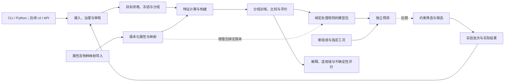

# Cat_AI 总体设计

2026-11-17状态更新：S1-A 和 S1-B 工程交付均已验收，S1-B v4 保留553条、排除40条，完整重放和5,530个逐值索引一致，无事实更正。下一任务为 S2 训练配置、F1/F2 训练及增强预测绑定，R2 比较随 S2/S3 推进。详见 [S1-B验收](../s1_b_acceptance.md)。下文带日期的旧状态保留历史语境。


版本：v0.2；日期：2026-11-13（Asia/Shanghai）。本文将既有需求、架构和最新实施决策汇总为系统设计入口，说明能力边界、模块协作、数据流转和交付顺序。文中的目标结构包含待实现能力；实际完成情况与证据统一查阅[进度](../progress.md)。

需求基准为[项目开发指引](../project_development_guide.md)，近期顺序沿用[ADR-017](../decisions.md#adr-017先完善特征数据与计算再交付可配置训练预测框架2026-11-12)。本文不修改原指引，也不扩大当前任务范围。

## 1. 系统目标与交付边界

系统服务于CO₂加氢制甲醇催化剂研发，长期形成“证据化数据 → 性能预测 → 约束下设计 → 实验验证 → 版本迭代”的研发闭环，支持多材料体系，以及组成、合成工艺和测试工况的联合研究。

当前先交付可以独立运行的预测子系统：研究者管理有来源的数据和物化属性，生成可追溯特征，按论文分组训练和比较模型，保存模型包，再输入完整组成及指定工况进行单条或批量预测。目标暂限CO₂转化率；最终算法和特征方案由比较证据决定，不预先指定ExtraTrees为最终模型。

| 使用场景 | 系统交付 | 阶段边界 |
|---|---|---|
| 导入和检查数据 | 原件留存、结构化事实、质量报告、审核或来源接受证据 | 通过格式治理不代表逐条原文核验 |
| 建立和比较模型 | 特征输入、分组清单、有效配置、逐记录预测、比较报告、模型包 | 工程可运行与科学泛化能力分别验收 |
| 使用已有模型 | 输入组成及工况，逐条返回预测、支持状态和限制 | 支持范围不足时拒绝，不自动补物种或切换模型 |
| 设计新催化剂（后期） | 有边界的候选、制备计划、目标工况、排序依据和约束证据 | 预测分数不等于可合成性或实验成功 |
| 实验反馈（后期） | 计划与实际关联、新数据版本、重训比较 | 实验失败和缺失值保留，不覆盖原计划 |

CO₂转化率提升不能直接代表甲醇产率提升。选择性、收率、STY与稳定性按目标定义及真实覆盖逐步接入。合成工艺是长期正式设计输入；当前来源未提供足够工艺数据，先保留实体和扩展位置，不补造字段。表征数据用于另行建设的DiagnosticModel，未合成配方的DesignModel只能使用设计前可知信息及给定工况。

## 2. 整体架构与模块职责

采用Python模块化单体、SQLite和版本化文件产物。CLI和脚本负责参数与调用，业务规则放在可复用模块；后续UI/API复用同一能力，不另建一套训练或预测逻辑。逻辑模块不等于需要独立服务或新建全部目录。

下图是目标架构，属性库、可配置训练及实验闭环等节点仍有待实现部分，状态见下一表。



| 逻辑模块 | 负责什么 | 输入 → 输出 | 当前基础与待补能力 |
|---|---|---|---|
| 接入与治理 | 适配来源、校验、单位与缺失状态、修订及审核 | 文件/证据 → staged、curated及治理记录 | 已有`sources`、`schemas`、`governance`、导入/修订/审核能力；物化属性适配待补 |
| 数据集管理 | 定义目标口径、准入、冻结和分组 | 治理记录 → 目标快照、资格与划分清单 | 已有`datasets`及快照路径；样品/批次独立性仍待证据 |
| 属性与派生存储 | 属性/映射版本、导入冲突、构建和派生值关联 | 属性原件、映射 → 可查询的固定版本 | 复用`storage`及SQLite；新表、最小迁移与查询待实现 |
| 特征工程 | 固定计算、输入筛选、训练侧拟合及预测变换 | 目标输入、属性版本 → 特征构建清单、矩阵与状态 | `features/pipeline.py`已有R1；物化计算与R2待补 |
| 训练与评价 | 配置校验、分组验证、模型比较与持久化 | 快照、划分、特征及配置 → 报告和模型包 | `modeling/experiments.py`已有默认比较；自定义配置及R2接入待补 |
| 独立预测 | 包校验、同规则变换、单条/批量输出 | 指定模型包＋新输入 → 预测及拒绝原因 | `modeling/predictor.py`已有R1；增强版本须绑定属性与映射 |
| 模型诊断 | 误差分层、解释、适用域和不确定性检验 | 模型及评价数据 → 诊断、局限与模型卡 | 已有I4/I5诊断；不代表R1或增强模型自动具备相同诊断证据 |
| 设计与实验 | 约束候选、排序、批次、反馈和重训比较 | 模型、设计空间、实验结果 → 新证据与新版本 | 有局部筛选接口；正式推荐和闭环后置 |

各模块通过明确的输入清单、版本标识与返回状态衔接，不依赖人工在脚本间复制临时表格。当前[CLI与脚本契约](../api_contracts.md)是已实现入口的依据；新增入口在交付时补充，不把目标架构当作可调用API。

## 3. 数据模型、存储与版本链

### 3.1 事实、属性与派生量分别管理

催化剂事实的主体关系沿用原指南：来源/抽取证据 → 配方 → 制备批次 → 测试 → 性能观测；表征关联制备批次。相同配方可以有多个批次，同一批次可以有多个测试条件，不能把多工况记录解释成多个独立材料。

物化属性作为另一类有来源的数据管理，逻辑身份包含元素或物种、属性定义、单位、来源及版本。物种映射显式说明中心元素计数与适用语义。派生值关联输入记录、父快照、属性/映射版本和算法版本，标明是计算结果，不作为原论文报告值写回。

| 存储位置 | 权威内容 | 版本与更新方式 |
|---|---|---|
| `data/raw/` | 输入文件和属性原件 | 按哈希留存；修订另立版本，不改原件 |
| SQLite | 来源、实体关系、治理/修订/审核；后续属性、映射与派生关联 | 复用现有库；新增表提供最小迁移、幂等和冲突检查 |
| `data/snapshots/` | 固定目标口径及记录内容的证据包 | 当前为不可覆盖JSON；新的催化剂事实生成新快照 |
| 特征构建产物 | 父快照/资格/划分、特征版本、筛选清单、属性引用及覆盖 | 输出新构建；只补属性/派生值不改旧目标快照 |
| `artifacts/reports/` | 划分、有效配置、折归属、逐记录输出和评价 | 新运行新目录，关联输入及实现身份 |
| `artifacts/models/` | 与预处理、输入规则绑定的模型包 | 新训练生成新包；加载检查内容及绑定版本 |

Parquet、模型注册服务和分布式特征平台均非当前必需。先用现有存储完成可查询、可重算和可追溯交付。

### 3.2 两条来源链在特征构建处汇合

```text
催化剂事实：原件 → 导入/修订 → 治理 → 审核或显式来源接受 → 目标准入 → 冻结快照与论文划分
属性与映射：原件/证据 → 校验与治理 → 版本化入库 → 固定属性及映射引用
两者汇合：特征构建与selection → 训练侧拟合/分组评价 → 模型包 → 新输入预测
后期反馈：候选计划 → 实际制备与测试 → 审核 → 新事实版本/新快照 → 新训练运行
```

`staged/curated`表示治理结果，审核或来源接受表示证据状态，两者不可合并。当前TheMeCat使用显式来源接受策略，压力沿用用户绝压假设；这些限制随数据、评价和预测输出保留。新增属性导入不能提升原催化剂记录的核验等级。

所有下游产物都应能追溯到父输入与规则。已有路径的具体字段见[API契约](../api_contracts.md)；后续构建和配置入口补齐对应身份及哈希。Git提交号不充分表示未提交工作区代码，运行需保留实际使用的实现哈希。SQLite与文件当前没有跨介质原子事务，失败可能留下中间产物；不能把半次运行标为成功，也不以覆盖旧目录进行恢复。

## 4. 统一工作流

### 4.1 数据准备与特征构建

先明确每项特征来自已有事实、外部属性导入还是确定计算。催化剂事实沿既有治理及冻结链；属性和映射先完成来源、定义、单位、版本及冲突检查，再正式入库。计算模块使用固定引用，既支持历史训练输入，也支持未来新配方。

组成使用完整来源角色/物种材料mol%；工况使用温度、绝压、H₂/CO₂与质量归一反应物流量。近期增强只加入电负性、共价半径及来源角色统计。具体计量、中心计数、公式和不支持策略集中在[特征方案](../feature_engineering_plan_v0.1.md)，本文不复制公式。

复合物种补充核查沿用[ADR-019](../decisions.md#adr-019复合物种核查与实施边界2026-11-13)：公式解析、来源语义和特征资格分别判定，正式使用经确认的版本化中心映射。组成事实更正走修订及新快照链，不能仅在特征层改写；经确认的多中心或小数计量不自动拒绝，未核实疑点保持隔离。化合物类别仅作独立元数据，本轮F1/F2范围及S1-A→S1-B→S2→S3顺序保持不变，具体任务和验收统一维护在特征方案第2.5节。

固定公式的派生量可以预计算；词表、缩放等从样本学习的处理只能在对应训练折拟合。数据库可以保存特征构建与派生值，但不能用全体数据拟合后的矩阵替代交叉验证中的折内处理。

### 4.2 训练、比较与模型保存

研究者选择目标快照、既定划分、支持的特征预设和模型配置。训练入口检查资格及输入完整性，重建筛选清单，执行训练侧分组评价，按规则选工作组合，再保存报告与绑定模型包。

| 配置种类 | 内容 | 边界 |
|---|---|---|
| 项目配置 | 数据库、目录、治理版本、批次容量 | 沿用现有Settings，不容纳任意训练参数 |
| 特征配置 | 受支持特征集、固定属性/映射版本及规则 | 不能加入目标、DOI或结果文本等泄漏字段 |
| 训练配置（待补） | 模型、合法超参数、seed、DOI折数、数据引用及输出路径 | 独立schema；有效配置保存，未知字段或非法参数拒绝 |
| 预测输入 | 指定模型包、完整组成与工况 | 不修改包内词表、特征或训练超参数；改参数须新训练 |

`baseline_compare`运行固定对照，`custom_train`运行用户合法配置，二者分别记录。当前只交付了R1固定比较和预测，自定义训练尚未实现。

默认使用原train内三折DOI验证，每折重建词表及预处理，以全部OOF记录的论文等权MAE选模。validation用于开发评价，已查看test仅作历史对照。R2特征增益在同子集、同分区、同折及配对算法/参数上比较。全部诊断误差、入口支持率、拒绝原因和共同支持子集分别报告；低支持率不能被平均分数掩盖。

模型包绑定目标定义/单位、输入schema、特征处理、词表、所需缩放器、模型及相关版本/哈希；增强包还绑定属性和映射的固定版本与必要内容。预测不从可变数据库读取“最新属性”后继续沿用旧model_id。解释、适用域和不确定性证据必须对应实际模型及评价数据，不能继承另一次运行的结论。

### 4.3 已有模型预测

加载指定可信模型包并校验 → 检查输入 → 用包内规则计算与变换 → 模型预测 → 每条返回状态及可用值或null。无需重新训练、目标标签、DOI或实验计划。现有调用方式见[独立预测契约](../api_contracts.md#r1-独立预测33)。

合法输入可以返回ok；超出训练范围返回caution及提示；输入非法、未见正含量物种角色、增强属性不支持或输出非法时返回明确不可用原因。输出超出0–100%时保留有限raw_prediction，可用目标值为null；非有限数不进入JSON。模型包加载失败终止调用，批量条目失败逐条保留，不静默丢行或自动降级为其他模型。

范围提示是启发式诊断；当前不等于经验证的适用域或校准区间。模型可加载和预测一致性是工程验收，不能替代独立样品、批次或跨家族泛化验证。

### 4.4 后期设计与实验反馈

E阶段复用预测能力，在明确材料/工艺空间和目标工况下生成并检查候选，补充可制备性、前驱体、设备、成本/风险及对照证据；催化剂设计与固定催化剂的反应条件优化分开运行。候选须保留proposed状态和排序依据，批次默认4槽、最多6槽。

F阶段关联候选计划与实际制备/测试，审核后形成新的数据版本与模型运行，比较固定评价条件下的变化。实际值不覆盖计划，失败结果不丢弃。设备驱动和实时控制另行设计，当前训练预测交付不以设备对接或实验准备为前置条件。

## 5. 一条实施主线与三种编号

项目只沿原A–F路线演进。其他编号表示该路线内的细分或实验设置，不形成平行项目。

| 编号 | 表达什么 | 与整体的关系 |
|---|---|---|
| A–F | 工程骨架、治理、预测、诊断、推荐、实验反馈六类能力 | 全项目长期路线 |
| I1–I5、TheMeCat B0–B4 | 既有增量验收切片、特定数据源接入步骤 | 支撑A–D等能力，保留历史及专项说明 |
| S1-A、S1-B、S2、S3 | 当前预测子系统建设顺序 | S1-A已验收；接续计算、框架与配置、整体验收 |
| R1/R2、F_cond/F_base/F1/F2 | 基础/增强实验预设及其特征集 | 用于模型比较，不代表新增开发阶段 |

| 总体能力 | 当前已有基础 | 后续交付重点 |
|---|---|---|
| A/B：可信数据底座 | 工程骨架、治理、修订、目标资格与冻结 | 当前补属性/映射治理存储；原文核验按既有决策暂缓 |
| C：训练与独立预测 | R1基础特征、默认分组比较、模型包和预测已验收 | 补齐S1物化数据及计算，再完成自定义训练、R2和整体验收 |
| D：评价研究 | 初版诊断可用 | 按实际模型补齐解释及可靠性证据，逐步检验不确定性和适用域 |
| E：约束下设计 | 局部接口 | 有可用模型和约束证据后建设正式候选与批次 |
| F：实验反馈 | 基础数据契约 | 有真实结果后建立计划/实际关联及版本化回灌 |

近期的一个完整交付，是研究者能够准备有来源的特征数据，运行默认或合法自定义训练，检查误差和支持率，再无需重训地加载指定模型完成单条/批量预测。完整交付需要S1–S3剩余验收全部完成；没有分数提升也可以如实交付工程，但不能声称增强有效或跨材料泛化。

**S1-A/S1-B 已验收；下一项为 S2 配置训练和增强预测绑定。** S1-B 已有553条固定特征，不表示 F1/F2 模型性能已验证。之后按共同支持子集和原 DOI 分区推进 R2/S3，详见[特征方案](../feature_engineering_plan_v0.1.md)和[S1-B验收](../s1_b_acceptance.md)。

## 6. 项目管理工作台规划

2026-11-13用户提出Web项目管理工作台规划需求，详细方案见[工作台方案](project_workbench_plan.md)。首版建议提供项目总览、任务与验收、成果索引、决策和文档浏览，采用本地单项目使用方式。方案中的技术栈、管理库、接口和任务编号均为拟议设计，当前处于规划阶段。

工作台通过既有内容ID、版本和哈希关联数据、特征及模型成果，按明确的验收记录维护任务状态。后续运行操作复用现有Python模块，并随对应研发能力交付逐项接入。工作台作为项目支撑能力关联A–F主线，研发侧细化顺序继续由特征方案维护。

## 7. 文档职责与变更方式

推荐阅读顺序：README → 本文了解整体 → progress了解现状 → 当前专项方案执行任务。各文档承担不同问题：

| 文档 | 维护内容 |
|---|---|
| [开发指引](../project_development_guide.md) | 原始需求、科研边界及A–F基准，保留原件 |
| 本总体设计 | 系统目标、模块协作、数据与模型生命周期、整条路线及文档职责 |
| [工作台方案](project_workbench_plan.md) | 项目管理页面、任务与验收、成果索引、存储及分期实施规划 |
| [progress](../progress.md) | 当前完成状态、实际运行证据和唯一的当前下一步；下方保留历史记录 |
| [特征工程与预测方案](../feature_engineering_plan_v0.1.md) | 当前S1–S3的字段、公式、模型/特征预设及细化验收 |
| [TheMeCat专项方案](../themecat_implementation_plan.md) | 数据源语义、来源接受和修订接入，不另定全平台路线 |
| [实施与验收清单](../implementation_amendment.md) | I1–I5及增量验收要求，不另建总架构 |
| [API契约](../api_contracts.md) | 已实现调用、输入输出与失败行为；待实现扩展须显式标规划 |
| [decisions](../decisions.md) | 决策及替代关系；历史决策不因后续实现被改写 |
| [物化属性思路](../phy_chem_features.md)及参考资料 | 候选方法与研究材料，不自动扩大本期范围 |

需求或边界调整先记录明确的用户决策，再同步总体设计及受影响的专项方案；仅完成某个任务则更新progress及接口，不为每次交付重写总方案。发生冲突时，按用户明确指示、需求基准及有效决策核对并修订相关文档；progress中的事实不能被解释为自动修改需求，规划也不能覆盖已有证据。

原指南已包含总体目标和初始架构；本文补齐其与后续决策、实际代码之间的衔接。后续优先维护这份整体视图和当前专项方案，减少继续新增同层级执行方案。
