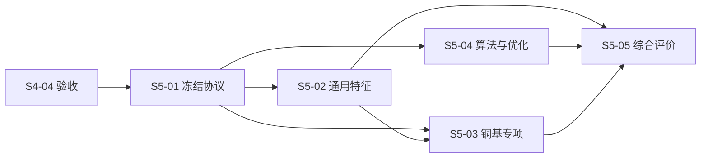

# Cat_AI S5 科研实施计划

2026-11-23（北京时间）。按用户进一步明确的研究定位修订，待登记和实施。保留 [S5 原方案](Cat_AI_S5_plan_and_task_20261123.md)与 [S4 已确认决策](Cat_AI_next_stage_execution_draft_20261120.md#6-已确认的实施口径)供追溯。S5 以本计划约定的数据、评价和任务范围为准。

## 1. 仓库、管理库与上游成果

本地 `main`、本地 `origin/main` 与 GitHub 实时比较均为 `7fb122809e713653b8a4d25a0305ba0ff7fbde1b`。起始工作区无已跟踪文件变更，有六项未跟踪路径，包括传入的 S5 原方案和 WB-16-05 本地验收文件及目录。工作台按 [配置](../configs/workbench.yaml)使用本地 `data/workbench.sqlite`，库受 Git 忽略。以下任务状态来自该库的只读查询。schema 为 8，`quick_check` 通过，外键检查无异常。

| 阶段 | 已有能力和正式状态 | S5 采用方式 |
|---|---|---|
| S1 | S1A-01、S1B-01 均为 `done`。已有来源资格、S1-B v4 的 553 条共同资格、Pauling 电负性和 Cordero 共价半径、中心计数目录、版本化特征快照。 | 沿用属性和物种证据、来源角色和已验收算法。新物种和公式只在新版本内扩展。 [S1-A](s1_a_acceptance.md) · [S1-B](s1_b_acceptance.md) |
| S2 | 六项均为 `done`。F_cond/F_base/F1/F2、配置训练、指定包预测及旧包回归已验收。缺可信逐记录家族标签，既有 A/B1 家族对照按决策跳过。 | 复用特征与包契约。S5 的 A/B1 是显式含 Cu 视图上的训练范围比较。 [S2 集成](s2_02_acceptance.md) · [资格与既有家族对照](s2_03_acceptance.md) |
| S3 | S3-01、S3-02 均为 `done`。R2 默认预设为 F_base/Extra Trees。S3-01 全部开发 OOF 论文等权 MAE 5.373464 个百分点、入口可用 274/454，开发验证可用 28/47。S3-02 验收配置训练、指定包预测、失败路径及重放。 | 保留 R1/R2 包为既有基线。其历史成绩只用于对照背景。 [S3 比较](s3_01_comparison.md) · [端到端验收](s3_02_acceptance.md) |
| S4 | S4-01～04 均为 `done`。S4-01 冻结 Cu 分类与身份台账，S4-02 给出 593 父集、15 条身份未决暂排、578/211 目标视图及 542/211 共同资格视图。S4-03 冻结九组配置、分组和训练内折，交付脚本。S4-04 完成九组内部对照。 | S5 直接复用 S4 的两个共同资格视图和分组流程。每个 S5 划分只从其训练集与训练内折选模。 [S4-01](s4_01_acceptance.md) · [S4-02](s4_02_acceptance.md) · [S4-03](s4_03_acceptance.md) · [S4-04](s4_04_final_report.md) |
| D 与工作台 | D-01～D-03/D-05 有开发诊断，D-04 v2/D-06 已有点预测评价流程，正式独立数据仍待就绪，区间尚未校准。D-07 模型卡正文含问号损坏。正式库含科研 14 项、建设 29 项，无 S5 任务或正式 WB-07 任务。WB-13～15 已完成，WB-16-01～05 已完成，WB-16 父项及 WB-16-06 仍为 `planned`。WB-16-05 本地记录载明 266 项测试通过，全仓 Ruff 仍有既有问题。 | 复用诊断与工作台管理入口。S5-05 交付可读的新模型卡，WB-07 继续作为后续交互建设。 [D-06](d06_evaluation_workflow.md) · [D-07](d07_model_card.md) · [WB-16-05 本地记录](workbench/wb16_05_verification.md) |

### S4-04 九组及正式验收

正式库 `S4-04` 为 `done`，修订 6、验收标准 v1，2026-11-23 09:41（北京时间）留有提交及通过记录。三个必需项分别绑定固定证据清单、铜基比较和适用范围文件版本。正式库六项 S4-04 成果可用，主计划核对记录存在。只读复算固定清单中 141 个文件的 SHA-256，全部匹配。九个运行锁的源码散列与当前源码匹配，本地运行环境与抽查的 EXP-01/42 锁一致。历史逐条指标复算和模型重放由审计 v3 提供。 [正式登记逻辑](../scripts/accept_s4_04.py) · [证据清单](../artifacts/reports/s4-04-final-20261123-v1/evidence-sha256.json) · [审计 v3](../artifacts/reports/s4-04-audit-20261120-v3.json)

| 实验 / 划分种子 | 选中特征 | 测试记录等权 MAE（百分点） | 入口可用 |
|---|---|---:|---:|
| EXP-01 DOI / 42 | F_base | 5.451 | 88/110 |
| EXP-01 DOI / 43 | F_base | 9.574 | 59/104 |
| EXP-01 DOI / 44 | F_base | 5.679 | 88/108 |
| EXP-02 随机 / 42 | F_base | 2.026 | 105/108 |
| EXP-02 随机 / 43 | F_base | 2.663 | 105/108 |
| EXP-02 随机 / 44 | F_base | 2.553 | 106/108 |
| EXP-03 随机铜基投影 / 42 | F2 | 2.469 | 27/30 |
| EXP-03 随机铜基投影 / 43 | F_base | 3.553 | 39/41 |
| EXP-03 随机铜基投影 / 44 | F_base | 3.174 | 43/45 |

固定 Extra Trees 参数下，训练侧五折按记录等权 OOF MAE 选一个特征后留出评分一次。八组选 F_base。EXP-01/43 可用子集 MAE 为 13.680，提示分母改变足以改变结论。随机和 DOI 实验的成员与来源不同，差值无法识别划分方式的单因素影响。铜基配对差值为 +0.044、−0.106、−0.107 个百分点，种子 42 同时改变特征，尚无稳定增益或等效证据。铜基冻结目标视图及 S4 铜基训练的最高温度均为 553 K。来源接受、绝压假设和小样本来源集中仍是限制。 [对照分析](s4_04_comparison_analysis.md) · [适用范围](s4_04_applicability_coverage.md)

## 2. 研究定位与评价协议

S5 用已有文献数据深化通用与铜基催化剂特征工程，比较机器学习算法、研究有限超参数优化，并建立可复现的 CO₂ 转化率综合评价方法。新催化剂外推、未见组分预测和跨材料体系泛化属于长期研究方向，本阶段在适用范围与局限中记录。阶段范围聚焦设计前可获得的输入，主归 C、由 B/D 支撑。正式接入新来源、扩展目标、实验后表征建模、E/F 配方寻优和反馈，以及 WB-07 界面交付留待各自阶段。

1. **直接复用共同资格母池。** 全体系 542 条、铜基 211 条。S4 历史测试记录仍在共同资格内，按本轮冻结划分获得训练或测试角色；进入本轮训练的原始观测可用于本轮训练和训练内交叉验证。S4 已发布评分和派生结果仅作只读历史证据，不能充当 S5 候选选择依据。冻结母池之外的 15 条身份未决记录维持原纳排。 [S4-02](s4_02_acceptance.md) · [S5-01](s5_01_execution.md)
2. **分组随机 80/20 为主。** 整组分配已确认的重复实验身份，训练内五折，每折独立拟合预处理。配方签名用于覆盖和误差分层。DOI 分组能力继续保留，可按预登记附加单次 80/20 和训练内五折对照；DOI 对照及嵌套交叉验证均非阶段验收要求。铜基配对复用全体系划分及其铜基投影，实际成员数和五折可行性逐个核对。
3. **训练选择与留出评分分开。** 每个划分以该训练集及其五折结果选择特征、算法和超参数。预先锁定计划、候选、分母、选择规则和种子，保存训练侧决策、模型及散列，再单独评分。多个种子用于敏感性，成员可重叠，各自从训练侧独立选模，禁止把某个种子的测试成绩反馈给其他种子或后续候选。S5 留出成绩为既有 TheMeCat 上的内部评估；D-06 独立外部评价等待合格新来源。
4. **统一比较口径。** 报告记录等权 MAE、RMSE、论文等权 MAE、覆盖和共同可用配对误差。特征候选的可计算性与有效入口预测分开记录，硬拒绝保留状态及空预测。性能受控比较使用同一个划分、训练成员及适用的共同资格；全母池覆盖保留原分母。材料 mol%、来源角色和名义计量沿用来源口径。

## 3. 任务、实验矩阵与检查点

| 任务 | 实施计划 | 前置 | 交付关口 |
|---|---|---|---|
| S5-01 科研协议与基线诊断 | [S5-01 执行计划](s5_01_execution.md) | S4-04 | M0，基线、分组随机 80/20 与训练五折、选择和评分规则冻结 |
| S5-02 通用催化剂特征工程 | [S5-02 执行计划](s5_02_execution.md) | S5-01 | M1，特征公式、覆盖、同折消融、预测重载 |
| S5-04 机器学习算法与优化 | [S5-04 执行计划](s5_04_execution.md) | S5-01 | M1 固定参数算法对照，M2 折内有限搜索 |
| S5-03 铜基专项特征研究 | [S5-03 执行计划](s5_03_execution.md) | S5-01、S5-02 | M2，材料证据与配对，或经确认的范围缩减及缺口 |
| S5-05 综合模型评价与收口 | [S5-05 执行计划](s5_05_execution.md) | S5-02、S5-03、S5-04 | M3，预测误差、稳定性、特征贡献、适用范围、证据索引及模型卡 |

| 实验 | 研究变量 | 固定项与比较方式 |
|---|---|---|
| S5-E01 | F_cond/F_base/F1/F2/F3-P/F3-H/F3-I | 固定 S4 Extra Trees 参数，同一主划分、五折和共同资格；训练 OOF 比较特征 |
| S5-E02 | Extra Trees、RF、一种梯度提升及 Dummy/Ridge 参照 | 固定 F_base，同成员同折；先比较固定参数，再在训练五折内有限寻优 |
| S5-E03 | 铜基 F_base、通用特征及该通用特征加 F_Cu | 固定 Extra Trees 和铜基训练投影；核对资格与训练五折覆盖 |
| S5-E04 | A/B1 训练范围，B1/B2 专属特征 | 固定算法、参数及同一个铜基测试成员集合；训练及折按全体系投影 |
| S5-E05 | 少量特征×算法组合及综合评价 | 用预登记目录和训练 OOF 锁定基线、候选及报告臂，留出进行一次性内部评价 |

## 4. 模块与接口落位

| 用途 | 复用 | 拟新增或扩展的契约 |
|---|---|---|
| 数据、身份与折 | `datasets/research_prepare.py`、`research_split.py`、`split.normalize_doi` | 沿用相同视图、`partition` 及冻结清单格式。为 S5 建立新配置、成员与投影对账，记录历史留出重叠 |
| 特征 | `features/pipeline.project`、`physchem`、`enhanced`、`stoichiometry`、特征目录 | 新 F3/Cu transformer，向量/字段顺序、特征版本和属性目录绑定，逐条资格及状态。无合法向量时序列化空预测，与可编码域外分别记录 |
| 训练 | `modeling/research_training.py`、`config.py`，旧特征与估计器 | 扩充 S5 特征/估计器注册和参数校验，用现有候选清单承载受限参数组。保留 S4 v1 配置读写和重放语义，必要时仅对新增配置做最小版本区分 |
| 执行与评分 | `modeling/research_preflight.py`、`research_run.py`、`experiments.py`、`scripts/run_research_experiment.py` | 复用 `preflight/train/train-batch/score` 及固定锁。调用方读取冻结快照做完整性校验，训练只消费训练成员目标；S5 如需加固，在调用训练时仅传训练记录和目标定义元数据。增量覆盖空预测与分母，失败和重试写入新位置 |
| 解释和登记 | D 系列脚本、`workbench` 管理服务 | 同折适用域与解释报告、可读模型卡、固定成果版本；复用原有任务、路线、计划、模型运行与审查对象 |

后续实验配置放 `configs/s5/`，研究产物放 `artifacts/reports/s5-<task>-<tag>/`，冻结候选包放 `artifacts/models/s5-<tag>/`。每次运行有逻辑实验 ID、尝试 ID、版本和不可覆盖的输出。五份执行文件沿现有 `docs/s2_implementation_plan.md`、`docs/s3_02a_execution.md` 的平铺组织。报告路径和主计划文件分别登记，固定验收成果以实际生成的版本为准。

M0 用现有入口核对分区、五折和训练／评分边界。通过后 S5-02 和 S5-04 并行扩展特征和算法，分别验证其候选接入同一入口，S5-03 复用 S5-02 的特征契约。S4 运行锁对源码和环境做严格校验，历史回放使用原提交和锁定环境。S5 记录自己的源码、依赖和输入版本，使用新输出路径。

## 5. 工作台登记和科研路线图

建议批准后一次登记五个同层科研任务，只启动 S5-01。现有任务有 `milestone` 和依赖，schema 8 没有任务父 ID。用 `milestone="S5"` 聚合，执行清单编号留在五份主计划文件，S5-05 承接综合验收。路线图使用现有 C 根的 S5 分支，D/B 根提供跨阶段引用。路线节点父子关系由现有 `research_node.parent_id` 表达。

### S5 特征工程与模型评价

这一级标题拟作为 C 下新增 `cat-ai:task-branch:S5` 的唯一来源章节，来源为本文件及审批后 SHA-256。节点排序取 C 分支下一个可用顺序值。五个任务的 `primary_stage` 为 C，各有一个主节点链接。

| 任务 | 工作台优先级 | `stages` 与引用节点 | 主计划章节 `section_locator` |
|---|---|---|---|
| S5-01 | high | B/C/D，引用 B、D 根 | S5-01 科研协议与基线诊断 |
| S5-02 | high | B/C，引用 B 根 | S5-02 通用催化剂特征工程 |
| S5-03 | normal | B/C/D，引用 B、D 根 | S5-03 铜基专项特征研究 |
| S5-04 | high | C | S5-04 机器学习算法与优化 |
| S5-05 | normal | C/D，引用 D 根 | S5-05 综合模型评价与收口 |

1. **部署前。** 复核 S4-04 已通过、五个任务 ID 与节点 ID 可用、审批版文档哈希与唯一标题匹配。建立正式库一致性备份及工作区文件清单，按 [S4 登记](../scripts/register_s4_03.py)和[备份恢复](../src/catalyst_ai/workbench/backup.py)在副本演练。核对请求 ID、修订号、失败回滚、重复部署和恢复结果。
2. **文档与任务。** 以 `index.register/scan` 注册总计划 `S5-research-plan` 和各 `S5-0X-execution-plan`；以 `plans.save_document_purpose` 登记 `research_plan` 与 `execution_plan`。用 `service.create_task/add_dependency` 写目标、交付、必需验收项及上表依赖，`category=research`。审查负责人、计划日期按确认值登记。每项以 `plans.save_task_plan_reference` 登记 `S5-0X-primary-plan`，指向其文件、表中确切标题、`purpose=execution_plan,is_primary=1`，再调用 `verify_task_plan_reference` 核对哈希。
3. **路线与进展。** 用 `research_nodes.save_research_node/save_task_node_link` 维护 C 分支与 B/D 引用。用 `service.transition` 将 S5-01 从 `planned` 推到 `ready`，授权开工再到 `in_progress`；其余维持 `planned` 至前置和科研门槛满足。按需用 `category_context` 写科研焦点和近期安排。从 `/roadmap` 树/画布、科研任务列表和 `/tasks/{id}` 验证往返与进展，主计划从 `/tasks/{id}/plans/{reference_id}` 定位章节。
4. **成果与验收。** 进展写任务状态/历史，技术问题用既有科研问题记录关联任务。运行产生后通过 `model_runs.save` 绑定任务 ID 与固定成果版本。非运行类报告可加一个 `purpose=acceptance,is_primary=0` 的已核对章节引用，让任务详情直接打开报告，并用验收检查项固定 `evidence_id + SHA-256`。当前验收历史展示版本 ID，固定文件走现有成果详情或 `/artifacts/{artifact_id}/download/{version}`。在副本和正式库分别检查浏览路径、固定版本、无重复条目、`quick_check` 和外键。由现有 `submit_review/accept_review` 记录结论并改变完成状态。

## 6. 开工后的冻结项

| 冻结项 | 拟定做法 |
|---|---|
| 划分与比较阈值 | S5-01 预先确定主划分、稳定性复运行种子、报告臂、共同支持下限、覆盖护栏与有实际意义的 MAE 差值。铜基沿用 S4 的探索性就绪核查，核对 211 条视图实际投影和资格收缩 |
| 特征与算法 | 首版用已审查的属性和目录；先 RF，验证 XGBoost 依赖后决定是否采用。若环境不适配，在评分前确认一种 scikit-learn 提升算法或记录缩减 |
| 登记与审查 | 待授权登记五项、启动 S5-01，确认负责人及审查人；负结果和有证据支持的局限可作为科研结论 |
