# S1–S5 CO2 转化率模型训练结果与科研复盘
> **2026-11-25 专项诊断更新：** 在同一留出记录上加入组成信息，三个种子的 MAE 分别改善 0.118、0.149、0.135 个百分点；铜基分层未显示同向收益。严格限定同 DOI、四项工况一致后，每种子只有 3–4 组至少三个不同配方，排序结果波动很大，尚不能证明模型具备可靠的新材料筛选能力。实测转化率 ≥20% 的共同可用样本每种子仅 6–10 条，ET 平均残差均为负；参见文末专项诊断。该阈值和分组为观察后探索。

2026-11-25｜依据已冻结的实验和逐条预测；误差单位均为转化率百分点。

## 摘要

S5 主模型 F_base / Extra Trees 在三个分组随机留出划分中，可用预测 MAE 为 2.072–2.303、RMSE 为 3.107–3.522、R² 为 0.844–0.904，覆盖率 105–107 / 108。S4 更严格的 DOI 留出全体诊断 MAE 为 5.451–9.574，表明新文献泛化存在明显困难。两类划分的成员和来源不同，差值不能单独归因于划分方法。已有留出数据曾被观察，所有结果均为内部研究评价，尚无独立外部验证。

物化特征和铜基专属特征未表现出稳定增益；三种子训练侧选择规则最终保留基础树模型。模型适合训练数据覆盖范围内的探索性排序和提出待实验验证的候选，不能仅凭数值预测确认新配方，更不能视作外部验证过的筛选工具。

## 数据、目标与评价口径

源表 821 行；S4 冻结 593 条、37 DOI、141 个组成签名，其中 Cu 基 211 条（16 DOI）、非 Cu 382 条。铜基包括 207 条 Cu 物种及 4 条 La–Mn–Cu 氧化物；来源角色不等同于真实活性位。CO2 转化率为入口与出口 CO2 摩尔流量差除以入口量，单位 %。S1 共同资格为 553 条；S4/S5 进一步采用 542 条共同母池，不能把以上规模混为同一训练集。详见 [S4 数据审计](来源/artifacts/reports/s4-01-20261120/profile.json) 与 [S3 数据和划分](来源/docs/s3_01_comparison.md)。

S3 R1 为训练/开发验证/历史测试 493/47/53；R2 为 454/47/52，按 DOI 分组，训练内三折 DOI CV。S4 随机 434/108；DOI 划分种子 42、43、44 的训练/留出分别为 432/110、438/104、434/108；铜基训练/留出分别 181/30、170/41、166/45。S5 全体系各种子均 434/108、训练内五折，按身份组划分；铜基分别 170/41、162/49、166/45。分组随机允许同一 DOI 同时出现于训练和留出，不能代表新文献。不同种子训练成员高度重叠，不是独立重复。

S4 全体温度 433–673 K（中位数 523 K），绝压 0.4–60 bar（中位数 30 bar）；S5 主种子训练为 433–673 K、0.4–50 bar、H₂/CO2 3–5、质量归一流量 0.87–40 NL/g_cat/h。铜基视图温度最高 553 K。压力沿用数据集绝压假设；区间内也不保证组合被充分覆盖。来源未逐篇核实。目标分布下图使用 S5 主种子可用留出记录，并非全母池分布。

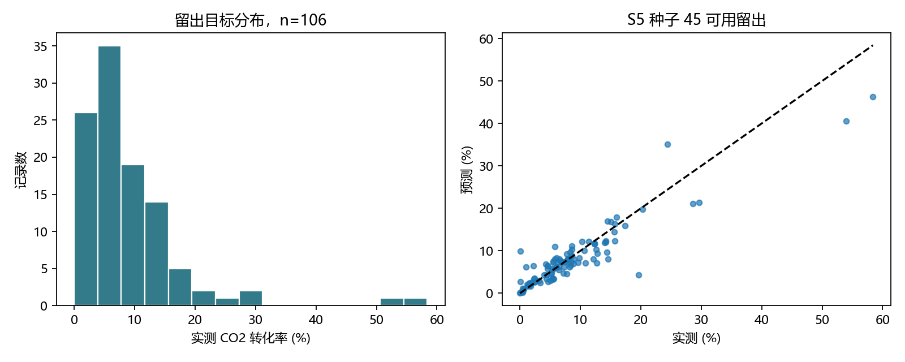

## 多种子模型表现

S5-E05 基础模型，入口可用（ok/caution），OOF 为训练集五折折外预测，留出各 108 条；MAE、RMSE、R²在各自可用集合计算。

| 种子 | OOF 可用/总数 | OOF MAE | OOF RMSE | OOF R² | 留出可用/总数 | 留出 MAE | 留出 RMSE | 留出 R² | DOI 等权 MAE |
|---|---:|---:|---:|---:|---:|---:|---:|---:|---:|

| 45 | 426/434 | 2.328 | 3.539 | 0.851 | 106/108 | 2.085 | 3.483 | 0.844 | 2.387 |

| 46 | 425/434 | 2.294 | 3.656 | 0.837 | 107/108 | 2.072 | 3.107 | 0.887 | 2.265 |

| 47 | 428/434 | 2.207 | 3.617 | 0.816 | 105/108 | 2.303 | 3.522 | 0.904 | 1.989 |

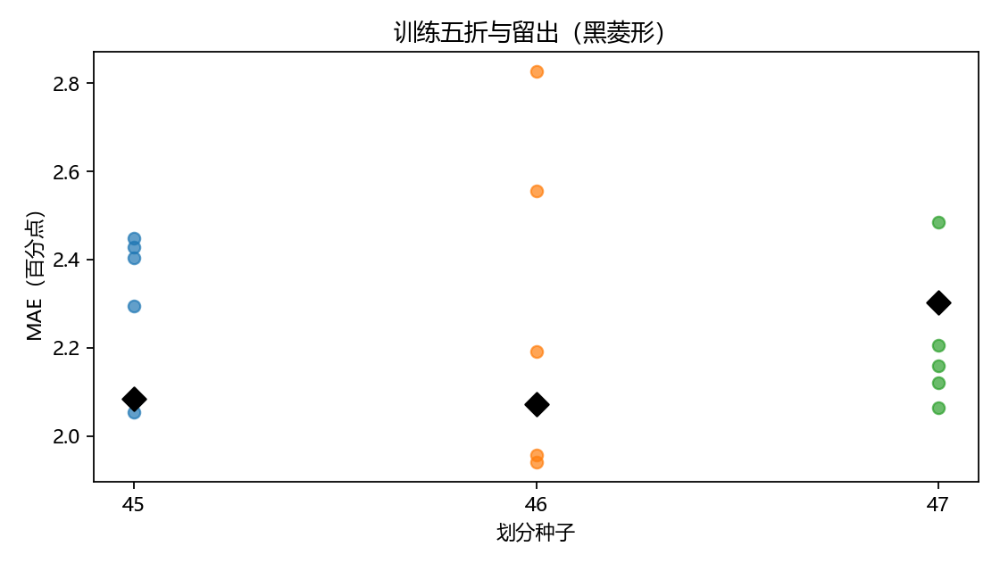

OOF 不是训练集拟合内误差；它与留出误差接近并不能证明不存在过拟合。多次实验使用同一母池并观察过留出，存在研究选择性适配风险。

## 特征方案

F_cond 为温度、绝压、H₂/CO2 比及质量归一流量 4 项；F_base 再加来源角色×物种的材料 mol% 列，宽度由训练词表决定；F1 再加活性角色总量、正含量物种数、电负性和共价半径均值 4 项；F2 再加载体同类 4 项及活性–载体两属性差，共较 F_base 增 10 项。F3-P 用角色元素组成和物化分布替代物种词表，F3-H 将物化材料块加入 F_base，F3-I 在 P 基础上加入角色间差、比例及分布。F3 和 F_base 的总列数随词表、适用标志而变，应以各运行特征清单为准；公式见 [描述符字典](来源/artifacts/reports/s5-02-e01-seed45-range-v2/descriptor_dictionary.md)。Cu 块以材料名义 mol%、Cu 中心量及同角色 Cu/Zn、Cu/Zr、Cu/Al 比及适用标志描述，非实测分散度或活性位。

下表为 S5-02 固定 Extra Trees、同种子同成员同折，各臂各自可用留出集；不同覆盖意味着表内数值不能直接当作配对差值。

| 种子 | 特征 | 可用/108 | MAE | RMSE | R² |
|---|---|---:|---:|---:|---:|

| 45 | F_base | 106/108 | 2.085 | 3.483 | 0.844 |

| 45 | F_cond | 108/108 | 2.226 | 3.481 | 0.847 |

| 45 | F1 | 106/108 | 2.215 | 3.673 | 0.827 |

| 45 | F2 | 106/108 | 2.196 | 3.617 | 0.832 |

| 45 | F3-P | 108/108 | 2.232 | 3.742 | 0.824 |

| 45 | F3-H | 106/108 | 2.166 | 3.613 | 0.832 |

| 45 | F3-I | 108/108 | 2.323 | 3.866 | 0.812 |

| 46 | F_base | 107/108 | 2.072 | 3.107 | 0.887 |

| 46 | F_cond | 108/108 | 2.210 | 3.259 | 0.876 |

| 46 | F1 | 107/108 | 2.097 | 3.119 | 0.886 |

| 46 | F2 | 107/108 | 2.124 | 3.143 | 0.885 |

| 46 | F3-P | 108/108 | 2.229 | 3.306 | 0.872 |

| 46 | F3-H | 107/108 | 2.134 | 3.161 | 0.883 |

| 46 | F3-I | 108/108 | 2.226 | 3.325 | 0.871 |

| 47 | F_base | 105/108 | 2.303 | 3.522 | 0.904 |

| 47 | F_cond | 108/108 | 2.554 | 3.814 | 0.885 |

| 47 | F1 | 105/108 | 2.202 | 3.374 | 0.911 |

| 47 | F2 | 105/108 | 2.181 | 3.359 | 0.912 |

| 47 | F3-P | 108/108 | 2.270 | 3.451 | 0.906 |

| 47 | F3-H | 105/108 | 2.179 | 3.373 | 0.912 |

| 47 | F3-I | 108/108 | 2.298 | 3.544 | 0.901 |

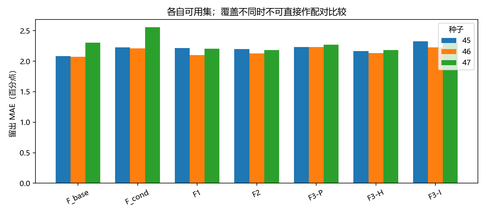

严格共同可用集的 F3-P − F_base MAE 差为 +0.0747、+0.1107、−0.0973；F3-H − F_base 为 +0.0816、+0.0626、−0.1239。S3 的 DOI 三折 R2 共同子集 F1/F2 相对 F_base 的论文等权 OOF MAE 分别增加 0.558/0.514。S5-02 训练侧分别选择 F1、F_base、F_base，而 S5-E05 的组合训练规则三种子都保留 F_base/ET；两者选择空间不同，不矛盾。

Cu 全体系与专属训练模型的共同留出配对差 B1−A 为 +0.0436、+0.0073、−0.0330；加 Cu 块 B2−B1 为 +0.0285、+0.0692、+0.0084，n=39、49、44。Cu/Zn 同角色可算 85/211，Cu/Zr、Cu/Al 为 0/211，名义比依赖来源角色与数据口径。证据支持的是“本次未见稳定增益”，不是证明描述符无物理作用。可能原因包括小样本、特征与已有组成冗余、角色与真实活性位不一致、缺少分散度和反应前后表征，以及来源/工况混杂；这些均是待检验假设。

## 算法与参数

S5-04 固定 F_base：ET 和 RF 均 100 树、叶最小 2、最大特征 1、深度不限；Gradient Boosting 100 树、深度 3、学习率 0.1；Dummy 预测均值；Ridge α=1。每种树的有限搜索另试两组，三个种子固定参数在对应训练共同集均优于其备选；不是穷举最优。S5-E05 后续实际加入 XGBoost，固定组 100 树、深度 3、学习率 0.1，并给 ET、RF、XGB 各三组预算、F_base 与训练侧选中的 F3-P 组合。S5-04 本身没有 XGB，不能混写。

下表为 S5-04 五算法各种子严格共同可用集合，故每行的 MAE、RMSE、R²使用同一成员；覆盖则为该臂各自可用数/108。OOF 为五算法训练共同可用集合。

| 种子 | 算法 | OOF共同n | OOF MAE | OOF RMSE | OOF R² | 留出共同n | 留出 MAE | 留出 RMSE | 留出 R² | 留出覆盖 |
|---|---|---:|---:|---:|---:|---:|---:|---:|---:|---:|

| 45 | extra_trees | 389 | 2.487 | 3.688 | 0.842 | 91 | 2.181 | 3.573 | 0.844 | 106/108 |

| 45 | random_forest | 389 | 2.502 | 3.653 | 0.845 | 91 | 2.170 | 3.599 | 0.841 | 106/108 |

| 45 | gradient_boosting | 389 | 2.684 | 3.763 | 0.836 | 91 | 2.263 | 3.505 | 0.849 | 99/108 |

| 45 | dummy | 389 | 6.106 | 9.352 | -0.014 | 91 | 5.329 | 9.112 | -0.017 | 106/108 |

| 45 | ridge | 389 | 4.077 | 6.422 | 0.522 | 91 | 3.901 | 6.372 | 0.503 | 93/108 |

| 46 | extra_trees | 391 | 2.424 | 3.785 | 0.829 | 95 | 2.186 | 3.235 | 0.880 | 107/108 |

| 46 | random_forest | 391 | 2.550 | 3.917 | 0.817 | 95 | 2.149 | 2.935 | 0.901 | 107/108 |

| 46 | gradient_boosting | 391 | 2.676 | 3.728 | 0.835 | 95 | 2.346 | 3.325 | 0.873 | 104/108 |

| 46 | dummy | 391 | 5.920 | 9.198 | -0.007 | 95 | 5.949 | 9.487 | -0.036 | 107/108 |

| 46 | ridge | 391 | 3.992 | 6.467 | 0.502 | 95 | 4.092 | 5.921 | 0.597 | 95/108 |

| 47 | extra_trees | 390 | 2.273 | 3.622 | 0.819 | 100 | 2.397 | 3.606 | 0.901 | 105/108 |

| 47 | random_forest | 390 | 2.410 | 3.617 | 0.819 | 100 | 2.482 | 3.504 | 0.906 | 105/108 |

| 47 | gradient_boosting | 390 | 2.603 | 3.918 | 0.788 | 100 | 2.471 | 3.483 | 0.907 | 103/108 |

| 47 | dummy | 390 | 5.676 | 8.556 | -0.011 | 100 | 6.854 | 11.623 | -0.033 | 105/108 |

| 47 | ridge | 390 | 3.817 | 6.148 | 0.478 | 100 | 4.702 | 7.743 | 0.542 | 100/108 |

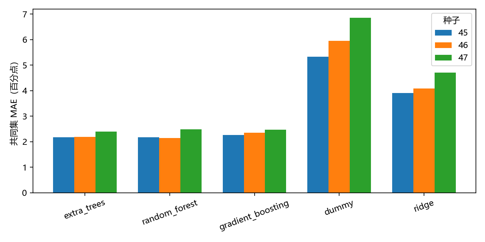

S5-E05 的 18 臂严格共同留出集 100、100、102 条：固定 ET MAE 分别 2.193、2.187、2.367，固定 XGB 为 2.276、2.419、2.420。训练严格共同集分别 412、412、410 条，种子 45 固定基线距最低 MAE 0.0922，其余两种子为 0；按事先规定 0.1 平局规则保留较简单的固定基线。R² 未用于选择，并非各指标排序一致：例如种子 45 的 S5-04 共同留出上 Gradient Boosting 的 R² 高于 ET，而其 MAE 更差；R²受同集目标方差与大误差影响。完整 18 臂所有参数及训练/留出指标见 [E05 逐臂指标](来源/artifacts/reports/s5-05-e05-20261124-v1/metrics.json)。

## 泛化与解释

S4 DOI 分组全体诊断 MAE 依种子为 5.451、9.574、5.679；随机分组为 2.026、2.663、2.553。相同种子偶然共同留出记录上 DOI/随机分别 5.677/2.672（31 条）、7.953/4.066（24 条）、6.934/2.351（26 条）。训练成员、论文、配方及工况同时变化，不能将差异归为单一原因。DOI 种子 43 一篇文献 22 条贡献 66.4% 的绝对误差，且有流量越界警示；来源和配方同时改变，不能断定越界导致大误差。未见配方、跨材料族和独立实验室的可靠性尚无足够受控证据；未见物种/角色还可能被入口拒绝。

训练五折联合置换导致 MAE 增量：组成块种子 45/46/47 为 4.546/4.755/4.684，工况块为 3.048/2.977/3.058。说明两块均被模型利用；置换可产生不现实组合、相关变量共享贡献，数字不能解释为独立因果效应。以下为 S5-02 种子 45 最终拟合模型的树分裂重要性，属于模型内统计，不是催化机理。

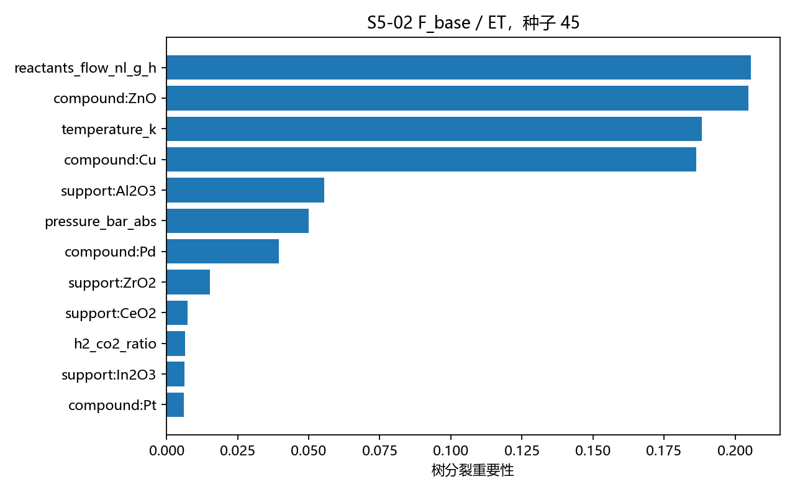

| 特征 | 分裂重要性 |
|---|---:|

| reactants_flow_nl_g_h | 0.2056 |

| compound:ZnO | 0.2047 |

| temperature_k | 0.1882 |

| compound:Cu | 0.1864 |

| support:Al2O3 | 0.0554 |

| pressure_bar_abs | 0.0499 |

| compound:Pd | 0.0396 |

| support:ZrO2 | 0.0152 |

| support:CeO2 | 0.0074 |

| h2_co2_ratio | 0.0065 |

| support:In2O3 | 0.0064 |

| compound:Pt | 0.0060 |

## 误差与实例

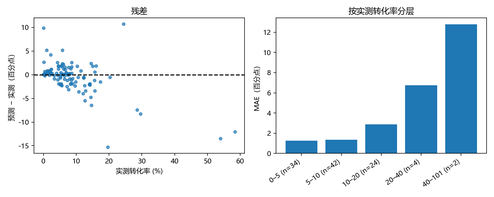

主种子 45，106 条入口可用留出；残差定义为预测减实测。分层样本量小的柱不宜比较为稳定体系差异。

| 转化率区间 (%) | n | MAE | 平均残差 |
|---|---:|---:|---:|

| [0, 5) | 34 | 1.251 | 0.992 |

| [5, 10) | 42 | 1.347 | -0.071 |

| [10, 20) | 24 | 2.888 | -2.107 |

| [20, 40) | 4 | 6.748 | -1.398 |

| [40, 101) | 2 | 12.775 | -12.775 |

| 样本 ID | DOI | 实测 | 预测 | 绝对误差 |
|---|---|---:|---:|---:|

| b267b491d76f4aeca7b3756117185729:1 | 10.1039/c2cy20604h | 0.40 | 0.43 | 0.03 |

| 3e3ab40574204713b0d69503b3f3f395:1 | 10.1016/j.cej.2024.149370 | 6.00 | 6.04 | 0.04 |

| a2821fdf2d824adca186974f8e60ce86:1 | 10.1016/j.jes.2023.05.010 | 0.10 | 0.16 | 0.06 |

| 9e47cf0448454d948a5bf1048e0467a0:1 | 10.1016/0926-860x(95)00049-6 | 19.60 | 4.27 | 15.33 |

| ca875727ddc64b428c611e6b48ca1fae:1 | 10.1021/acs.iecr.7b01464 | 54.00 | 40.50 | 13.50 |

| c61031e74b03403bb4a961659e84ebd1:1 | 10.1021/acs.iecr.7b01464 | 58.40 | 46.35 | 12.05 |

个例可能反映训练邻域密度、配方与工况差异、测量噪声或来源口径，但仅凭这些预测不能判定原因。种子 45 的 DOI `10.1016/0926-860x(95)00049-6` 可用留出 2 条 MAE 12.597，样本太少，不代表该体系的普遍误差。逐 DOI 指标与状态见 [E05 metrics](来源/artifacts/reports/s5-05-e05-20261124-v1/metrics.json)。温度和催化体系逐条关联需要再核对样本表与记录身份；本报告不把未核实的分层推测写成结果。

## 科研结论与建议

当前最可靠的结论是：模型在既有数据分布内有可观的内部预测能力，但跨文献误差显著更大且覆盖下降；单一 MAE 或 R² 不能代表新配方性能。基础组成和工况编码有效，有限搜索、物化扩展及铜基专属块尚未带来稳定可复现的替代优势。瓶颈可能包括文献来源集中、配方与工况共变、名义组成不能描述真实活性结构、来源测量条件异质，以及未知物种支持不足；这些原因需通过新数据检验。

建议优先：① 锁定新 DOI 和独立实验室数据，记录覆盖率、记录及 DOI 等权误差；② 设计按配方/材料族分组的预注册测试，区别插值与外推；③ 核验原文、压力与单位，增加重复实验和误差标注；④ 对代表性铜基配方加入实测负载、分散度、表面结构并在同成员、同折上消融；⑤ 建立校准的不确定度与适用域，先在独立数据上检验，再用于筛选。候选必须经过实验复核，树模型分散度不等于已校准预测区间。

## 原始证据

- [S4 DOI 与随机划分、铜基配对分析](来源/docs/s4_04_comparison_analysis.md)；[S4 覆盖审计](来源/docs/s4_04_applicability_coverage.md)。
- [S5-02 全特征消融与逐折结果](来源/artifacts/reports/s5-02-e01-seed45-range-v2/ablation_analysis.json)；[S5-03 铜基审计](来源/artifacts/reports/s5-03-m2-audit-20261124/report.md)。
- [S5-04 算法评价](来源/artifacts/reports/s5-04-e02-20261124-v1/final-review-report.md)；[S5-E05 完整报告](来源/artifacts/reports/s5-05-e05-20261124-v1/final_report.md)、[逐条留出预测](来源/artifacts/reports/s5-05-e05-20261124-v1/run-45/holdout/predictions.json)、[五折块置换](来源/artifacts/reports/s5-05-e05-20261124-v1/fold-permutation.json)。

## 专项诊断：材料识别与筛选（观察后分析）

以下均重新计算自 S4 冻结视图、原始记录审计与 S5 已保存留出预测；不重新训练。三种子成员重叠，同文献记录相关，结果不是独立外部验证。所有分组、阈值、相似度与排序评价均为事后探索，不能作显著性或部署准确率保证。

### 共同母池分布与特征宽度

S4 全体系共同资格 542 条、铜基视图 211 条；铜基是全体系的子集，不是额外样本。配方由来源角色、物种及 mol% 的完整列表定义，仍不能等同于实测结构、独立制备批次或催化体系族。

| 范围 | 记录 | DOI | 名义配方数 | 转化率最小 | 中位 | P75 | 最大 |
| --- | --- | --- | --- | --- | --- | --- | --- |
| 全体系 | 542 | 36 | 135 | 0.0 | 6.38 | 11.28 | 59.6 |
| 铜基 | 211 | 16 | 47 | 0.1 | 8.3 | 15.3 | 59.6 |
| 非铜基 | 331 | 22 | 88 | 0.0 | 5.43 | 9.18 | 22.5 |

| 范围 | 变量 | n | 最小 | P25 | 中位 | P75 | 最大 |
| --- | --- | --- | --- | --- | --- | --- | --- |
| 全体系 | 温度 K | 542 | 433.0 | 503.0 | 523.0 | 548.0 | 673.0 |
| 全体系 | 绝压 bar | 542 | 0.4 | 20.0 | 30.0 | 40.0 | 50.0 |
| 全体系 | H2/CO2 | 542 | 1.0 | 3.0 | 3.0 | 3.8 | 5.0 |
| 全体系 | 流量 NL/g/h | 542 | 0.87 | 4.27 | 8.8 | 18.0 | 51.84 |
| 铜基 | 温度 K | 211 | 433.0 | 493.0 | 513.0 | 523.0 | 553.0 |
| 铜基 | 绝压 bar | 211 | 0.4 | 10.0 | 30.0 | 30.0 | 50.0 |
| 铜基 | H2/CO2 | 211 | 1.0 | 3.0 | 3.0 | 3.8 | 3.8 |
| 铜基 | 流量 NL/g/h | 211 | 0.87 | 3.17 | 7.5 | 10.6 | 18.0 |

全体系来源活性角色中出现次数最高的物种（多标签，可重叠）：Cu 207 条、Pd 129 条、In2O3 93 条、Zn 86 条、ZnO 85 条、ZrO2 45 条、Ir 34 条、Pt 20 条、BaCO3 20 条、Cr2O3 20 条。

铜基来源活性角色中出现次数最高的物种（多标签，可重叠）：Cu 207 条、ZnO 85 条、BaCO3 20 条、K2CO3 20 条、CeO2 6 条、LaMn0.1Cu0.9O3 1 条、LaMn0.7Cu0.3O3 1 条、LaMn0.3Cu0.7O3 1 条、LaMn0.5Cu0.5O3 1 条。

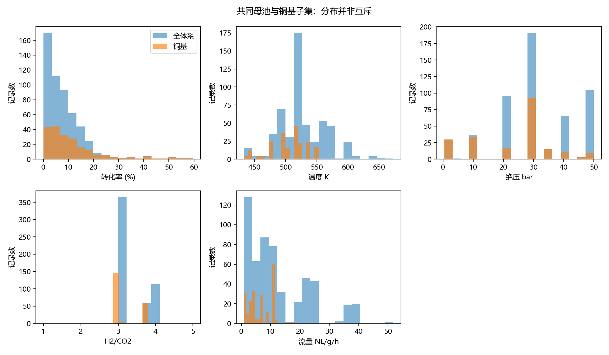

S5-02 保存的全训练拟合包实际 `n_features_in_`（包含缺角色占位及适用标志，非原始测量变量个数）：

| 范围/种子 | F_cond | F_base | F1 | F2 | F3-P | F3-H | F3-I | Cu 扩展 B2 |
|---|---:|---:|---:|---:|---:|---:|---:|---:|
| 全体系 45 | 4 | 38 | 42 | 48 | 18 | 52 | 21 | — |
| 全体系 46 | 4 | 39 | 43 | 49 | 18 | 53 | 21 | — |
| 全体系 47 | 4 | 37 | 41 | 47 | 18 | 51 | 21 | — |
| 铜基 45 | 4 | 19 | 23 | 29 | 18 | 33 | 21 | 37 |
| 铜基 46 | 4 | 21 | 25 | 31 | 18 | 35 | 21 | 39 |
| 铜基 47 | 4 | 20 | 24 | 30 | 18 | 34 | 21 | 38 |

Cu B2 在铜基 F_base 上增加 18 列；各训练折词表可能更短。宽度从可信已保存模型包读取，不重拟合。

### F_cond 与 F_base：严格共同留出配对

固定 ET，种子相同、同一留出成员；两臂均 ok/caution 且有限预测的交集计算 MAE、RMSE、R²。覆盖分别以 108 条为分母。ΔMAE = F_cond − F_base，正值表示组成特征改善。

| 种子 | 共同n | cond可用/108 | base可用/108 | cond MAE | cond RMSE | cond R² | base MAE | base RMSE | base R² | ΔMAE |
| --- | --- | --- | --- | --- | --- | --- | --- | --- | --- | --- |
| 45 | 106 | 108 | 106 | 2.203 | 3.476 | 0.845 | 2.085 | 3.483 | 0.844 | 0.118 |
| 46 | 107 | 108 | 107 | 2.22 | 3.272 | 0.875 | 2.072 | 3.107 | 0.887 | 0.149 |
| 47 | 105 | 108 | 105 | 2.438 | 3.65 | 0.896 | 2.303 | 3.522 | 0.904 | 0.135 |

分层：classification；正值表示 F_base 较 F_cond 的 MAE 改善。

| seed | classification | n | gain |
| --- | --- | --- | --- |
| 45 | cu | 39 | -0.012 |
| 45 | non_cu | 67 | 0.194 |
| 46 | cu | 49 | -0.07 |
| 46 | non_cu | 58 | 0.333 |
| 47 | cu | 44 | -0.017 |
| 47 | non_cu | 61 | 0.245 |

分层：温度层；正值表示 F_base 较 F_cond 的 MAE 改善。

| seed | 温度层 | n | gain |
| --- | --- | --- | --- |
| 45 | <500 | 21 | -0.202 |
| 45 | 500–<550 | 60 | 0.339 |
| 45 | 550–<600 | 19 | -0.25 |
| 45 | ≥600 | 6 | 0.201 |
| 46 | <500 | 33 | 0.098 |
| 46 | 500–<550 | 49 | 0.214 |
| 46 | 550–<600 | 18 | -0.045 |
| 46 | ≥600 | 7 | 0.428 |
| 47 | <500 | 23 | 0.172 |
| 47 | 500–<550 | 51 | 0.079 |
| 47 | 550–<600 | 27 | 0.418 |
| 47 | ≥600 | 4 | -1.275 |

分层：目标层；正值表示 F_base 较 F_cond 的 MAE 改善。

| seed | 目标层 | n | gain |
| --- | --- | --- | --- |
| 45 | <5 | 34 | -0.027 |
| 45 | 5–<10 | 42 | 0.091 |
| 45 | 10–<20 | 24 | 0.415 |
| 45 | ≥20 | 6 | -0.053 |
| 46 | <5 | 38 | 0.061 |
| 46 | 5–<10 | 33 | -0.145 |
| 46 | 10–<20 | 26 | 0.702 |
| 46 | ≥20 | 10 | 0.01 |
| 47 | <5 | 40 | 0.066 |
| 47 | 5–<10 | 28 | 0.633 |
| 47 | 10–<20 | 29 | -0.095 |
| 47 | ≥20 | 8 | -0.431 |

### 排序能力：先定义可评价条件

以每个留出种子、同一 DOI、四项工况数值完全相同为组；将组内相同名义配方的重复记录的实测和预测取均值，仅保留至少 3 个不同配方、实测及预测均有变化的组。Spearman ρ、Kendall τ-b 按组计算后等权平均；Top-1 命中为预测最高配方是否为唯一实测最高配方；若最高实测或预测存在并列则 Top-1 不计入。分组只比较同文献且工况完全相同的留出记录，不是前瞻性新配方盲筛；Top-2 召回率为预测前二与实测前二交集数除以二，边界并列的组不计算。因各算法可能产生常数预测或并列，各自可算组数不同，跨算法平均值不是完全配对。排除组数及结果在表中。所有四算法使用五臂（ET、RF、GB、XGB、F_cond）严格共同可用记录，以便可比。

| 种子 | 算法 | 共同n | 工况组数 | ≥3配方组 | 配方数合计 | 可算组 | Spearman均值 | Kendall均值 | Top1可算组 | Top1命中组 | Top1并列排除 | Top2可算组 | Top2平均召回 |
| --- | --- | --- | --- | --- | --- | --- | --- | --- | --- | --- | --- | --- | --- |
| 45 | ET | 99 | 73 | 4 | 13 | 4 | 0.625 | 0.5 | 4 | 4 | 0 | 4 | 0.625 |
| 45 | RF | 99 | 73 | 4 | 13 | 4 | 0.612 | 0.478 | 3 | 2 | 1 | 4 | 0.75 |
| 45 | GB | 99 | 73 | 4 | 13 | 3 | 0.816 | 0.749 | 2 | 2 | 1 | 3 | 0.833 |
| 45 | XGB | 99 | 73 | 4 | 13 | 4 | -0.027 | -0.062 | 2 | 1 | 2 | 2 | 0.5 |
| 45 | F_cond | 99 | 73 | 4 | 13 | 0 | nan | nan | 0 | 0 | 0 | 0 | nan |
| 46 | ET | 104 | 70 | 3 | 10 | 3 | -0.033 | 0.111 | 3 | 1 | 0 | 3 | 0.5 |
| 46 | RF | 104 | 70 | 3 | 10 | 3 | -0.291 | -0.244 | 2 | 1 | 1 | 2 | 0.25 |
| 46 | GB | 104 | 70 | 3 | 10 | 1 | 1.0 | 1.0 | 1 | 1 | 0 | 1 | 1.0 |
| 46 | XGB | 104 | 70 | 3 | 10 | 2 | 0.933 | 0.908 | 2 | 2 | 0 | 1 | 1.0 |
| 46 | F_cond | 104 | 70 | 3 | 10 | 0 | nan | nan | 0 | 0 | 0 | 0 | nan |
| 47 | ET | 103 | 69 | 3 | 12 | 3 | 0.261 | 0.24 | 2 | 2 | 1 | 3 | 0.5 |
| 47 | RF | 103 | 69 | 3 | 12 | 3 | 0.268 | 0.239 | 3 | 2 | 0 | 3 | 0.5 |
| 47 | GB | 103 | 69 | 3 | 12 | 3 | 0.457 | 0.465 | 2 | 2 | 1 | 2 | 1.0 |
| 47 | XGB | 103 | 69 | 3 | 12 | 3 | 0.124 | 0.132 | 1 | 1 | 2 | 2 | 0.75 |
| 47 | F_cond | 103 | 69 | 3 | 12 | 0 | nan | nan | 0 | 0 | 0 | 0 | nan |

上述组的候选数、来源数与观察后选取均限制外推；不能将记录加权当作独立实验。

### 算法对高值与整体的表现

固定参数 F_base：ET/RF/GB 来自 S5-04，XGB 来自 S5-E05；严格五臂交集。高值阈值为观察后设定的实测 ≥20%，不是筛选门槛的科学标准。R²在目标方差为零时不定义。

| 种子 | 算法 | 区间 | n | MAE | RMSE | R² | 平均残差 |
| --- | --- | --- | --- | --- | --- | --- | --- |
| 45 | ET | 全部 | 99 | 2.212 | 3.603 | 0.834 | -0.535 |
| 45 | ET | 高值≥20% | 6 | 8.757 | 9.717 | 0.565 | -5.19 |
| 45 | RF | 全部 | 99 | 2.195 | 3.603 | 0.834 | -0.423 |
| 45 | RF | 高值≥20% | 6 | 9.133 | 10.37 | 0.505 | -2.905 |
| 45 | GB | 全部 | 99 | 2.248 | 3.46 | 0.847 | -0.306 |
| 45 | GB | 高值≥20% | 6 | 8.371 | 9.379 | 0.595 | -4.236 |
| 45 | XGB | 全部 | 99 | 2.288 | 3.44 | 0.849 | -0.352 |
| 45 | XGB | 高值≥20% | 6 | 8.675 | 9.456 | 0.588 | -4.69 |
| 45 | F_cond | 全部 | 99 | 2.342 | 3.596 | 0.835 | -0.475 |
| 45 | F_cond | 高值≥20% | 6 | 8.704 | 9.484 | 0.586 | -3.998 |
| 46 | ET | 全部 | 104 | 2.125 | 3.151 | 0.884 | 0.039 |
| 46 | ET | 高值≥20% | 10 | 3.969 | 5.472 | 0.772 | -1.95 |
| 46 | RF | 全部 | 104 | 2.124 | 2.923 | 0.9 | 0.049 |
| 46 | RF | 高值≥20% | 10 | 3.218 | 3.916 | 0.883 | -0.929 |
| 46 | GB | 全部 | 104 | 2.32 | 3.326 | 0.871 | -0.17 |
| 46 | GB | 高值≥20% | 10 | 5.106 | 6.491 | 0.679 | -2.376 |
| 46 | XGB | 全部 | 104 | 2.341 | 3.234 | 0.878 | -0.182 |
| 46 | XGB | 高值≥20% | 10 | 4.927 | 5.836 | 0.741 | -2.845 |
| 46 | F_cond | 全部 | 104 | 2.256 | 3.313 | 0.872 | -0.237 |
| 46 | F_cond | 高值≥20% | 10 | 3.979 | 5.516 | 0.768 | -2.393 |
| 47 | ET | 全部 | 103 | 2.345 | 3.556 | 0.902 | -0.837 |
| 47 | ET | 高值≥20% | 8 | 7.017 | 8.384 | 0.42 | -1.685 |
| 47 | RF | 全部 | 103 | 2.419 | 3.453 | 0.908 | -0.76 |
| 47 | RF | 高值≥20% | 8 | 6.424 | 7.488 | 0.537 | -0.236 |
| 47 | GB | 全部 | 103 | 2.414 | 3.433 | 0.909 | -0.517 |
| 47 | GB | 高值≥20% | 8 | 7.621 | 8.386 | 0.419 | -2.119 |
| 47 | XGB | 全部 | 103 | 2.399 | 3.337 | 0.914 | -0.442 |
| 47 | XGB | 高值≥20% | 8 | 6.997 | 7.696 | 0.511 | -1.351 |
| 47 | F_cond | 全部 | 103 | 2.472 | 3.684 | 0.895 | -0.828 |
| 47 | F_cond | 高值≥20% | 8 | 6.586 | 8.12 | 0.456 | -1.037 |

### 误差、配方邻域与工况

相似度定义为 1 − ½×角色-物种材料 mol% 向量的 L1 距离，按 100 归一；每个留出记录只和该种子训练集比较，取最大值。1 表示名义配方完全相同，未包含结构或工况相似性。重复种子不合并为独立样本；相同 DOI 表示训练见过来源，而非见过该配方。以下均为五臂共同可用集的 ET。

按 目标层 分层：

| seed | 目标层 | n | MAE | bias |
| --- | --- | --- | --- | --- |
| 45 | <5 | 27 | 1.502 | 1.176 |
| 45 | 5–<10 | 42 | 1.347 | -0.071 |
| 45 | 10–<20 | 24 | 2.888 | -2.107 |
| 45 | ≥20 | 6 | 8.757 | -5.19 |
| 46 | <5 | 35 | 1.667 | 1.4 |
| 46 | 5–<10 | 33 | 1.641 | 0.545 |
| 46 | 10–<20 | 26 | 2.645 | -1.672 |
| 46 | ≥20 | 10 | 3.969 | -1.95 |
| 47 | <5 | 38 | 1.346 | 0.898 |
| 47 | 5–<10 | 28 | 1.528 | -0.697 |
| 47 | 10–<20 | 29 | 3.153 | -3.012 |
| 47 | ≥20 | 8 | 7.017 | -1.685 |

按 温度层 分层：

| seed | 温度层 | n | MAE | bias |
| --- | --- | --- | --- | --- |
| 45 | <500 | 14 | 1.506 | -0.545 |
| 45 | 500–<550 | 60 | 2.53 | -0.408 |
| 45 | 550–<600 | 19 | 1.968 | -1.03 |
| 45 | ≥600 | 6 | 1.446 | -0.205 |
| 46 | <500 | 30 | 1.173 | 0.716 |
| 46 | 500–<550 | 49 | 2.384 | -0.426 |
| 46 | 550–<600 | 18 | 3.266 | -0.172 |
| 46 | ≥600 | 7 | 1.452 | 0.926 |
| 47 | <500 | 21 | 0.847 | 0.13 |
| 47 | 500–<550 | 51 | 2.81 | -0.978 |
| 47 | 550–<600 | 27 | 2.624 | -1.113 |
| 47 | ≥600 | 4 | 2.394 | -2.256 |

按 classification 分层：

| seed | classification | n | MAE | bias |
| --- | --- | --- | --- | --- |
| 45 | cu | 35 | 2.862 | -0.891 |
| 45 | non_cu | 64 | 1.857 | -0.34 |
| 46 | cu | 49 | 2.336 | 0.333 |
| 46 | non_cu | 55 | 1.936 | -0.224 |
| 47 | cu | 44 | 2.719 | -0.771 |
| 47 | non_cu | 59 | 2.065 | -0.887 |

按 相似度层 分层：

| seed | 相似度层 | n | MAE | bias |
| --- | --- | --- | --- | --- |
| 45 | <0.5 | 2 | 12.597 | -2.729 |
| 45 | 0.8–<0.95 | 5 | 1.046 | 0.842 |
| 45 | ≥0.95 | 92 | 2.05 | -0.562 |
| 46 | <0.5 | 2 | 4.075 | 4.075 |
| 46 | 0.8–<0.95 | 4 | 5.249 | 0.076 |
| 46 | ≥0.95 | 98 | 1.957 | -0.045 |
| 47 | 0.8–<0.95 | 6 | 3.283 | 1.394 |
| 47 | ≥0.95 | 97 | 2.287 | -0.975 |

按 same_formula 分层：

| seed | same_formula | n | MAE | bias |
| --- | --- | --- | --- | --- |
| 45 | False | 11 | 3.314 | 0.302 |
| 45 | True | 88 | 2.074 | -0.639 |
| 46 | False | 12 | 2.946 | 0.831 |
| 46 | True | 92 | 2.017 | -0.065 |
| 47 | False | 15 | 1.983 | -0.051 |
| 47 | True | 88 | 2.406 | -0.971 |

按 same_doi 分层：

| seed | same_doi | n | MAE | bias |
| --- | --- | --- | --- | --- |
| 45 | True | 99 | 2.212 | -0.535 |
| 46 | True | 104 | 2.125 | 0.039 |
| 47 | True | 103 | 2.345 | -0.837 |

按 pressure_bar_abs 分层：

| seed | pressure_bar_abs_bin | n | MAE | bias |
| --- | --- | --- | --- | --- |
| 45 | [-inf, 10.0) | 3 | 0.712 | 0.712 |
| 45 | [10.0, 30.0) | 21 | 1.992 | 0.273 |
| 45 | [30.0, 50.0) | 58 | 2.319 | -0.969 |
| 45 | [50.0, inf) | 17 | 2.385 | -0.271 |
| 46 | [-inf, 10.0) | 7 | 3.298 | 1.968 |
| 46 | [10.0, 30.0) | 26 | 2.132 | -0.302 |
| 46 | [30.0, 50.0) | 55 | 1.931 | -0.067 |
| 46 | [50.0, inf) | 16 | 2.262 | 0.112 |
| 47 | [-inf, 10.0) | 5 | 1.865 | -0.857 |
| 47 | [10.0, 30.0) | 21 | 1.553 | -0.681 |
| 47 | [30.0, 50.0) | 55 | 2.957 | -1.189 |
| 47 | [50.0, inf) | 22 | 1.679 | -0.101 |

按 h2_co2_ratio 分层：

| seed | h2_co2_ratio_bin | n | MAE | bias |
| --- | --- | --- | --- | --- |
| 45 | [-inf, 3.0) | 2 | 3.022 | 3.022 |
| 45 | [3.0, 4.0) | 81 | 2.382 | -0.633 |
| 45 | [4.0, inf) | 16 | 1.25 | -0.479 |
| 46 | [-inf, 3.0) | 2 | 3.412 | 3.412 |
| 46 | [3.0, 4.0) | 89 | 2.21 | 0.052 |
| 46 | [4.0, inf) | 13 | 1.345 | -0.573 |
| 47 | [3.0, 4.0) | 82 | 2.594 | -0.825 |
| 47 | [4.0, inf) | 21 | 1.373 | -0.883 |

按 flow_nl_g_h 分层：

| seed | flow_nl_g_h_bin | n | MAE | bias |
| --- | --- | --- | --- | --- |
| 45 | [-inf, 2.0) | 5 | 7.788 | -3.508 |
| 45 | [2.0, 5.0) | 25 | 2.087 | -0.514 |
| 45 | [5.0, 10.0) | 27 | 1.679 | 0.165 |
| 45 | [10.0, inf) | 42 | 1.965 | -0.643 |
| 46 | [-inf, 2.0) | 6 | 4.908 | -0.98 |
| 46 | [2.0, 5.0) | 30 | 1.637 | -0.322 |
| 46 | [5.0, 10.0) | 21 | 1.902 | -0.046 |
| 46 | [10.0, inf) | 47 | 2.18 | 0.436 |
| 47 | [-inf, 2.0) | 9 | 6.002 | -1.263 |
| 47 | [2.0, 5.0) | 23 | 2.203 | -0.845 |
| 47 | [5.0, 10.0) | 27 | 2.45 | -1.367 |
| 47 | [10.0, inf) | 44 | 1.606 | -0.421 |

高值记录逐条审计：以下表保留原样本名称、来源、工况、域状态及与训练配方的最大相似度；相似度高不保证附近工况有实验。完整记录及最近邻信息见 CSV。

| seed | record_id | doi | sample_name | temperature_k | pressure_bar_abs | h2_co2_ratio | flow_nl_g_h | conversion_pct | ET | 残差 | sim | same_doi | status |
| --- | --- | --- | --- | --- | --- | --- | --- | --- | --- | --- | --- | --- | --- |
| 45 | 4c7dcfca35ce49b2845d0a98028aea08:1 | 10.1039/c2cy20604h | Cu/Al2O3 | 533.0 | 36.0 | 3.8 | 10.6 | 20.3 | 19.755 | -0.545 | 1.0 | True | ok |
| 45 | bc40253694d04b519b30ce1a77c1e7ae:1 | 10.1021/acs.iecr.7b01464 | CZA200 | 513.0 | 20.0 | 3.0 | 0.87 | 24.4 | 35.1 | 10.7 | 1.0 | True | ok |
| 45 | bd324c0ec1fe465fa3cd09d9160ffdc8:1 | 10.1039/c2cy20604h | Cu/Al2O3 | 553.0 | 36.0 | 3.8 | 10.6 | 29.6 | 21.316 | -8.284 | 1.0 | True | ok |
| 45 | c424a14bdbf446399f5ec1569275ecd5:1 | 10.1039/c2cy20604h | Cu-K/Al2O3 | 553.0 | 36.0 | 3.8 | 10.6 | 28.6 | 21.139 | -7.461 | 1.0 | True | ok |
| 45 | c61031e74b03403bb4a961659e84ebd1:1 | 10.1021/acs.iecr.7b01464 | CZA400 | 533.0 | 30.0 | 3.0 | 0.87 | 58.4 | 46.35 | -12.05 | 1.0 | True | ok |
| 45 | ca875727ddc64b428c611e6b48ca1fae:1 | 10.1021/acs.iecr.7b01464 | CZA400 | 523.0 | 30.0 | 3.0 | 0.87 | 54.0 | 40.5 | -13.5 | 1.0 | True | ok |
| 46 | 171642fbd1314388a70ce15560df6b6e:1 | 10.1039/c2cy20604h | Cu-Ba/Al2O3 | 533.0 | 36.0 | 3.8 | 10.6 | 22.9 | 20.228 | -2.672 | 1.0 | True | ok |
| 46 | 32cc390049ee4be480fb98be06c66deb:1 | 10.1016/j.apcata.2013.09.026 | CHT-ALa | 523.0 | 50.0 | 3.0 | 12.0 | 23.3 | 23.422 | 0.122 | 0.99 | True | ok |
| 46 | 4c7dcfca35ce49b2845d0a98028aea08:1 | 10.1039/c2cy20604h | Cu/Al2O3 | 533.0 | 36.0 | 3.8 | 10.6 | 20.3 | 20.001 | -0.299 | 1.0 | True | ok |
| 46 | 72aae5852a8343819fdf805726f07e23:1 | 10.1039/c2cy20604h | Cu/Al2O3 | 553.0 | 3.0 | 3.8 | 10.6 | 21.3 | 16.647 | -4.653 | 1.0 | True | ok |
| 46 | 7c1f8b34d718444c88fe904f37780c63:1 | 10.1021/acs.iecr.7b01464 | CZA200 | 533.0 | 30.0 | 3.0 | 0.87 | 39.7 | 47.886 | 8.186 | 1.0 | True | ok |
| 46 | 823dc34191034ae4a3282798ff72bbde:1 | 10.1021/acs.iecr.7b01464 | CZA-300 | 533.0 | 30.0 | 3.0 | 0.87 | 53.0 | 47.886 | -5.114 | 1.0 | True | ok |
| 46 | 991996da92d44f1aa36e5f6c186fbb19:1 | 10.1016/j.apcatb.2017.06.069 | Pd-P/In2O3 | 573.0 | 50.0 | 4.0 | 21.0 | 20.5 | 16.423 | -4.077 | 1.0 | True | ok |
| 46 | b7ebb0f602d84df2a0eb7a463fc91bff:1 | 10.1021/acs.iecr.7b01464 | CZA-300 | 523.0 | 30.0 | 3.0 | 0.87 | 46.1 | 47.886 | 1.786 | 1.0 | True | ok |
| 46 | c424a14bdbf446399f5ec1569275ecd5:1 | 10.1039/c2cy20604h | Cu-K/Al2O3 | 553.0 | 36.0 | 3.8 | 10.6 | 28.6 | 28.373 | -0.227 | 1.0 | True | ok |
| 46 | d76f57a9b78d443f976ced355d712907:1 | 10.1021/acs.iecr.7b01464 | CZA400 | 513.0 | 20.0 | 3.0 | 0.87 | 39.9 | 27.35 | -12.55 | 1.0 | True | ok |
| 47 | 17f06d327f734d439f43006305714742:1 | 10.1021/acs.iecr.7b01464 | CZA400 | 513.0 | 40.0 | 3.0 | 0.87 | 59.6 | 44.599 | -15.001 | 1.0 | True | ok |
| 47 | 2b3d644c943c46b1bd8c20dc28173f54:1 | 10.1021/acs.iecr.7b01464 | CZA200 | 513.0 | 30.0 | 3.0 | 0.87 | 49.3 | 45.04 | -4.26 | 1.0 | True | ok |
| 47 | 76a5e62244814114971291730f25993c:1 | 10.1021/acs.iecr.7b01464 | CZA-300 | 513.0 | 30.0 | 3.0 | 0.87 | 40.1 | 45.04 | 4.94 | 1.0 | True | ok |
| 47 | 7c1f8b34d718444c88fe904f37780c63:1 | 10.1021/acs.iecr.7b01464 | CZA200 | 533.0 | 30.0 | 3.0 | 0.87 | 39.7 | 52.788 | 13.088 | 1.0 | True | ok |
| 47 | 991996da92d44f1aa36e5f6c186fbb19:1 | 10.1016/j.apcatb.2017.06.069 | Pd-P/In2O3 | 573.0 | 50.0 | 4.0 | 21.0 | 20.5 | 16.04 | -4.46 | 1.0 | True | ok |
| 47 | b7ebb0f602d84df2a0eb7a463fc91bff:1 | 10.1021/acs.iecr.7b01464 | CZA-300 | 523.0 | 30.0 | 3.0 | 0.87 | 46.1 | 44.506 | -1.594 | 1.0 | True | ok |
| 47 | ca875727ddc64b428c611e6b48ca1fae:1 | 10.1021/acs.iecr.7b01464 | CZA400 | 523.0 | 30.0 | 3.0 | 0.87 | 54.0 | 44.506 | -9.494 | 1.0 | True | ok |
| 47 | f8a6bb57eed8400d921ce983d61550a6:1 | 10.1021/acs.iecr.7b01464 | CZA200 | 513.0 | 40.0 | 3.0 | 0.87 | 41.3 | 44.599 | 3.299 | 1.0 | True | ok |

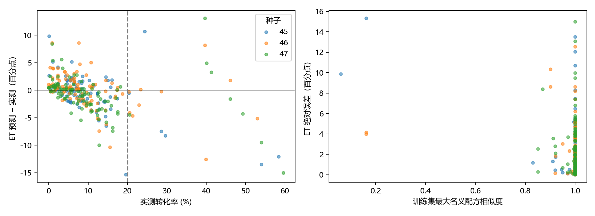

解释边界：高值偏差只描述所列观察后子集；树模型均值回归、训练高值稀缺、配方和来源混杂均是可能解释，不能从相关性确定原因。比较只使用入口共同可用样本，遗漏的拒绝记录仍是筛选风险。以上模型的排序是在严格交集上针对已发表、同来源相同工况做的事后检验；即使局部排序良好，也不能证明其能识别未知材料或可靠推荐全新配方。应以独立来源、盲法和实际候选集合验证排序、Top-K 和覆盖，且对每个候选保留实验确认。

数据与计算来源：[共同视图](来源/artifacts/reports/s4-02-20261120-v1/all-view.json)、[铜基视图](来源/artifacts/reports/s4-02-20261120-v1/cu-view.json)、[记录审计](来源/artifacts/reports/s4-01-20261120/record-audit.csv)、[S5-02 逐臂预测](来源/artifacts/reports/s5-02-e01-seed45-range-v2/run/holdout/all_arms.json)、[S5-04 逐臂预测](来源/artifacts/reports/s5-04-e02-20261124-v1/fixed-45/holdout/all_arms.json)、[S5-E05 逐臂预测](来源/artifacts/reports/s5-05-e05-20261124-v1/run-45/holdout/all_arms.json)。计算及全部种子路径见 [诊断脚本](专项诊断.py)。

### 来源与高值的补充统计

下表 DOI 分层仅列每个种子共同可用集里不少于 3 条的来源，未见 DOI 组在随机划分中不存在。

| seed | doi | n | MAE | bias |
| --- | --- | --- | --- | --- |
| 45 | 10.1002/anie.202401168 | 9 | 1.584 | -0.578 |
| 45 | 10.1002/cphc.202300530 | 6 | 1.174 | -0.195 |
| 45 | 10.1016/j.apcata.2019.117144 | 3 | 0.973 | 0.529 |
| 45 | 10.1016/j.apcatb.2019.118367 | 3 | 2.066 | 1.383 |
| 45 | 10.1016/j.cej.2022.135090 | 3 | 3.035 | 1.683 |
| 45 | 10.1016/j.cej.2024.149370 | 3 | 0.882 | 0.882 |
| 45 | 10.1016/j.fuel.2015.09.082 | 3 | 3.752 | -3.752 |
| 45 | 10.1016/j.fuel.2023.127927 | 7 | 2.36 | -1.18 |
| 45 | 10.1016/j.jcat.2007.04.003 | 5 | 1.461 | 0.463 |
| 45 | 10.1016/j.jcat.2019.09.024 | 6 | 1.087 | 0.217 |
| 45 | 10.1016/j.jes.2023.01.018 | 4 | 0.491 | 0.432 |
| 45 | 10.1016/j.jes.2023.05.010 | 4 | 1.656 | -1.656 |
| 45 | 10.1016/j.jscs.2019.09.002 | 3 | 2.426 | 2.426 |
| 45 | 10.1021/acs.iecr.7b01464 | 3 | 12.083 | -4.95 |
| 45 | 10.1039/c2cy20604h | 9 | 2.745 | -1.698 |
| 45 | 10.1126/sciadv.1701290 | 12 | 1.019 | -0.207 |
| 46 | 10.1002/anie.202401168 | 4 | 0.761 | 0.44 |
| 46 | 10.1002/cphc.202300530 | 7 | 1.477 | -1.296 |
| 46 | 10.1016/j.cattod.2019.05.040 | 3 | 1.77 | -1.054 |
| 46 | 10.1016/j.fuel.2023.127927 | 5 | 1.933 | -0.022 |
| 46 | 10.1016/j.jcat.2007.04.003 | 6 | 1.93 | 1.93 |
| 46 | 10.1016/j.jcat.2019.09.024 | 7 | 1.777 | -1.099 |
| 46 | 10.1016/j.jes.2023.05.010 | 5 | 1.351 | -0.89 |
| 46 | 10.1016/j.molcata.2011.05.019 | 3 | 0.317 | 0.317 |
| 46 | 10.1016/s0926-860x(98)00079-9 | 3 | 1.314 | 0.871 |
| 46 | 10.1021/acs.iecr.7b01464 | 4 | 6.909 | -1.923 |
| 46 | 10.1039/c2cy20604h | 14 | 2.301 | 0.762 |
| 46 | 10.1039/c6ra28305e | 3 | 2.359 | 2.359 |
| 46 | 10.1126/sciadv.1701290 | 13 | 1.963 | 1.403 |
| 47 | 10.1002/cphc.202300530 | 7 | 2.089 | -0.795 |
| 47 | 10.1016/j.apcatb.2017.06.069 | 4 | 2.628 | -1.27 |
| 47 | 10.1016/j.cej.2022.135090 | 4 | 3.256 | -0.399 |
| 47 | 10.1016/j.cej.2024.149370 | 4 | 1.392 | -1.392 |
| 47 | 10.1016/j.fuel.2015.09.082 | 3 | 6.264 | -2.525 |
| 47 | 10.1016/j.fuel.2022.125878 | 5 | 4.085 | -3.725 |
| 47 | 10.1016/j.jcat.2007.04.003 | 12 | 1.592 | -0.105 |
| 47 | 10.1016/j.jcat.2016.03.017 | 5 | 1.98 | -1.902 |
| 47 | 10.1016/j.jcat.2019.09.024 | 4 | 1.52 | -0.214 |
| 47 | 10.1016/j.jes.2023.01.018 | 3 | 0.609 | 0.482 |
| 47 | 10.1016/j.jes.2023.05.010 | 4 | 1.659 | -1.063 |
| 47 | 10.1016/j.matchemphys.2018.08.038 | 3 | 1.989 | -1.79 |
| 47 | 10.1021/acs.iecr.7b01464 | 7 | 7.382 | -1.289 |
| 47 | 10.1021/acscatal.9b01869 | 3 | 0.603 | 0.217 |
| 47 | 10.1039/c2cy20604h | 6 | 1.785 | -0.945 |
| 47 | 10.1126/sciadv.1701290 | 10 | 1.809 | 1.003 |

实测 ≥20% 的高值记录按预测减实测统计（重复种子不可相加）：

| seed | n | 平均残差 | 低估数 | 同名义配方数 | 同DOI数 |
| --- | --- | --- | --- | --- | --- |
| 45 | 6 | -5.19 | 5.0 | 6 | 6 |
| 46 | 10 | -1.95 | 7.0 | 9 | 10 |
| 47 | 8 | -1.685 | 5.0 | 8 | 8 |

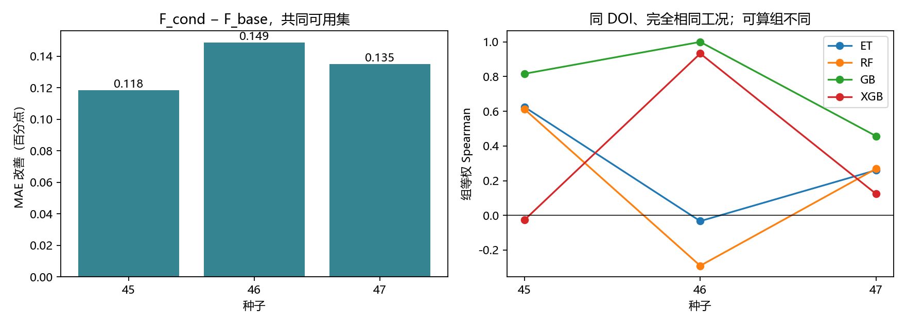

**跨算法排序比较请以文末“六算法统一留出比较”的严格共同排序组为准；上图各算法可算组不同，不能直接比较。**

## 六算法统一留出比较：补充诊断

本节是观察后对已有预测的重算，不重新训练、不重新选模。S5-04 固定臂包含 Extra Trees（ET）、Random Forest（RF）、Gradient Boosting（GB）、Ridge、Dummy；S5-E05 提供固定 XGBoost（XGB）。三种子两阶段配置的视图、快照、目标、目录、模型种子以及完整训练／留出成员和训练内五折划分逐项一致；同参数 ET、RF 的两个阶段留出预测和状态逐条一致。固定模型均使用 F_base；ET/RF 为 100 树、叶最小 2、深度不限、max_features=1，GB 和 XGB 均 100 树、深度 3、学习率 0.1，Ridge alpha=1，Dummy 为训练均值。算法实现、处理流程和各自适用状态仍不同；这不是同一阶段预先登记的六算法联合实验。已观察留出数据、反复研究、种子成员重叠和文献相关性限制结论，非独立外部验证。

### 整体误差和覆盖率

每个种子取六臂共同 ok/caution 且预测有限的严格交集，所有 MAE、RMSE、R² 在同一成员上重新计算；“各自可用”以各自 108 条留出为分母，不能用各自可用集分数替代共同集作排名。R² 取决于同一共同集目标方差，误差单位为 CO2 转化率百分点。

| 种子 | 算法 | 共同n | 各自可用n | MAE | RMSE | R² |
| --- | --- | --- | --- | --- | --- | --- |
| 45 | Extra Trees | 91 | 106 | 2.181 | 3.573 | 0.844 |
| 45 | Random Forest | 91 | 106 | 2.170 | 3.599 | 0.841 |
| 45 | Gradient Boosting | 91 | 99 | 2.263 | 3.505 | 0.849 |
| 45 | XGBoost | 91 | 104 | 2.291 | 3.477 | 0.852 |
| 45 | Ridge | 91 | 93 | 3.901 | 6.372 | 0.503 |
| 45 | Dummy | 91 | 106 | 5.329 | 9.112 | -0.017 |
| 46 | Extra Trees | 95 | 107 | 2.186 | 3.235 | 0.880 |
| 46 | Random Forest | 95 | 107 | 2.149 | 2.935 | 0.901 |
| 46 | Gradient Boosting | 95 | 104 | 2.346 | 3.325 | 0.873 |
| 46 | XGBoost | 95 | 104 | 2.383 | 3.252 | 0.878 |
| 46 | Ridge | 95 | 95 | 4.092 | 5.921 | 0.597 |
| 46 | Dummy | 95 | 107 | 5.949 | 9.487 | -0.036 |
| 47 | Extra Trees | 100 | 105 | 2.397 | 3.606 | 0.901 |
| 47 | Random Forest | 100 | 105 | 2.482 | 3.504 | 0.906 |
| 47 | Gradient Boosting | 100 | 103 | 2.471 | 3.483 | 0.907 |
| 47 | XGBoost | 100 | 103 | 2.458 | 3.386 | 0.912 |
| 47 | Ridge | 100 | 100 | 4.702 | 7.743 | 0.542 |
| 47 | Dummy | 100 | 105 | 6.854 | 11.623 | -0.033 |

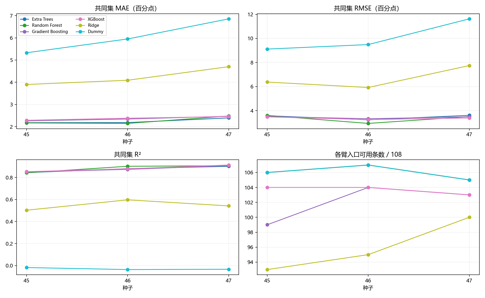

### 严格共同排序组

同一种子、同一 DOI、温度、绝压、H2/CO2 和流量完全相同的六臂共同可用记录构成组；先对相同名义配方的重复记录取实测和预测均值，要求至少三个配方且实测有变化。Spearman 和 Kendall τ-b 仅使用四个主要算法都具有非恒定预测的相同组，按组等权。Top-1 进一步要求实测和四算法预测最高值均不并列；Top-2 要求实测和四算法的第 2 与第 3 名均不并列，召回率为预测前二与实测前二交集除以 2。Ridge 在这些四算法共同组上作为参照，若其自身恒定或边界并列则不计相应指标；Dummy 为恒定预测，相关系数与 Top-K 均不可定义，不作零分。各指标的共同组可以不同，表内注明分母。各组涉及的 DOI、工况、配方数及相关系数见 [逐组数据](算法统一_排序逐组.csv)。

| 种子 | 算法 | 共同记录n | 候选组 | 四算法相关共同组 | 算法可算组 | Spearman | Kendall | 四算法Top1共同组 | 算法Top1可算组 | Top1命中 | 四算法Top2共同组 | 算法Top2可算组 | Top2平均召回 |
| --- | --- | --- | --- | --- | --- | --- | --- | --- | --- | --- | --- | --- | --- |
| 45 | Extra Trees | 91 | 3 | 2 | 2 | 0.750 | 0.667 | 0 | 0 | — | 1 | 1 | 0.500 |
| 45 | Random Forest | 91 | 3 | 2 | 2 | 0.724 | 0.623 | 0 | 0 | — | 1 | 1 | 0.500 |
| 45 | Gradient Boosting | 91 | 3 | 2 | 2 | 0.724 | 0.623 | 0 | 0 | — | 1 | 1 | 0.500 |
| 45 | XGBoost | 91 | 3 | 2 | 2 | 0.129 | 0.118 | 0 | 0 | — | 1 | 1 | 0.500 |
| 45 | Ridge | 91 | 3 | 2 | 2 | -0.300 | -0.333 | 0 | 0 | — | 1 | 1 | 0.500 |
| 45 | Dummy | 91 | 3 | 2 | 0 | — | — | 0 | 0 | — | 1 | 0 | — |
| 46 | Extra Trees | 95 | 3 | 1 | 1 | -0.500 | -0.333 | 1 | 1 | 0.000 | 1 | 1 | 0.500 |
| 46 | Random Forest | 95 | 3 | 1 | 1 | -1.000 | -1.000 | 1 | 1 | 0.000 | 1 | 1 | 0.500 |
| 46 | Gradient Boosting | 95 | 3 | 1 | 1 | 1.000 | 1.000 | 1 | 1 | 1.000 | 1 | 1 | 1.000 |
| 46 | XGBoost | 95 | 3 | 1 | 1 | 1.000 | 1.000 | 1 | 1 | 1.000 | 1 | 1 | 1.000 |
| 46 | Ridge | 95 | 3 | 1 | 1 | -1.000 | -1.000 | 1 | 1 | 0.000 | 1 | 1 | 0.500 |
| 46 | Dummy | 95 | 3 | 1 | 0 | — | — | 1 | 0 | — | 1 | 0 | — |
| 47 | Extra Trees | 100 | 3 | 3 | 3 | 0.261 | 0.240 | 1 | 1 | 1.000 | 2 | 2 | 0.750 |
| 47 | Random Forest | 100 | 3 | 3 | 3 | 0.268 | 0.239 | 1 | 1 | 0.000 | 2 | 2 | 0.500 |
| 47 | Gradient Boosting | 100 | 3 | 3 | 3 | 0.457 | 0.465 | 1 | 1 | 1.000 | 2 | 2 | 1.000 |
| 47 | XGBoost | 100 | 3 | 3 | 3 | 0.124 | 0.132 | 1 | 1 | 1.000 | 2 | 2 | 0.750 |
| 47 | Ridge | 100 | 3 | 3 | 3 | -0.313 | -0.271 | 1 | 1 | 0.000 | 2 | 2 | 0.500 |
| 47 | Dummy | 100 | 3 | 3 | 0 | — | — | 1 | 0 | — | 2 | 0 | — |

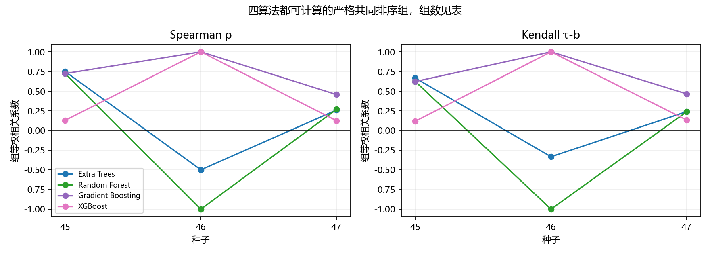

### 高转化率子集

以同一六臂共同记录中实测转化率 ≥20% 定义高值；此阈值是观察后诊断，不是预设的应用标准。平均残差为预测减实测，低估数以严格小于零计。各算法同一种子的分母相同；种子间不能累加为独立样本。

| 种子 | 算法 | 高值n | MAE | 平均残差 | 低估数 | 高估数 | 相等数 |
| --- | --- | --- | --- | --- | --- | --- | --- |
| 45 | Extra Trees | 6 | 8.757 | -5.190 | 5 | 1 | 0 |
| 45 | Random Forest | 6 | 9.133 | -2.905 | 4 | 2 | 0 |
| 45 | Gradient Boosting | 6 | 8.371 | -4.236 | 5 | 1 | 0 |
| 45 | XGBoost | 6 | 8.675 | -4.690 | 5 | 1 | 0 |
| 45 | Ridge | 6 | 14.740 | -14.740 | 6 | 0 | 0 |
| 45 | Dummy | 6 | 27.428 | -27.428 | 6 | 0 | 0 |
| 46 | Extra Trees | 10 | 3.969 | -1.950 | 7 | 3 | 0 |
| 46 | Random Forest | 10 | 3.218 | -0.929 | 7 | 3 | 0 |
| 46 | Gradient Boosting | 10 | 5.106 | -2.376 | 8 | 2 | 0 |
| 46 | XGBoost | 10 | 4.927 | -2.845 | 8 | 2 | 0 |
| 46 | Ridge | 10 | 11.575 | -11.429 | 9 | 1 | 0 |
| 46 | Dummy | 10 | 23.170 | -23.170 | 10 | 0 | 0 |
| 47 | Extra Trees | 8 | 7.017 | -1.685 | 5 | 3 | 0 |
| 47 | Random Forest | 8 | 6.424 | -0.236 | 4 | 4 | 0 |
| 47 | Gradient Boosting | 8 | 7.621 | -2.119 | 5 | 3 | 0 |
| 47 | XGBoost | 8 | 6.997 | -1.351 | 5 | 3 | 0 |
| 47 | Ridge | 8 | 21.611 | -21.611 | 8 | 0 | 0 |
| 47 | Dummy | 8 | 35.584 | -35.584 | 8 | 0 | 0 |

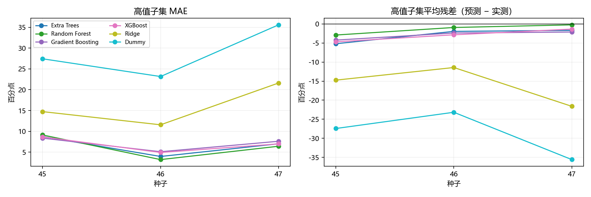

### 如何理解 GB 的误差与排序

MAE 衡量预测值距实测值的绝对偏差；排序相关性只衡量同组内相对顺序，对某组内共同偏移或单调尺度变化不敏感。因此一个模型可以产生较大的绝对误差、同时较好地区分同条件下的高低，也可能因预测并列而无法排序。比较应以本节四算法相同排序组为准：上一节各模型各自可算组不同的相关系数不构成公平配对。在同一共同留出集上，GB 的 MAE 比 ET 分别高 0.082、0.160、0.074；但 GB 的 RMSE 在种子 45、47 较低，R² 相应较高。严格共同排序组上的 GB / ET Spearman 分别为 0.724 / 0.750（2 组）、1.000 / −0.500（1 组）、0.457 / 0.261（3 组）。这只说明 46、47 的极少数组中 GB 的相对顺序较好，45 则相反；种子 45 没有四算法共同可算 Top-1 组。共同组数量太少，不能据此认定 GB 的排序优势或推荐更换模型。MAE、排序指标、Top-K 的目标及权重各异；本分析不将任何留出结果用于重新选模。

来源：[S5-04 固定臂运行](来源/artifacts/reports/s5-04-e02-20261124-v1/)、[S5-E05 运行](来源/artifacts/reports/s5-05-e05-20261124-v1/)、[共同预测与 ID](算法统一_共同留出预测.csv)、[可复核计算脚本](算法统一分析.py)。各阶段固定参数及划分以其配置和 split 文件为准。

