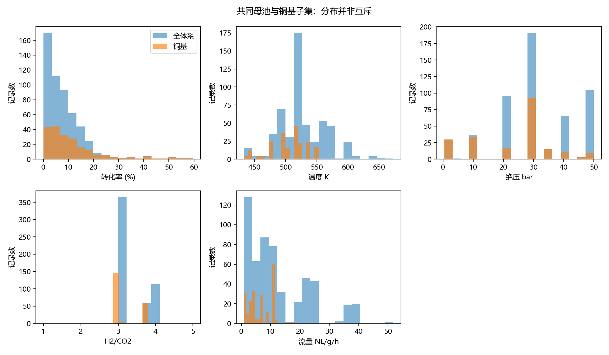
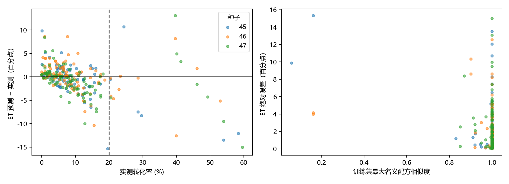
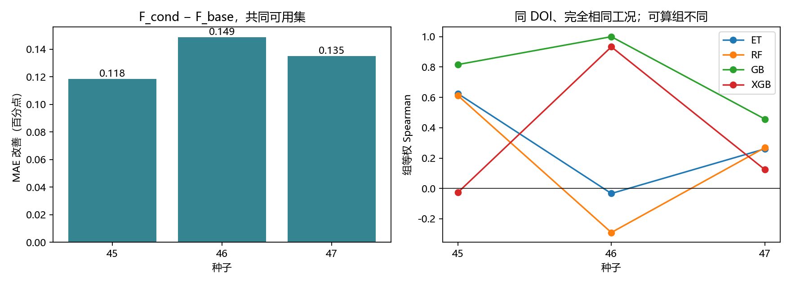

## 专项诊断：材料识别与筛选（观察后分析）

以下均重新计算自 S4 冻结视图、原始记录审计与 S5 已保存留出预测；不重新训练。三种子成员重叠，同文献记录相关，结果不是独立外部验证。所有分组、阈值、相似度与排序评价均为事后探索，不能作显著性或部署准确率保证。

### 共同母池分布与特征宽度

S4 全体系共同资格 542 条、铜基视图 211 条；铜基是全体系的子集，不是额外样本。配方由来源角色、物种及 mol% 的完整列表定义，仍不能等同于实测结构、独立制备批次或催化体系族。

| 范围 | 记录 | DOI | 名义配方数 | 转化率最小 | 中位 | P75 | 最大 |
| --- | --- | --- | --- | --- | --- | --- | --- |
| 全体系 | 542 | 36 | 135 | 0.0 | 6.38 | 11.28 | 59.6 |
| 铜基 | 211 | 16 | 47 | 0.1 | 8.3 | 15.3 | 59.6 |
| 非铜基 | 331 | 22 | 88 | 0.0 | 5.43 | 9.18 | 22.5 |

| 范围 | 变量 | n | 最小 | P25 | 中位 | P75 | 最大 |
| --- | --- | --- | --- | --- | --- | --- | --- |
| 全体系 | 温度 K | 542 | 433.0 | 503.0 | 523.0 | 548.0 | 673.0 |
| 全体系 | 绝压 bar | 542 | 0.4 | 20.0 | 30.0 | 40.0 | 50.0 |
| 全体系 | H2/CO2 | 542 | 1.0 | 3.0 | 3.0 | 3.8 | 5.0 |
| 全体系 | 流量 NL/g/h | 542 | 0.87 | 4.27 | 8.8 | 18.0 | 51.84 |
| 铜基 | 温度 K | 211 | 433.0 | 493.0 | 513.0 | 523.0 | 553.0 |
| 铜基 | 绝压 bar | 211 | 0.4 | 10.0 | 30.0 | 30.0 | 50.0 |
| 铜基 | H2/CO2 | 211 | 1.0 | 3.0 | 3.0 | 3.8 | 3.8 |
| 铜基 | 流量 NL/g/h | 211 | 0.87 | 3.17 | 7.5 | 10.6 | 18.0 |

全体系来源活性角色中出现次数最高的物种（多标签，可重叠）：Cu 207 条、Pd 129 条、In2O3 93 条、Zn 86 条、ZnO 85 条、ZrO2 45 条、Ir 34 条、Pt 20 条、BaCO3 20 条、Cr2O3 20 条。

铜基来源活性角色中出现次数最高的物种（多标签，可重叠）：Cu 207 条、ZnO 85 条、BaCO3 20 条、K2CO3 20 条、CeO2 6 条、LaMn0.1Cu0.9O3 1 条、LaMn0.7Cu0.3O3 1 条、LaMn0.3Cu0.7O3 1 条、LaMn0.5Cu0.5O3 1 条。

S5-02 保存的全训练拟合包实际 `n_features_in_`（包含缺角色占位及适用标志，非原始测量变量个数）：

| 范围/种子 | F_cond | F_base | F1 | F2 | F3-P | F3-H | F3-I | Cu 扩展 B2 |
|---|---:|---:|---:|---:|---:|---:|---:|---:|
| 全体系 45 | 4 | 38 | 42 | 48 | 18 | 52 | 21 | — |
| 全体系 46 | 4 | 39 | 43 | 49 | 18 | 53 | 21 | — |
| 全体系 47 | 4 | 37 | 41 | 47 | 18 | 51 | 21 | — |
| 铜基 45 | 4 | 19 | 23 | 29 | 18 | 33 | 21 | 37 |
| 铜基 46 | 4 | 21 | 25 | 31 | 18 | 35 | 21 | 39 |
| 铜基 47 | 4 | 20 | 24 | 30 | 18 | 34 | 21 | 38 |

Cu B2 在铜基 F_base 上增加 18 列；各训练折词表可能更短。宽度从可信已保存模型包读取，不重拟合。

### F_cond 与 F_base：严格共同留出配对

固定 ET，种子相同、同一留出成员；两臂均 ok/caution 且有限预测的交集计算 MAE、RMSE、R²。覆盖分别以 108 条为分母。ΔMAE = F_cond − F_base，正值表示组成特征改善。

| 种子 | 共同n | cond可用/108 | base可用/108 | cond MAE | cond RMSE | cond R² | base MAE | base RMSE | base R² | ΔMAE |
| --- | --- | --- | --- | --- | --- | --- | --- | --- | --- | --- |
| 45 | 106 | 108 | 106 | 2.203 | 3.476 | 0.845 | 2.085 | 3.483 | 0.844 | 0.118 |
| 46 | 107 | 108 | 107 | 2.22 | 3.272 | 0.875 | 2.072 | 3.107 | 0.887 | 0.149 |
| 47 | 105 | 108 | 105 | 2.438 | 3.65 | 0.896 | 2.303 | 3.522 | 0.904 | 0.135 |

分层：classification；正值表示 F_base 较 F_cond 的 MAE 改善。

| seed | classification | n | gain |
| --- | --- | --- | --- |
| 45 | cu | 39 | -0.012 |
| 45 | non_cu | 67 | 0.194 |
| 46 | cu | 49 | -0.07 |
| 46 | non_cu | 58 | 0.333 |
| 47 | cu | 44 | -0.017 |
| 47 | non_cu | 61 | 0.245 |

分层：温度层；正值表示 F_base 较 F_cond 的 MAE 改善。

| seed | 温度层 | n | gain |
| --- | --- | --- | --- |
| 45 | <500 | 21 | -0.202 |
| 45 | 500–<550 | 60 | 0.339 |
| 45 | 550–<600 | 19 | -0.25 |
| 45 | ≥600 | 6 | 0.201 |
| 46 | <500 | 33 | 0.098 |
| 46 | 500–<550 | 49 | 0.214 |
| 46 | 550–<600 | 18 | -0.045 |
| 46 | ≥600 | 7 | 0.428 |
| 47 | <500 | 23 | 0.172 |
| 47 | 500–<550 | 51 | 0.079 |
| 47 | 550–<600 | 27 | 0.418 |
| 47 | ≥600 | 4 | -1.275 |

分层：目标层；正值表示 F_base 较 F_cond 的 MAE 改善。

| seed | 目标层 | n | gain |
| --- | --- | --- | --- |
| 45 | <5 | 34 | -0.027 |
| 45 | 5–<10 | 42 | 0.091 |
| 45 | 10–<20 | 24 | 0.415 |
| 45 | ≥20 | 6 | -0.053 |
| 46 | <5 | 38 | 0.061 |
| 46 | 5–<10 | 33 | -0.145 |
| 46 | 10–<20 | 26 | 0.702 |
| 46 | ≥20 | 10 | 0.01 |
| 47 | <5 | 40 | 0.066 |
| 47 | 5–<10 | 28 | 0.633 |
| 47 | 10–<20 | 29 | -0.095 |
| 47 | ≥20 | 8 | -0.431 |

### 排序能力：先定义可评价条件

以每个留出种子、同一 DOI、四项工况数值完全相同为组；将组内相同名义配方的重复记录的实测和预测取均值，仅保留至少 3 个不同配方、实测及预测均有变化的组。Spearman ρ、Kendall τ-b 按组计算后等权平均；Top-1 命中为预测最高配方是否为唯一实测最高配方；若最高实测或预测存在并列则 Top-1 不计入。分组只比较同文献且工况完全相同的留出记录，不是前瞻性新配方盲筛；Top-2 召回率为预测前二与实测前二交集数除以二，边界并列的组不计算。因各算法可能产生常数预测或并列，各自可算组数不同，跨算法平均值不是完全配对。排除组数及结果在表中。所有四算法使用五臂（ET、RF、GB、XGB、F_cond）严格共同可用记录，以便可比。

| 种子 | 算法 | 共同n | 工况组数 | ≥3配方组 | 配方数合计 | 可算组 | Spearman均值 | Kendall均值 | Top1可算组 | Top1命中组 | Top1并列排除 | Top2可算组 | Top2平均召回 |
| --- | --- | --- | --- | --- | --- | --- | --- | --- | --- | --- | --- | --- | --- |
| 45 | ET | 99 | 73 | 4 | 13 | 4 | 0.625 | 0.5 | 4 | 4 | 0 | 4 | 0.625 |
| 45 | RF | 99 | 73 | 4 | 13 | 4 | 0.612 | 0.478 | 3 | 2 | 1 | 4 | 0.75 |
| 45 | GB | 99 | 73 | 4 | 13 | 3 | 0.816 | 0.749 | 2 | 2 | 1 | 3 | 0.833 |
| 45 | XGB | 99 | 73 | 4 | 13 | 4 | -0.027 | -0.062 | 2 | 1 | 2 | 2 | 0.5 |
| 45 | F_cond | 99 | 73 | 4 | 13 | 0 | nan | nan | 0 | 0 | 0 | 0 | nan |
| 46 | ET | 104 | 70 | 3 | 10 | 3 | -0.033 | 0.111 | 3 | 1 | 0 | 3 | 0.5 |
| 46 | RF | 104 | 70 | 3 | 10 | 3 | -0.291 | -0.244 | 2 | 1 | 1 | 2 | 0.25 |
| 46 | GB | 104 | 70 | 3 | 10 | 1 | 1.0 | 1.0 | 1 | 1 | 0 | 1 | 1.0 |
| 46 | XGB | 104 | 70 | 3 | 10 | 2 | 0.933 | 0.908 | 2 | 2 | 0 | 1 | 1.0 |
| 46 | F_cond | 104 | 70 | 3 | 10 | 0 | nan | nan | 0 | 0 | 0 | 0 | nan |
| 47 | ET | 103 | 69 | 3 | 12 | 3 | 0.261 | 0.24 | 2 | 2 | 1 | 3 | 0.5 |
| 47 | RF | 103 | 69 | 3 | 12 | 3 | 0.268 | 0.239 | 3 | 2 | 0 | 3 | 0.5 |
| 47 | GB | 103 | 69 | 3 | 12 | 3 | 0.457 | 0.465 | 2 | 2 | 1 | 2 | 1.0 |
| 47 | XGB | 103 | 69 | 3 | 12 | 3 | 0.124 | 0.132 | 1 | 1 | 2 | 2 | 0.75 |
| 47 | F_cond | 103 | 69 | 3 | 12 | 0 | nan | nan | 0 | 0 | 0 | 0 | nan |

上述组的候选数、来源数与观察后选取均限制外推；不能将记录加权当作独立实验。

### 算法对高值与整体的表现

固定参数 F_base：ET/RF/GB 来自 S5-04，XGB 来自 S5-E05；严格五臂交集。高值阈值为观察后设定的实测 ≥20%，不是筛选门槛的科学标准。R²在目标方差为零时不定义。

| 种子 | 算法 | 区间 | n | MAE | RMSE | R² | 平均残差 |
| --- | --- | --- | --- | --- | --- | --- | --- |
| 45 | ET | 全部 | 99 | 2.212 | 3.603 | 0.834 | -0.535 |
| 45 | ET | 高值≥20% | 6 | 8.757 | 9.717 | 0.565 | -5.19 |
| 45 | RF | 全部 | 99 | 2.195 | 3.603 | 0.834 | -0.423 |
| 45 | RF | 高值≥20% | 6 | 9.133 | 10.37 | 0.505 | -2.905 |
| 45 | GB | 全部 | 99 | 2.248 | 3.46 | 0.847 | -0.306 |
| 45 | GB | 高值≥20% | 6 | 8.371 | 9.379 | 0.595 | -4.236 |
| 45 | XGB | 全部 | 99 | 2.288 | 3.44 | 0.849 | -0.352 |
| 45 | XGB | 高值≥20% | 6 | 8.675 | 9.456 | 0.588 | -4.69 |
| 45 | F_cond | 全部 | 99 | 2.342 | 3.596 | 0.835 | -0.475 |
| 45 | F_cond | 高值≥20% | 6 | 8.704 | 9.484 | 0.586 | -3.998 |
| 46 | ET | 全部 | 104 | 2.125 | 3.151 | 0.884 | 0.039 |
| 46 | ET | 高值≥20% | 10 | 3.969 | 5.472 | 0.772 | -1.95 |
| 46 | RF | 全部 | 104 | 2.124 | 2.923 | 0.9 | 0.049 |
| 46 | RF | 高值≥20% | 10 | 3.218 | 3.916 | 0.883 | -0.929 |
| 46 | GB | 全部 | 104 | 2.32 | 3.326 | 0.871 | -0.17 |
| 46 | GB | 高值≥20% | 10 | 5.106 | 6.491 | 0.679 | -2.376 |
| 46 | XGB | 全部 | 104 | 2.341 | 3.234 | 0.878 | -0.182 |
| 46 | XGB | 高值≥20% | 10 | 4.927 | 5.836 | 0.741 | -2.845 |
| 46 | F_cond | 全部 | 104 | 2.256 | 3.313 | 0.872 | -0.237 |
| 46 | F_cond | 高值≥20% | 10 | 3.979 | 5.516 | 0.768 | -2.393 |
| 47 | ET | 全部 | 103 | 2.345 | 3.556 | 0.902 | -0.837 |
| 47 | ET | 高值≥20% | 8 | 7.017 | 8.384 | 0.42 | -1.685 |
| 47 | RF | 全部 | 103 | 2.419 | 3.453 | 0.908 | -0.76 |
| 47 | RF | 高值≥20% | 8 | 6.424 | 7.488 | 0.537 | -0.236 |
| 47 | GB | 全部 | 103 | 2.414 | 3.433 | 0.909 | -0.517 |
| 47 | GB | 高值≥20% | 8 | 7.621 | 8.386 | 0.419 | -2.119 |
| 47 | XGB | 全部 | 103 | 2.399 | 3.337 | 0.914 | -0.442 |
| 47 | XGB | 高值≥20% | 8 | 6.997 | 7.696 | 0.511 | -1.351 |
| 47 | F_cond | 全部 | 103 | 2.472 | 3.684 | 0.895 | -0.828 |
| 47 | F_cond | 高值≥20% | 8 | 6.586 | 8.12 | 0.456 | -1.037 |

### 误差、配方邻域与工况

相似度定义为 1 − ½×角色-物种材料 mol% 向量的 L1 距离，按 100 归一；每个留出记录只和该种子训练集比较，取最大值。1 表示名义配方完全相同，未包含结构或工况相似性。重复种子不合并为独立样本；相同 DOI 表示训练见过来源，而非见过该配方。以下均为五臂共同可用集的 ET。

按 目标层 分层：

| seed | 目标层 | n | MAE | bias |
| --- | --- | --- | --- | --- |
| 45 | <5 | 27 | 1.502 | 1.176 |
| 45 | 5–<10 | 42 | 1.347 | -0.071 |
| 45 | 10–<20 | 24 | 2.888 | -2.107 |
| 45 | ≥20 | 6 | 8.757 | -5.19 |
| 46 | <5 | 35 | 1.667 | 1.4 |
| 46 | 5–<10 | 33 | 1.641 | 0.545 |
| 46 | 10–<20 | 26 | 2.645 | -1.672 |
| 46 | ≥20 | 10 | 3.969 | -1.95 |
| 47 | <5 | 38 | 1.346 | 0.898 |
| 47 | 5–<10 | 28 | 1.528 | -0.697 |
| 47 | 10–<20 | 29 | 3.153 | -3.012 |
| 47 | ≥20 | 8 | 7.017 | -1.685 |

按 温度层 分层：

| seed | 温度层 | n | MAE | bias |
| --- | --- | --- | --- | --- |
| 45 | <500 | 14 | 1.506 | -0.545 |
| 45 | 500–<550 | 60 | 2.53 | -0.408 |
| 45 | 550–<600 | 19 | 1.968 | -1.03 |
| 45 | ≥600 | 6 | 1.446 | -0.205 |
| 46 | <500 | 30 | 1.173 | 0.716 |
| 46 | 500–<550 | 49 | 2.384 | -0.426 |
| 46 | 550–<600 | 18 | 3.266 | -0.172 |
| 46 | ≥600 | 7 | 1.452 | 0.926 |
| 47 | <500 | 21 | 0.847 | 0.13 |
| 47 | 500–<550 | 51 | 2.81 | -0.978 |
| 47 | 550–<600 | 27 | 2.624 | -1.113 |
| 47 | ≥600 | 4 | 2.394 | -2.256 |

按 classification 分层：

| seed | classification | n | MAE | bias |
| --- | --- | --- | --- | --- |
| 45 | cu | 35 | 2.862 | -0.891 |
| 45 | non_cu | 64 | 1.857 | -0.34 |
| 46 | cu | 49 | 2.336 | 0.333 |
| 46 | non_cu | 55 | 1.936 | -0.224 |
| 47 | cu | 44 | 2.719 | -0.771 |
| 47 | non_cu | 59 | 2.065 | -0.887 |

按 相似度层 分层：

| seed | 相似度层 | n | MAE | bias |
| --- | --- | --- | --- | --- |
| 45 | <0.5 | 2 | 12.597 | -2.729 |
| 45 | 0.8–<0.95 | 5 | 1.046 | 0.842 |
| 45 | ≥0.95 | 92 | 2.05 | -0.562 |
| 46 | <0.5 | 2 | 4.075 | 4.075 |
| 46 | 0.8–<0.95 | 4 | 5.249 | 0.076 |
| 46 | ≥0.95 | 98 | 1.957 | -0.045 |
| 47 | 0.8–<0.95 | 6 | 3.283 | 1.394 |
| 47 | ≥0.95 | 97 | 2.287 | -0.975 |

按 same_formula 分层：

| seed | same_formula | n | MAE | bias |
| --- | --- | --- | --- | --- |
| 45 | False | 11 | 3.314 | 0.302 |
| 45 | True | 88 | 2.074 | -0.639 |
| 46 | False | 12 | 2.946 | 0.831 |
| 46 | True | 92 | 2.017 | -0.065 |
| 47 | False | 15 | 1.983 | -0.051 |
| 47 | True | 88 | 2.406 | -0.971 |

按 same_doi 分层：

| seed | same_doi | n | MAE | bias |
| --- | --- | --- | --- | --- |
| 45 | True | 99 | 2.212 | -0.535 |
| 46 | True | 104 | 2.125 | 0.039 |
| 47 | True | 103 | 2.345 | -0.837 |

按 pressure_bar_abs 分层：

| seed | pressure_bar_abs_bin | n | MAE | bias |
| --- | --- | --- | --- | --- |
| 45 | [-inf, 10.0) | 3 | 0.712 | 0.712 |
| 45 | [10.0, 30.0) | 21 | 1.992 | 0.273 |
| 45 | [30.0, 50.0) | 58 | 2.319 | -0.969 |
| 45 | [50.0, inf) | 17 | 2.385 | -0.271 |
| 46 | [-inf, 10.0) | 7 | 3.298 | 1.968 |
| 46 | [10.0, 30.0) | 26 | 2.132 | -0.302 |
| 46 | [30.0, 50.0) | 55 | 1.931 | -0.067 |
| 46 | [50.0, inf) | 16 | 2.262 | 0.112 |
| 47 | [-inf, 10.0) | 5 | 1.865 | -0.857 |
| 47 | [10.0, 30.0) | 21 | 1.553 | -0.681 |
| 47 | [30.0, 50.0) | 55 | 2.957 | -1.189 |
| 47 | [50.0, inf) | 22 | 1.679 | -0.101 |

按 h2_co2_ratio 分层：

| seed | h2_co2_ratio_bin | n | MAE | bias |
| --- | --- | --- | --- | --- |
| 45 | [-inf, 3.0) | 2 | 3.022 | 3.022 |
| 45 | [3.0, 4.0) | 81 | 2.382 | -0.633 |
| 45 | [4.0, inf) | 16 | 1.25 | -0.479 |
| 46 | [-inf, 3.0) | 2 | 3.412 | 3.412 |
| 46 | [3.0, 4.0) | 89 | 2.21 | 0.052 |
| 46 | [4.0, inf) | 13 | 1.345 | -0.573 |
| 47 | [3.0, 4.0) | 82 | 2.594 | -0.825 |
| 47 | [4.0, inf) | 21 | 1.373 | -0.883 |

按 flow_nl_g_h 分层：

| seed | flow_nl_g_h_bin | n | MAE | bias |
| --- | --- | --- | --- | --- |
| 45 | [-inf, 2.0) | 5 | 7.788 | -3.508 |
| 45 | [2.0, 5.0) | 25 | 2.087 | -0.514 |
| 45 | [5.0, 10.0) | 27 | 1.679 | 0.165 |
| 45 | [10.0, inf) | 42 | 1.965 | -0.643 |
| 46 | [-inf, 2.0) | 6 | 4.908 | -0.98 |
| 46 | [2.0, 5.0) | 30 | 1.637 | -0.322 |
| 46 | [5.0, 10.0) | 21 | 1.902 | -0.046 |
| 46 | [10.0, inf) | 47 | 2.18 | 0.436 |
| 47 | [-inf, 2.0) | 9 | 6.002 | -1.263 |
| 47 | [2.0, 5.0) | 23 | 2.203 | -0.845 |
| 47 | [5.0, 10.0) | 27 | 2.45 | -1.367 |
| 47 | [10.0, inf) | 44 | 1.606 | -0.421 |

高值记录逐条审计：以下表保留原样本名称、来源、工况、域状态及与训练配方的最大相似度；相似度高不保证附近工况有实验。完整记录及最近邻信息见 CSV。

| seed | record_id | doi | sample_name | temperature_k | pressure_bar_abs | h2_co2_ratio | flow_nl_g_h | conversion_pct | ET | 残差 | sim | same_doi | status |
| --- | --- | --- | --- | --- | --- | --- | --- | --- | --- | --- | --- | --- | --- |
| 45 | 4c7dcfca35ce49b2845d0a98028aea08:1 | 10.1039/c2cy20604h | Cu/Al2O3 | 533.0 | 36.0 | 3.8 | 10.6 | 20.3 | 19.755 | -0.545 | 1.0 | True | ok |
| 45 | bc40253694d04b519b30ce1a77c1e7ae:1 | 10.1021/acs.iecr.7b01464 | CZA200 | 513.0 | 20.0 | 3.0 | 0.87 | 24.4 | 35.1 | 10.7 | 1.0 | True | ok |
| 45 | bd324c0ec1fe465fa3cd09d9160ffdc8:1 | 10.1039/c2cy20604h | Cu/Al2O3 | 553.0 | 36.0 | 3.8 | 10.6 | 29.6 | 21.316 | -8.284 | 1.0 | True | ok |
| 45 | c424a14bdbf446399f5ec1569275ecd5:1 | 10.1039/c2cy20604h | Cu-K/Al2O3 | 553.0 | 36.0 | 3.8 | 10.6 | 28.6 | 21.139 | -7.461 | 1.0 | True | ok |
| 45 | c61031e74b03403bb4a961659e84ebd1:1 | 10.1021/acs.iecr.7b01464 | CZA400 | 533.0 | 30.0 | 3.0 | 0.87 | 58.4 | 46.35 | -12.05 | 1.0 | True | ok |
| 45 | ca875727ddc64b428c611e6b48ca1fae:1 | 10.1021/acs.iecr.7b01464 | CZA400 | 523.0 | 30.0 | 3.0 | 0.87 | 54.0 | 40.5 | -13.5 | 1.0 | True | ok |
| 46 | 171642fbd1314388a70ce15560df6b6e:1 | 10.1039/c2cy20604h | Cu-Ba/Al2O3 | 533.0 | 36.0 | 3.8 | 10.6 | 22.9 | 20.228 | -2.672 | 1.0 | True | ok |
| 46 | 32cc390049ee4be480fb98be06c66deb:1 | 10.1016/j.apcata.2013.09.026 | CHT-ALa | 523.0 | 50.0 | 3.0 | 12.0 | 23.3 | 23.422 | 0.122 | 0.99 | True | ok |
| 46 | 4c7dcfca35ce49b2845d0a98028aea08:1 | 10.1039/c2cy20604h | Cu/Al2O3 | 533.0 | 36.0 | 3.8 | 10.6 | 20.3 | 20.001 | -0.299 | 1.0 | True | ok |
| 46 | 72aae5852a8343819fdf805726f07e23:1 | 10.1039/c2cy20604h | Cu/Al2O3 | 553.0 | 3.0 | 3.8 | 10.6 | 21.3 | 16.647 | -4.653 | 1.0 | True | ok |
| 46 | 7c1f8b34d718444c88fe904f37780c63:1 | 10.1021/acs.iecr.7b01464 | CZA200 | 533.0 | 30.0 | 3.0 | 0.87 | 39.7 | 47.886 | 8.186 | 1.0 | True | ok |
| 46 | 823dc34191034ae4a3282798ff72bbde:1 | 10.1021/acs.iecr.7b01464 | CZA-300 | 533.0 | 30.0 | 3.0 | 0.87 | 53.0 | 47.886 | -5.114 | 1.0 | True | ok |
| 46 | 991996da92d44f1aa36e5f6c186fbb19:1 | 10.1016/j.apcatb.2017.06.069 | Pd-P/In2O3 | 573.0 | 50.0 | 4.0 | 21.0 | 20.5 | 16.423 | -4.077 | 1.0 | True | ok |
| 46 | b7ebb0f602d84df2a0eb7a463fc91bff:1 | 10.1021/acs.iecr.7b01464 | CZA-300 | 523.0 | 30.0 | 3.0 | 0.87 | 46.1 | 47.886 | 1.786 | 1.0 | True | ok |
| 46 | c424a14bdbf446399f5ec1569275ecd5:1 | 10.1039/c2cy20604h | Cu-K/Al2O3 | 553.0 | 36.0 | 3.8 | 10.6 | 28.6 | 28.373 | -0.227 | 1.0 | True | ok |
| 46 | d76f57a9b78d443f976ced355d712907:1 | 10.1021/acs.iecr.7b01464 | CZA400 | 513.0 | 20.0 | 3.0 | 0.87 | 39.9 | 27.35 | -12.55 | 1.0 | True | ok |
| 47 | 17f06d327f734d439f43006305714742:1 | 10.1021/acs.iecr.7b01464 | CZA400 | 513.0 | 40.0 | 3.0 | 0.87 | 59.6 | 44.599 | -15.001 | 1.0 | True | ok |
| 47 | 2b3d644c943c46b1bd8c20dc28173f54:1 | 10.1021/acs.iecr.7b01464 | CZA200 | 513.0 | 30.0 | 3.0 | 0.87 | 49.3 | 45.04 | -4.26 | 1.0 | True | ok |
| 47 | 76a5e62244814114971291730f25993c:1 | 10.1021/acs.iecr.7b01464 | CZA-300 | 513.0 | 30.0 | 3.0 | 0.87 | 40.1 | 45.04 | 4.94 | 1.0 | True | ok |
| 47 | 7c1f8b34d718444c88fe904f37780c63:1 | 10.1021/acs.iecr.7b01464 | CZA200 | 533.0 | 30.0 | 3.0 | 0.87 | 39.7 | 52.788 | 13.088 | 1.0 | True | ok |
| 47 | 991996da92d44f1aa36e5f6c186fbb19:1 | 10.1016/j.apcatb.2017.06.069 | Pd-P/In2O3 | 573.0 | 50.0 | 4.0 | 21.0 | 20.5 | 16.04 | -4.46 | 1.0 | True | ok |
| 47 | b7ebb0f602d84df2a0eb7a463fc91bff:1 | 10.1021/acs.iecr.7b01464 | CZA-300 | 523.0 | 30.0 | 3.0 | 0.87 | 46.1 | 44.506 | -1.594 | 1.0 | True | ok |
| 47 | ca875727ddc64b428c611e6b48ca1fae:1 | 10.1021/acs.iecr.7b01464 | CZA400 | 523.0 | 30.0 | 3.0 | 0.87 | 54.0 | 44.506 | -9.494 | 1.0 | True | ok |
| 47 | f8a6bb57eed8400d921ce983d61550a6:1 | 10.1021/acs.iecr.7b01464 | CZA200 | 513.0 | 40.0 | 3.0 | 0.87 | 41.3 | 44.599 | 3.299 | 1.0 | True | ok |

解释边界：高值偏差只描述所列观察后子集；树模型均值回归、训练高值稀缺、配方和来源混杂均是可能解释，不能从相关性确定原因。比较只使用入口共同可用样本，遗漏的拒绝记录仍是筛选风险。以上模型的排序是在严格交集上针对已发表、同来源相同工况做的事后检验；即使局部排序良好，也不能证明其能识别未知材料或可靠推荐全新配方。应以独立来源、盲法和实际候选集合验证排序、Top-K 和覆盖，且对每个候选保留实验确认。

数据与计算来源：[共同视图](../artifacts/reports/s4-02-20261120-v1/all-view.json)、[铜基视图](../artifacts/reports/s4-02-20261120-v1/cu-view.json)、[记录审计](../artifacts/reports/s4-01-20261120/record-audit.csv)、[S5-02 逐臂预测](../artifacts/reports/s5-02-e01-seed45-range-v2/run/holdout/all_arms.json)、[S5-04 逐臂预测](../artifacts/reports/s5-04-e02-20261124-v1/fixed-45/holdout/all_arms.json)、[S5-E05 逐臂预测](../artifacts/reports/s5-05-e05-20261124-v1/run-45/holdout/all_arms.json)。计算及全部种子路径见 [诊断脚本](专项诊断.py)。

### 来源与高值的补充统计

下表 DOI 分层仅列每个种子共同可用集里不少于 3 条的来源，未见 DOI 组在随机划分中不存在。

| seed | doi | n | MAE | bias |
| --- | --- | --- | --- | --- |
| 45 | 10.1002/anie.202401168 | 9 | 1.584 | -0.578 |
| 45 | 10.1002/cphc.202300530 | 6 | 1.174 | -0.195 |
| 45 | 10.1016/j.apcata.2019.117144 | 3 | 0.973 | 0.529 |
| 45 | 10.1016/j.apcatb.2019.118367 | 3 | 2.066 | 1.383 |
| 45 | 10.1016/j.cej.2022.135090 | 3 | 3.035 | 1.683 |
| 45 | 10.1016/j.cej.2024.149370 | 3 | 0.882 | 0.882 |
| 45 | 10.1016/j.fuel.2015.09.082 | 3 | 3.752 | -3.752 |
| 45 | 10.1016/j.fuel.2023.127927 | 7 | 2.36 | -1.18 |
| 45 | 10.1016/j.jcat.2007.04.003 | 5 | 1.461 | 0.463 |
| 45 | 10.1016/j.jcat.2019.09.024 | 6 | 1.087 | 0.217 |
| 45 | 10.1016/j.jes.2023.01.018 | 4 | 0.491 | 0.432 |
| 45 | 10.1016/j.jes.2023.05.010 | 4 | 1.656 | -1.656 |
| 45 | 10.1016/j.jscs.2019.09.002 | 3 | 2.426 | 2.426 |
| 45 | 10.1021/acs.iecr.7b01464 | 3 | 12.083 | -4.95 |
| 45 | 10.1039/c2cy20604h | 9 | 2.745 | -1.698 |
| 45 | 10.1126/sciadv.1701290 | 12 | 1.019 | -0.207 |
| 46 | 10.1002/anie.202401168 | 4 | 0.761 | 0.44 |
| 46 | 10.1002/cphc.202300530 | 7 | 1.477 | -1.296 |
| 46 | 10.1016/j.cattod.2019.05.040 | 3 | 1.77 | -1.054 |
| 46 | 10.1016/j.fuel.2023.127927 | 5 | 1.933 | -0.022 |
| 46 | 10.1016/j.jcat.2007.04.003 | 6 | 1.93 | 1.93 |
| 46 | 10.1016/j.jcat.2019.09.024 | 7 | 1.777 | -1.099 |
| 46 | 10.1016/j.jes.2023.05.010 | 5 | 1.351 | -0.89 |
| 46 | 10.1016/j.molcata.2011.05.019 | 3 | 0.317 | 0.317 |
| 46 | 10.1016/s0926-860x(98)00079-9 | 3 | 1.314 | 0.871 |
| 46 | 10.1021/acs.iecr.7b01464 | 4 | 6.909 | -1.923 |
| 46 | 10.1039/c2cy20604h | 14 | 2.301 | 0.762 |
| 46 | 10.1039/c6ra28305e | 3 | 2.359 | 2.359 |
| 46 | 10.1126/sciadv.1701290 | 13 | 1.963 | 1.403 |
| 47 | 10.1002/cphc.202300530 | 7 | 2.089 | -0.795 |
| 47 | 10.1016/j.apcatb.2017.06.069 | 4 | 2.628 | -1.27 |
| 47 | 10.1016/j.cej.2022.135090 | 4 | 3.256 | -0.399 |
| 47 | 10.1016/j.cej.2024.149370 | 4 | 1.392 | -1.392 |
| 47 | 10.1016/j.fuel.2015.09.082 | 3 | 6.264 | -2.525 |
| 47 | 10.1016/j.fuel.2022.125878 | 5 | 4.085 | -3.725 |
| 47 | 10.1016/j.jcat.2007.04.003 | 12 | 1.592 | -0.105 |
| 47 | 10.1016/j.jcat.2016.03.017 | 5 | 1.98 | -1.902 |
| 47 | 10.1016/j.jcat.2019.09.024 | 4 | 1.52 | -0.214 |
| 47 | 10.1016/j.jes.2023.01.018 | 3 | 0.609 | 0.482 |
| 47 | 10.1016/j.jes.2023.05.010 | 4 | 1.659 | -1.063 |
| 47 | 10.1016/j.matchemphys.2018.08.038 | 3 | 1.989 | -1.79 |
| 47 | 10.1021/acs.iecr.7b01464 | 7 | 7.382 | -1.289 |
| 47 | 10.1021/acscatal.9b01869 | 3 | 0.603 | 0.217 |
| 47 | 10.1039/c2cy20604h | 6 | 1.785 | -0.945 |
| 47 | 10.1126/sciadv.1701290 | 10 | 1.809 | 1.003 |

实测 ≥20% 的高值记录按预测减实测统计（重复种子不可相加）：

| seed | n | 平均残差 | 低估数 | 同名义配方数 | 同DOI数 |
| --- | --- | --- | --- | --- | --- |
| 45 | 6 | -5.19 | 5.0 | 6 | 6 |
| 46 | 10 | -1.95 | 7.0 | 9 | 10 |
| 47 | 8 | -1.685 | 5.0 | 8 | 8 |

