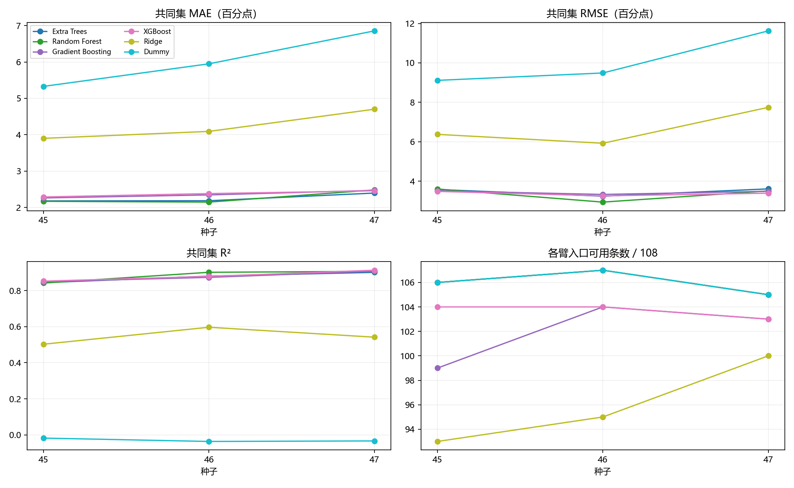
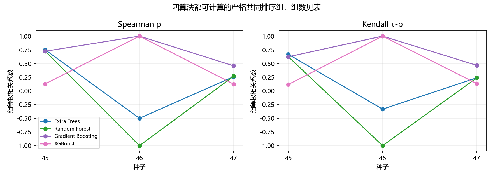
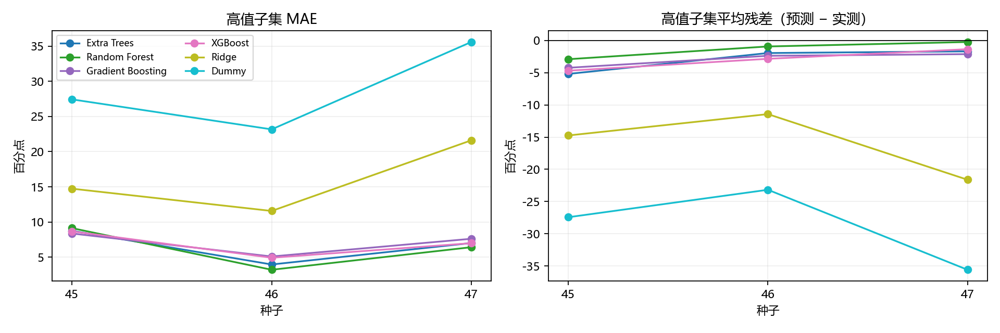

## 六算法统一留出比较：补充诊断

本节是观察后对已有预测的重算，不重新训练、不重新选模。S5-04 固定臂包含 Extra Trees（ET）、Random Forest（RF）、Gradient Boosting（GB）、Ridge、Dummy；S5-E05 提供固定 XGBoost（XGB）。三种子两阶段配置的视图、快照、目标、目录、模型种子以及完整训练／留出成员和训练内五折划分逐项一致；同参数 ET、RF 的两个阶段留出预测和状态逐条一致。固定模型均使用 F_base；ET/RF 为 100 树、叶最小 2、深度不限、max_features=1，GB 和 XGB 均 100 树、深度 3、学习率 0.1，Ridge alpha=1，Dummy 为训练均值。算法实现、处理流程和各自适用状态仍不同；这不是同一阶段预先登记的六算法联合实验。已观察留出数据、反复研究、种子成员重叠和文献相关性限制结论，非独立外部验证。

### 整体误差和覆盖率

每个种子取六臂共同 ok/caution 且预测有限的严格交集，所有 MAE、RMSE、R² 在同一成员上重新计算；“各自可用”以各自 108 条留出为分母，不能用各自可用集分数替代共同集作排名。R² 取决于同一共同集目标方差，误差单位为 CO2 转化率百分点。

| 种子 | 算法 | 共同n | 各自可用n | MAE | RMSE | R² |
| --- | --- | --- | --- | --- | --- | --- |
| 45 | Extra Trees | 91 | 106 | 2.181 | 3.573 | 0.844 |
| 45 | Random Forest | 91 | 106 | 2.170 | 3.599 | 0.841 |
| 45 | Gradient Boosting | 91 | 99 | 2.263 | 3.505 | 0.849 |
| 45 | XGBoost | 91 | 104 | 2.291 | 3.477 | 0.852 |
| 45 | Ridge | 91 | 93 | 3.901 | 6.372 | 0.503 |
| 45 | Dummy | 91 | 106 | 5.329 | 9.112 | -0.017 |
| 46 | Extra Trees | 95 | 107 | 2.186 | 3.235 | 0.880 |
| 46 | Random Forest | 95 | 107 | 2.149 | 2.935 | 0.901 |
| 46 | Gradient Boosting | 95 | 104 | 2.346 | 3.325 | 0.873 |
| 46 | XGBoost | 95 | 104 | 2.383 | 3.252 | 0.878 |
| 46 | Ridge | 95 | 95 | 4.092 | 5.921 | 0.597 |
| 46 | Dummy | 95 | 107 | 5.949 | 9.487 | -0.036 |
| 47 | Extra Trees | 100 | 105 | 2.397 | 3.606 | 0.901 |
| 47 | Random Forest | 100 | 105 | 2.482 | 3.504 | 0.906 |
| 47 | Gradient Boosting | 100 | 103 | 2.471 | 3.483 | 0.907 |
| 47 | XGBoost | 100 | 103 | 2.458 | 3.386 | 0.912 |
| 47 | Ridge | 100 | 100 | 4.702 | 7.743 | 0.542 |
| 47 | Dummy | 100 | 105 | 6.854 | 11.623 | -0.033 |

### 严格共同排序组

同一种子、同一 DOI、温度、绝压、H2/CO2 和流量完全相同的六臂共同可用记录构成组；先对相同名义配方的重复记录取实测和预测均值，要求至少三个配方且实测有变化。Spearman 和 Kendall τ-b 仅使用四个主要算法都具有非恒定预测的相同组，按组等权。Top-1 进一步要求实测和四算法预测最高值均不并列；Top-2 要求实测和四算法的第 2 与第 3 名均不并列，召回率为预测前二与实测前二交集除以 2。Ridge 在这些四算法共同组上作为参照，若其自身恒定或边界并列则不计相应指标；Dummy 为恒定预测，相关系数与 Top-K 均不可定义，不作零分。各指标的共同组可以不同，表内注明分母。各组涉及的 DOI、工况、配方数及相关系数见 [逐组数据](算法统一_排序逐组.csv)。

| 种子 | 算法 | 共同记录n | 候选组 | 四算法相关共同组 | 算法可算组 | Spearman | Kendall | 四算法Top1共同组 | 算法Top1可算组 | Top1命中 | 四算法Top2共同组 | 算法Top2可算组 | Top2平均召回 |
| --- | --- | --- | --- | --- | --- | --- | --- | --- | --- | --- | --- | --- | --- |
| 45 | Extra Trees | 91 | 3 | 2 | 2 | 0.750 | 0.667 | 0 | 0 | — | 1 | 1 | 0.500 |
| 45 | Random Forest | 91 | 3 | 2 | 2 | 0.724 | 0.623 | 0 | 0 | — | 1 | 1 | 0.500 |
| 45 | Gradient Boosting | 91 | 3 | 2 | 2 | 0.724 | 0.623 | 0 | 0 | — | 1 | 1 | 0.500 |
| 45 | XGBoost | 91 | 3 | 2 | 2 | 0.129 | 0.118 | 0 | 0 | — | 1 | 1 | 0.500 |
| 45 | Ridge | 91 | 3 | 2 | 2 | -0.300 | -0.333 | 0 | 0 | — | 1 | 1 | 0.500 |
| 45 | Dummy | 91 | 3 | 2 | 0 | — | — | 0 | 0 | — | 1 | 0 | — |
| 46 | Extra Trees | 95 | 3 | 1 | 1 | -0.500 | -0.333 | 1 | 1 | 0.000 | 1 | 1 | 0.500 |
| 46 | Random Forest | 95 | 3 | 1 | 1 | -1.000 | -1.000 | 1 | 1 | 0.000 | 1 | 1 | 0.500 |
| 46 | Gradient Boosting | 95 | 3 | 1 | 1 | 1.000 | 1.000 | 1 | 1 | 1.000 | 1 | 1 | 1.000 |
| 46 | XGBoost | 95 | 3 | 1 | 1 | 1.000 | 1.000 | 1 | 1 | 1.000 | 1 | 1 | 1.000 |
| 46 | Ridge | 95 | 3 | 1 | 1 | -1.000 | -1.000 | 1 | 1 | 0.000 | 1 | 1 | 0.500 |
| 46 | Dummy | 95 | 3 | 1 | 0 | — | — | 1 | 0 | — | 1 | 0 | — |
| 47 | Extra Trees | 100 | 3 | 3 | 3 | 0.261 | 0.240 | 1 | 1 | 1.000 | 2 | 2 | 0.750 |
| 47 | Random Forest | 100 | 3 | 3 | 3 | 0.268 | 0.239 | 1 | 1 | 0.000 | 2 | 2 | 0.500 |
| 47 | Gradient Boosting | 100 | 3 | 3 | 3 | 0.457 | 0.465 | 1 | 1 | 1.000 | 2 | 2 | 1.000 |
| 47 | XGBoost | 100 | 3 | 3 | 3 | 0.124 | 0.132 | 1 | 1 | 1.000 | 2 | 2 | 0.750 |
| 47 | Ridge | 100 | 3 | 3 | 3 | -0.313 | -0.271 | 1 | 1 | 0.000 | 2 | 2 | 0.500 |
| 47 | Dummy | 100 | 3 | 3 | 0 | — | — | 1 | 0 | — | 2 | 0 | — |

### 高转化率子集

以同一六臂共同记录中实测转化率 ≥20% 定义高值；此阈值是观察后诊断，不是预设的应用标准。平均残差为预测减实测，低估数以严格小于零计。各算法同一种子的分母相同；种子间不能累加为独立样本。

| 种子 | 算法 | 高值n | MAE | 平均残差 | 低估数 | 高估数 | 相等数 |
| --- | --- | --- | --- | --- | --- | --- | --- |
| 45 | Extra Trees | 6 | 8.757 | -5.190 | 5 | 1 | 0 |
| 45 | Random Forest | 6 | 9.133 | -2.905 | 4 | 2 | 0 |
| 45 | Gradient Boosting | 6 | 8.371 | -4.236 | 5 | 1 | 0 |
| 45 | XGBoost | 6 | 8.675 | -4.690 | 5 | 1 | 0 |
| 45 | Ridge | 6 | 14.740 | -14.740 | 6 | 0 | 0 |
| 45 | Dummy | 6 | 27.428 | -27.428 | 6 | 0 | 0 |
| 46 | Extra Trees | 10 | 3.969 | -1.950 | 7 | 3 | 0 |
| 46 | Random Forest | 10 | 3.218 | -0.929 | 7 | 3 | 0 |
| 46 | Gradient Boosting | 10 | 5.106 | -2.376 | 8 | 2 | 0 |
| 46 | XGBoost | 10 | 4.927 | -2.845 | 8 | 2 | 0 |
| 46 | Ridge | 10 | 11.575 | -11.429 | 9 | 1 | 0 |
| 46 | Dummy | 10 | 23.170 | -23.170 | 10 | 0 | 0 |
| 47 | Extra Trees | 8 | 7.017 | -1.685 | 5 | 3 | 0 |
| 47 | Random Forest | 8 | 6.424 | -0.236 | 4 | 4 | 0 |
| 47 | Gradient Boosting | 8 | 7.621 | -2.119 | 5 | 3 | 0 |
| 47 | XGBoost | 8 | 6.997 | -1.351 | 5 | 3 | 0 |
| 47 | Ridge | 8 | 21.611 | -21.611 | 8 | 0 | 0 |
| 47 | Dummy | 8 | 35.584 | -35.584 | 8 | 0 | 0 |

### 如何理解 GB 的误差与排序

MAE 衡量预测值距实测值的绝对偏差；排序相关性只衡量同组内相对顺序，对某组内共同偏移或单调尺度变化不敏感。因此一个模型可以产生较大的绝对误差、同时较好地区分同条件下的高低，也可能因预测并列而无法排序。比较应以本节四算法相同排序组为准：上一节各模型各自可算组不同的相关系数不构成公平配对。在同一共同留出集上，GB 的 MAE 比 ET 分别高 0.082、0.160、0.074；但 GB 的 RMSE 在种子 45、47 较低，R² 相应较高。严格共同排序组上的 GB / ET Spearman 分别为 0.724 / 0.750（2 组）、1.000 / −0.500（1 组）、0.457 / 0.261（3 组）。这只说明 46、47 的极少数组中 GB 的相对顺序较好，45 则相反；种子 45 没有四算法共同可算 Top-1 组。共同组数量太少，不能据此认定 GB 的排序优势或推荐更换模型。MAE、排序指标、Top-K 的目标及权重各异；本分析不将任何留出结果用于重新选模。

来源：[S5-04 固定臂运行](../artifacts/reports/s5-04-e02-20261124-v1/)、[S5-E05 运行](../artifacts/reports/s5-05-e05-20261124-v1/)、[共同预测与 ID](算法统一_共同留出预测.csv)、[可复核计算脚本](算法统一分析.py)。各阶段固定参数及划分以其配置和 split 文件为准。
